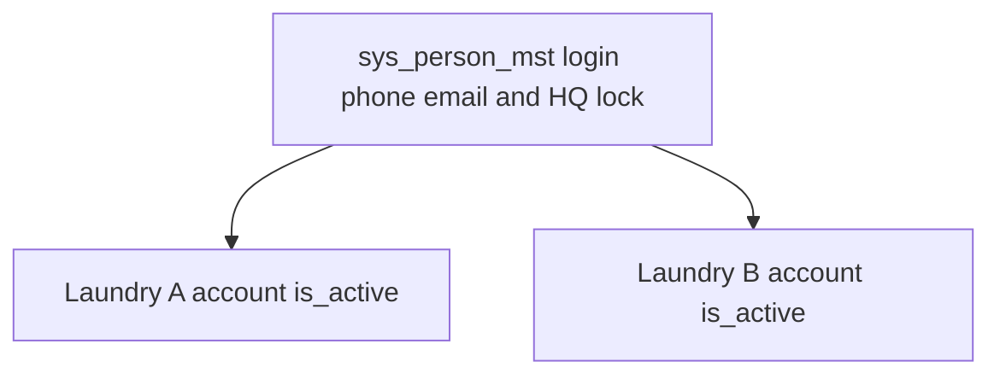

# Customers plan — lock the remaining identity rules

Update [docs/features/Tenants_Customers/PLAN.md](docs/features/Tenants_Customers/PLAN.md) only. Status stays **Discussion draft**. Do not write a migration, change web-admin, or change HQ.

The draft already has decisions 1–8 (one person, verify-then-link, no balance copy, logout-only laundry choice, staff stay inside one laundry, no auto-merge, no `person_main_context`, no person address or contact tables). Add the decisions below.

## When a customer stays at one laundry only

The commercial file is always the laundry’s own `org_customers_mst` row. “Not in the global” means `person_id` is null and there is no `sys_person_mst` row yet. That happens only when there is no verified phone and no verified email to identify the human:

- Walk-in, guest, or stub with no phone and no email, including the tenant default guest customer.
- A phone or email was typed on the account and has not been verified. It stays on that account. Nothing is written to `sys_person_mst`.
- The cashier chooses “Not this person”. The same verified phone or email cannot be saved onto a second person, so the file is saved as an unverified guest with that contact cleared and no link.
- A B2B company row. The company is not a person. A human contact can be linked later. This release does not put the company itself on `sys_person_mst`.
- Customers already stored today. This release does not backfill them by matching phones or emails. They stay laundry-only until the next verified visit, or until an explicit confirm inside that laundry.

The moment a phone or email is verified, the person is created or reused and this laundry’s account gets `person_id`. The name, contacts, retail type, addresses, system preferences, language, and system category move onto that person and are what every linked laundry sees. Orders, wallet, prices, consent, and the B2B company file stay on the account. A second laundry still gets its own new account, with empty balances.

Deactivating an account does not remove the person. The person remains. That laundry’s account is simply inactive. HQ lock does not delete the person either. It only blocks customer-app sign-in and new links.

## What you just chose

- A cashier activates or deactivates **this laundry’s account** (`org_customers_mst.is_active`). Other laundries are unchanged. That account drops out of the customer-app picker, and only that account’s sessions end.
- HQ alone locks or unlocks the **person**. While locked, customer-app sign-in is denied at every laundry, existing customer-app sessions for that person end, and a new laundry cannot link them. Counter sales on an account this laundry already has stay allowed. A cashier cannot see or set this lock, and the screen does not name other laundries. Unlock is HQ-only.
- A verified phone or email change is **one write** on the person. Other laundries are not updated row by row. They see the new value because they read the person. Login uses the verified key on `sys_person_mst`.

## Rules to add so the draft can be implemented later

- **Who may change the login key.** The customer, after a new OTP or a confirmed email, or the cashier on the account they have open. Both paths write the person once. Proof is required: an unverified typed number does not replace `phone_e164` or `email`.
- **Two identifiers, two people.** If the phone matches one person and the email matches another, the save is refused. The screen asks for one identifier. Nothing is linked.
- **Guest already has an account here.** Verification that finds a person who already has an account at this laundry opens that account. The walk-in row stays unlinked. This release does not merge orders or balances.
- **Names.** For a linked retail person, `name`, `name2`, `display_name`, `first_name`, and `last_name` live on the person. An edit at any linked laundry updates that one row, and every linked laundry sees it. An unlinked guest and a B2B company still store those columns on the account.
- **Picker.** A laundry appears only when the account is active, the organization is active, and the person is not HQ-locked. One query returns account id, tenant id, and display name.
- **Password.** Customer password login already exists on `org_customers_mst.password_hash` via [web-admin/lib/services/customer-password.service.ts](web-admin/lib/services/customer-password.service.ts). The live hash moves to the person. It is not copied onto a new laundry account. If two accounts disagree, those people use OTP until one person password is set. The failed-attempt counter sits on the person, because there is one password. Changing it ends every customer-app session for that person.
- **Session store.** Today’s public token is an unsigned base64 phone payload in [web-admin/lib/services/otp.service.ts](web-admin/lib/services/otp.service.ts). This release replaces that with a customer session table. It is not `sys_auth_user_sessions_mst`. Pending means person id and no account. Orders, booking, addresses, and the financial view reject pending. Binding writes the account and tenant. A body or query `tenantId` that disagrees is rejected. Browser roles cannot read the table.
- **Audit.** Account link, login-key change, and account activate or deactivate write one tenant audit row for this account only: actor, account, person, method. No balance and no other laundry. HQ search, account open, and person lock write an HQ audit row. If the audit insert fails, the change rolls back.
- **HQ workspace.** `/org-customers-manage/[personId]` gains lock and unlock. New permission `hq_org_customers:lock`, same `resource:action` shape as the existing `hq_org_customers:read` and `hq_org_customers:review`. Tenant tokens receive 403.

## Data placement

You chose to make the retail profile global: the full name, every phone and email including unverified ones, `guest` / `stub` / `walk_in` / `full`, addresses, the preference words, preferred language, and category. A linked laundry reads those from the person. The preference’s extra price is the exception: it is stored again on this laundry’s account and edited on that laundry’s screen. An unlinked guest has no person row yet, so those values sit on the account until verification, then the words move once and the price stays. A B2B company account keeps its own copy of all of them. Consent and balances stay on the laundry.

`sys_customers_mst` is legacy. It stays in the database. New writes do not use it, and `org_customers_mst.customer_id` is not the new person link.

### Global only — `sys_person_mst`

One row per verified human. No `tenant_org_id`. Browser roles cannot read it.

- `id`
- `name`, `name2`, `display_name`, `first_name`, `last_name` — the one retail name. Receipts and lists for a linked account read these.
- `phone_e164`, `phone_verified_at` — the one verified login phone. Unique when set. Null when the person was reached by verified email only.
- `email`, `email_verified_at` — the one verified login email, trimmed and lower-cased. Unique when set.
- `profile_type` — `guest`, `stub`, `walk_in`, or `full`. Never `b2b`.
- `preferred_language`
- `system_category_code` — the customer group, not the profile type. Foreign key to `sys_customer_category_cd` for a non-B2B platform code such as the shared VIP or regular group. A group that exists only on one laundry’s `org_customer_category_cf` has no platform code, so it stays on that account. Profile type (`guest`, `stub`, `walk_in`, `full`) is the separate `profile_type` column.
- `password_hash`, `password_updated_at` — the one customer password. New writes go here. `org_customers_mst.password_hash` is not read as the credential after this release and is not copied to a new account. The column stays; this release does not drop it. If two existing accounts disagree, the person has no password until they set one, and they sign in with OTP.
- Failed-attempt counter and attack-lock timestamp — one password, so one counter.
- HQ lock flag, locked at, locked by, reason — HQ only.
- `last_tenant_org_id` — hint for which laundry to highlight. Not authority.
- Standard audit columns.

Not on this table: consent, balances, customer number, company, tax, account active flag, or a role/context column. Addresses, extra contacts, and system preferences are child tables below, not more columns on this row.

Indexes: primary key, partial unique on `phone_e164`, partial unique on `email`. No name index.

### Global children — one person, seen by every linked laundry

Browser roles cannot read these. Staff reach them through the authenticated lookup, and only while this laundry has an account for that person.

- `sys_person_contact_dtl` — every phone and email, verified or not. The login phone and login email are the master columns above; this table holds the rest, including unverified numbers. A unique index covers verified values only. Unverified values are not unique and are not login keys. Another laundry sees the list. It does not get a copy written onto its account.
- `sys_person_address_dtl` — the person’s addresses. No `tenant_org_id`. No default country. Adding one at laundry A shows it at laundry B. Delivery price and whether the laundry serves that area stay on the laundry.
- `sys_person_pref_dtl` — the preference words only: `name`, `name2`, and the catalog code stored as plain text when the cashier picked one. No foreign key and no price. Laundry B sees the same words. It does not see what laundry A charges.

### Tenant only — `org_customers_mst` and its children

Every row has `tenant_org_id`. Nothing here is copied to another laundry when a person is linked.

For a linked retail account the screen reads name, contacts, type, addresses, preference words, language, and system category from the person. The same columns on `org_customers_mst` remain for an unlinked guest and for a B2B company. They are not a second copy kept in sync.

The preference extra price is both, on purpose. `org_customer_service_prefs` keeps one row per laundry account and person preference, with this laundry’s `extra_price`. The customer screen shows the global words and an editable price. The field opens with this laundry’s catalog price when the code exists in `org_service_preference_cf`. Otherwise it opens empty. Nothing is saved until the cashier saves. Saving writes only this account’s price. It does not change the global words, the catalog, or another laundry’s price. A price already typed is not replaced because the preference list was reloaded.

Account facts that stay tenant-only even after a link:

- `id`, `tenant_org_id`, human-friendly customer number
- `is_active` — this laundry only
- `customer_source_type`, `s_date`, notes, record status, and the account audit columns
- `type = b2b` and the company file: company name, tax, credit limit, payment terms, cost center, credit hold
- Money children: orders, invoices, vouchers, wallets, advances, loyalty, credit notes, AR, gift-card purchaser
- B2B contacts, contracts, and statements. This release does not add `person_id` on a B2B contact.
- Notification and marketing consent. A message from laundry A still checks laundry A’s consent. The language of that message is the person’s `preferred_language`.
- This account’s preference extra price on `org_customer_service_prefs`, edited on the screen. The catalog default in `org_service_preference_cf` is only the opening value when the code matches.
- Nullable `person_id`, partial unique `(tenant_org_id, person_id)`
- Per-tenant unique index on the account phone where it is present, for unlinked and B2B rows, after the duplicate pre-check

Staff search for a linked person looks up the verified or unverified contact on the person, then opens this laundry’s account by `(tenant_org_id, person_id)`. It does not join the person into the customer list query.

### Tables that are neither the person nor the account

- Customer session table (new, not `sys_auth_user_sessions_mst`): person id, nullable tenant, nullable account, pending or bound, expiry, revoked at. No business columns.
- Tenant audit row for link, login-key change, and account activate or deactivate: actor, this account, person, method. No balance and no other laundry.
- HQ audit row for search, account open, and person lock.

## Still outside this release

In-tenant financial merge, `auth.users` for customers, and turning `sys_customers_mst` back on. Person address, contact, and system-preference tables are in this release because the retail profile is global.
