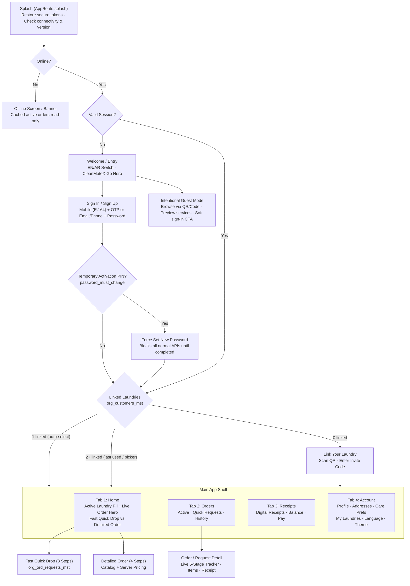
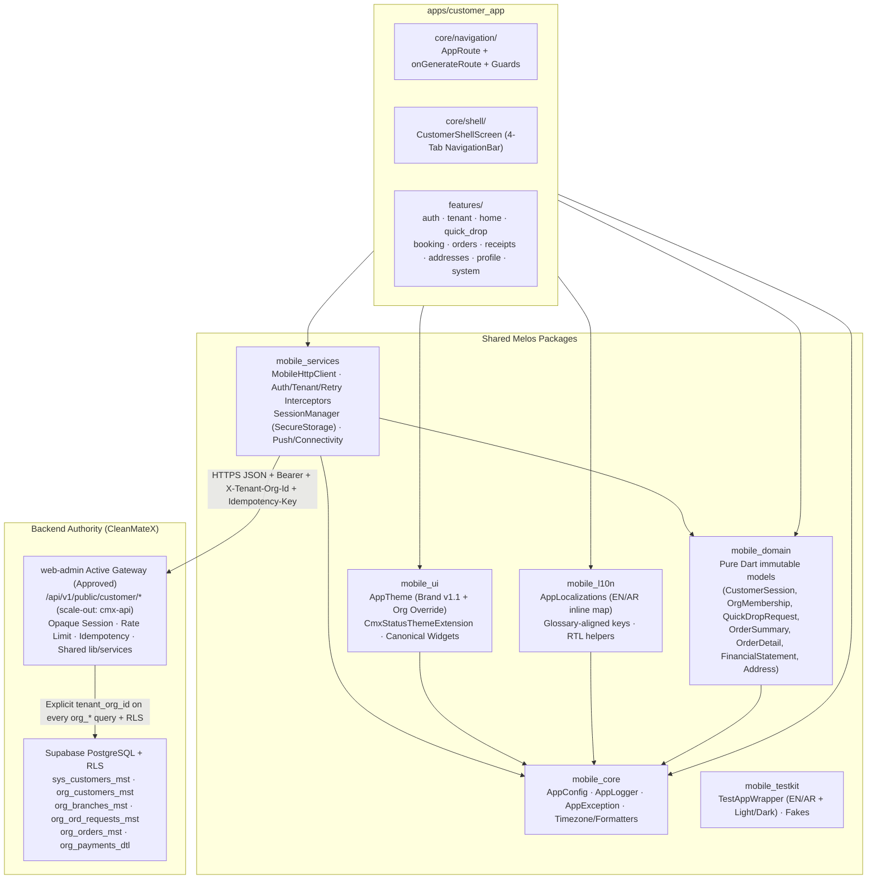

# CleanMateX Go — Customer Mobile App Master Design Blueprint

> **Product:** CleanMateX Go (Customer Mobile App · `cmx_mobile_apps/apps/customer_app`)  
> **Market:** GCC-First (EN / AR Bilingual + Native RTL), Multi-Tenant Laundry SaaS  
> **Stack:** Flutter 3.24+ (Melos Monorepo, Riverpod, `MobileHttpClient`, Material 3) · `web-admin` Active Customer Gateway (`/api/v1/public/customer/*`, scale-out target: `cmx-api`) · PostgreSQL / Supabase RLS  
> **Status:** ✅ Implemented & Verified (v2.0.0 — see [IMPLEMENTATION_PLAN.md](./IMPLEMENTATION_PLAN.md) & [docs/features/customer_app_orders/README.md](../../../docs/features/customer_app_orders/README.md))  
> **Grounded In:** `cmx_mobile_apps/` current baseline, `Brand Spec_v01.1.md`, `MOBILE_FOUNDATION_DECISIONS.md` (v2.3.0), `docs/features/customer_app_orders/README.md`, and CleanMateX Platform Glossary & Domain Rules.

---

## 1. Executive Vision & Current-State Gap Analysis

CleanMateX already has a clean Milestone 1–7 mobile foundation (`apps/customer_app` + 6 shared Melos packages). This blueprint elevates that functional baseline into a **world-class consumer laundry experience**—fast enough to place an order in **under 30 seconds**, transparent enough to eliminate *"Where is my laundry?"* phone/WhatsApp calls, and architecturally aligned with CleanMateX's global-identity, multi-organization, financial, and timezone invariants.

### What Exists Today vs. World-Class Target State

| Dimension | Current Repo State (`cmx_mobile_apps/`) | World-Class Target Design |
|---|---|---|
| **Visual Identity** | Placeholder royal blue (`#1A56DB`) in `mobile_ui/app_colors.dart`; basic Material cards | **CleanMateX Go Brand v1.1** (Aqua `#0AB6D8`, Deep Navy `#0E2A47`, Emerald `#1DBF73`, Poppins + Tajawal) + `ThemeExtension` semantic status tones + optional **per-Organization brand override** |
| **App Navigation** | Single-stack `CustomerHomeScreen` pushing into Orders / Booking / Profile | **4-Tab Persistent Shell** (Home · Orders · Receipts · Account) + Floating/Prominent Primary Order Launcher + Organization Switcher Pill |
| **Customer Identity & Tenancy** | Phone+OTP & Password screens + pre-auth Tenant Discovery | **Global Customer Identity** (`sys_customers_mst`) first → **My Laundries** switcher (`org_customers_mst` with `is_hidden_by_customer`) → QR/Invite/Code to link new laundries |
| **Order Intake** | Single 4-step detailed booking wizard | **Dual-Mode Intake**: (1) **Fast Quick Drop** (unpriced 3-step bag request → `org_ord_requests_mst`, <45s) + (2) **Detailed Order** (branch-scoped catalog, server-priced, idempotent checkout) |
| **Order Tracking** | Static list & timeline screen | **Live Track-First Experience**: Hero status card on Home, plain-language 5-stage tracker, Quick-Drop-to-Order seamless handoff, piece-level inspection summary, delay transparency & one-tap support |
| **Money & Receipts** | Basic statement card | **CleanMateX Financial Transparency**: Server-calculated totals, Speed Premium & VAT breakdown, canonical balance words (**Due / Due at collection / Settled / Overpaid**), always-light bilingual PDF/digital receipts, GCC payment rails |
| **Backend Boundary** | Milestone 4–6 wired to public `web-admin` endpoints + demo fallback | **Approved Active Gateway: `web-admin` (`/api/v1/public/customer/*`)** reusing 100% of POS pricing, tax, and Order Fin services with rate limiting, catalog caching, pagination & connection pooling (future scale-out target: `cmx-api` via base-URL switch) |

---

## 2. Product Principles & GCC-First UX Strategy

1. **Track-First, Book-in-Seconds:** Most returning opens are either *"Where is my order?"* or *"Pick up my laundry now."* Both must be answered above the fold on Home with **zero competing CTAs**.
2. **Zero Operational Jargon:** Customers never see internal branch codes, rack/bag IDs, staff names, QA failure rework loops, or raw backend enums (`IN_PROGRESS_QA_FAILED`). Every state translates into calm, reassuring plain language in natural English and natural Gulf Arabic.
3. **Cultural & Regional Native Fit (GCC):**
   - **Garment-native catalog presets:** Dishdasha / Thobe, Abaya, Ghutra / Shemagh, Bisht, Carpets, Curtains, Wash & Fold, Steam Press.
   - **GCC Addressing:** Map pin + Villa/Building + Flat/Floor + Street/Way/Zone/Block + Landmark + *"Leave at reception / guard / doorstep"* + *"Call on arrival"* toggle.
   - **GCC Payments (Phase 2):** Apple Pay, Mada, OmanNet / Debit, Credit Card, Cash on Delivery (COD), Wallet / Gift Cards.
   - **Strict Bilingual RTL:** English (`Poppins`) and Arabic (`Tajawal`) are equal first-class designs. Logical layout everywhere; phone numbers, order codes, PINs, and currency amounts stay LTR-isolated (`Directionality.ltr` / tabular figures).
4. **No Silent Money Mutation & No Client-Side Price Authority:**
   - Fast Quick Drop is clearly labeled **Unpriced Request** (final total confirmed after staff inspection).
   - Detailed Order displays **server-calculated previews** (subtotal, discounts, speed premium, VAT, total). Client never invents totals or silently mutates entered amounts.
5. **Authoritative Timezones:** All timestamps travel in UTC (`RFC 3339 Z`) and render in the **branch / service-location timezone** (falling back to Organization timezone) returned by the backend—including cut-off times (`آخر وقت للاستلام`) and working-day ready-by promises (`وقت الجاهزية`).

---

## 3. Information Architecture & End-to-End User Journeys

### 3.1 Master Navigation & Session Flow



### 3.2 Journey A — Frictionless Onboarding & Global Multi-Laundry Identity

| Step | Screen | UX Behavior & Guardrails |
|---|---|---|
| **1. First Launch** | `CustomerSplashScreen` → `CustomerEntryScreen` | CleanMateX Go Aqua-to-Navy gradient splash with *Sparkle X* emblem. Entry screen offers instant **EN / العربية** toggle at top, 2 value props (*Pickup at your door · Live tracking*), primary CTA **Sign In / Get Started**, secondary **Continue as Guest**, and tertiary **Scan Laundry QR**. |
| **2. Global Sign-In** | `CustomerLoginEntryScreen` / `CustomerPasswordLoginScreen` | Single clean identifier field supporting **GCC Mobile (E.164 country selector: OM +968, SA +966, AE +971, QA +974, KW +965, BH +973)** or **Verified Email**. Supports **OTP (SMS/WhatsApp)** and **Password** modes. Generic auth errors prevent account enumeration. |
| **3. Stub-to-App Activation** | `CustomerSetPasswordScreen` | When a walk-in POS customer (`stub`) receives a 6-digit one-time activation PIN from staff, signing in enforces immediate password creation before accessing any tenant/order API. |
| **4. My Laundries & Last Branch** | `CustomerTenantSwitcherSheet` + `CustomerTenantDiscoveryScreen` | Top pill shows **Active Organization + Last Order Branch** (`org_customers_mst.last_branch_id`, auto-updated whenever an order uses a different branch). Sheet lets customers switch Organization & Branch, **hide and unhide at any time** (`is_hidden_by_customer`, with a dedicated Hidden Laundries section so hidden orgs are always recoverable while active orders remain visible), or link a new laundry via **QR Scan / Deep Link / Code**. |
| **5. Guest Mode** | `CustomerGuestEntryScreen` | Intentional read-only experience: explore service categories, see how pickup & pricing work, scan a laundry QR to preview its menu, with clear value-framed sign-in prompts when tapping *Book Pickup*. |

---

### 3.3 Journey B — Dual-Mode Order Placement

CleanMateX serves two very different customer mindsets: **"Just take my bag!"** (70% of recurring laundry customers) and **"I want exact prices for my 2 thobes and 1 suit"** (30%). Supporting both cleanly is a major competitive advantage.

```mermaid
flowchart LR
    START["Tap 'New Order' / Launcher"] --> CHOICE{Choose Order Mode}

    CHOICE -- "Fast Quick Drop<br/>(3 Steps · Unpriced Request)" --> Q1["1. Fulfillment & Branch<br/>Pickup: Collect vs Store Drop-off<br/>Delivery: Deliver vs Store Pickup<br/>Branch optional / last_branch_id"]
    Q1 --> Q2["2. Speed & Bag Estimate<br/>Standard / Express (Cut-off & Ready-by)<br/>Est. Bags/Pieces + Optional Chips & Notes"]
    Q2 --> Q3["3. Review & Send Request<br/>'Confirmed after inspection' badge<br/>Idempotent Submit → REQ-XXXX"]
    Q3 --> QTRACK["Request Tracker<br/>Submitted → Reviewing → Accepted → Order Created"]

    CHOICE -- "Detailed Order<br/>(6 Steps · POS-Parity)" --> D1["1. Fulfillment & Branch (MANDATORY)<br/>Branch first (drives catalog/prices/TZ)<br/>Pickup (2 opts) + Delivery (2 opts)"]
    D1 --> D2["2. Select Items & Piece Care<br/>Categories · Qty Steppers<br/>Optional Per-Piece Prefs (+extra price) + Item Note"]
    D2 --> D3["3. Order Care Preferences<br/>Predefined Profile Prefs + 1 Master Toggle (All Pieces)<br/>Preferences Notes"]
    D3 --> D4["4. Schedule & Ready-By<br/>Speed + Slots + Est. Ready-By (Branch TZ)<br/>Hint: may vary after branch sorting"]
    D4 --> D5["5. Gift Card, Promo & Notes<br/>Gift Card · Promo Code · Payment Notes<br/>General Order Note + 'Save for future orders' toggle"]
    D5 --> D6["6. POS-Parity Server-Priced Review<br/>Gross · Discounts/Gift Card · VAT · Total & Balance<br/>Locked Submit → ORD-XXXX"]
    D6 --> OTRACK["Live Order Tracker (Horizontal / Vertical)"]
```



#### Shared 2×2 Fulfillment Selector (Quick Drop & Detailed Order)
1. **Pickup / Collection (`الاستلام`):**
   - **(a) Collect from my address** (*Send someone to collect*) → selects pickup address
   - **(b) Store Drop-off** (*I will bring it myself*)
2. **Delivery / Return (`التسليم`):**
   - **(a) Deliver to my address** (*Send driver to deliver*) → selects return address
   - **(b) Store Pickup** (*I will pick up myself*)
3. **Branch Rule:** Pre-filled from `org_customers_mst.last_branch_id`. **Optional / auto-assignable** in Fast Quick Drop (when tenant policy allows); **MANDATORY in Step 1** of Detailed Order because branch governs catalog, pricing, delivery fee, and timezone.

#### Fast Quick Drop Request State Mapping (Customer-Safe)

| Backend Request State (`org_ord_requests_mst`) | Customer Display Label (EN) | Customer Display Label (AR) | Visual Tone | Next-Step Guidance |
|---|---|---|---|---|
| `SUBMITTED` | Request Received | تم استلام الطلب | `info` | *"We've received your request and will confirm shortly."* |
| `REVIEWING` | Being Confirmed | جاري التأكيد | `brand` | *"The laundry is confirming your pickup window."* |
| `CONTACT_REQUIRED` | Quick Confirmation Needed | نحتاج تأكيداً سريعاً | `warning` | Prominent CTA: **Call Laundry** / **Confirm Details** |
| `ACCEPTED` | Confirmed — Pickup Scheduled | تم التأكيد — بانتظار الاستلام | `success` | Shows confirmed pickup slot / drop-off instructions |
| `ORDER_CREATED` | Order Active (Linked) | تم إنشاء الطلب | `success` | Auto-bridges to linked `ORD-XXXX` tracking view with 1 tap |
| `REJECTED` / `CANCELLED` | Request Closed | تم إلغاء الطلب | `neutral` / `danger` | Plain-language reason + **Create New Request** CTA |

---

### 3.4 Journey C — Track-First Order Lifecycle & Reassurance

Internal operational states (`NEW`, `INTAKE`, `PREPARATION`, `SORTING`, `WASHING`, `DRYING`, `FINISHING`, `ASSEMBLY`, `QA`, `QA_FAILED`, `PACKING`, `READY`, `OUT_FOR_DELIVERY`, `DELIVERED`, `COMPLETED`) are mapped cleanly to **5 calm customer milestones**:

| Customer Stage | Maps From Internal States | Customer Title (EN / AR) | Customer Reassurance Copy |
|---|---|---|---|
| **1. Received** | `NEW`, `INTAKE`, `PREPARATION` | **Order Received** · تم استلام الطلب | *"Your items are safely logged. Itemized receipt ready."* |
| **2. Cleaning** | `SORTING`, `WASHING`, `DRYING`, `FINISHING` | **Cleaning & Care** · قيد الغسيل والعناية | *"Being cleaned according to your care preferences."* |
| **3. Quality Check** | `ASSEMBLY`, `QA`, `QA_FAILED`, `PACKING` | **Final Inspection** · الفحص والتجهيز | *"Checking every garment before packaging."* *(QA rework stays invisible; if ETA slips, surface calm updated Ready-by time)* |
| **4. Ready / On the Way** | `READY`, `OUT_FOR_DELIVERY` | **Ready for Pickup** / **Out for Delivery** · جاهز للاستلام / في الطريق إليك | Shows pickup QR code (for counter pickup) OR live delivery window + driver handoff PIN |
| **5. Completed** | `DELIVERED`, `COMPLETED` | **Delivered** · تم التسليم | Shows digital receipt, **Settled / Due** badge, and **Reorder Similar** CTA |

---

## 4. Screen-by-Screen UI Blueprint (Wireframe Specs)

Every screen obeys the **CleanMateX Mobile Quality Bar**:
- **5 mandatory states:** Loading (shaped skeleton, never blank white), Success, Empty (mascot/icon + calm guidance + primary action), Recoverable Error (`AppErrorWidget` + localized retry), Offline (non-blocking banner for cached views or dedicated offline recovery screen).
- **1 primary CTA per viewport**, minimum **48×48dp** touch targets, **1.5×–2.0× text scaling** resilience, and full **Light + Dark** parity.

### 4.1 Home Screen (`CustomerHomeScreen`)
```text
┌─────────────────────────────────────────────┐
│ [Logo] Al-Noor Laundry ▾     [🔔] [عربي/EN] │  ← Active Org Pill + Alerts + Instant Locale
├─────────────────────────────────────────────┤
│ Good evening, Ahmed                         │  ← Personalized greeting (time-of-day aware)
│                                             │
│ ┌─────────────────────────────────────────┐ │
│ │ ● CLEANING & CARE         ORD-26-04182  │ │  ← Live Active Order Hero (carousel if >1)
│ │ ━━━━━━━━━━━━━━━○○○  Step 2 of 5         │ │     Visual stepper + icon + tone (never color-only)
│ │ Ready by Tomorrow, 6:00 PM (Muscat)     │ │     Rendered in fulfilment branch timezone
│ │ 8 items · Balance: Due 4.500 OMR   [ → ]│ │     LTR-isolated money/code
│ └─────────────────────────────────────────┘ │
│                                             │
│  [ ⚡ Fast Quick Drop ]   [ 🧺 Detailed ]   │  ← Primary CTA (Aqua filled) + Secondary (Navy outline)
│   Send bag in 30 sec       Pick exact items │
│                                             │
│ ┌─────────────────────────────────────────┐ │
│ │ ⚠ Action Needed: Confirm pickup address │ │  ← Conditional Urgent Banner (only when present)
│ └─────────────────────────────────────────┘ │
│                                             │
│ Quick Actions                               │
│ [ ↻ Reorder Last ] [ 📄 Receipts ] [ 📍 Addr]│  ← Compact horizontal icon tiles
├─────────────────────────────────────────────┤
│  [🏠 Home]  [📦 Orders]  [🧾 Receipts]  [👤] │  ← Material 3 NavigationBar (4 tabs)
└─────────────────────────────────────────────┘
```
*Empty State (No Active Orders):* Friendly **Cleanliness Champion (`بطل النظافة`)** spot illustration + *"All fresh & spotless! Ready for your next pickup?"* + single prominent **Schedule Pickup** primary button.

### 4.2 Orders Hub (`CustomerOrdersScreen`)
- **Top Segmented Control:** `Active (2)` · `Requests (1)` · `History`
- **Order Card Hierarchy:**
  - Row 1: Monospace LTR Order/Request Code (`ORD-26-04182`) + Semantic Status Pill (icon + label)
  - Row 2: Plain-language next milestone (*"Ready by Thu, 6:00 PM"*) + Item/Bag count
  - Row 3: Financial footer (`Total 4.500 OMR` · `Balance: Settled` / `Due at collection`) + directional chevron (`rtl` mirrored)
- **Pull-to-Refresh + Paginated `SliverList`** (never `ListView(children: ...)`).

### 4.3 Order Detail & Live Tracker (`CustomerOrderDetailScreen`)
1. **Top Visual Tracker (Flexible `N`-Stage Horizontal or Vertical Stepper):** Data-driven `AppProgressStepperWidget` rendering **any** number of stages (3-step Quick Drop, 5-stage live order, or 7–10+ full order history events) with both **Horizontal** (evenly spaced ≤5, scrollable >5) and **Vertical** timeline modes (user toggle in header + responsive default), timestamps, active pulse ring, and branch timezone badge.
2. **Urgent Action Card (Contextual):**
   - If `READY` (store pickup) → **Show Pickup QR / Code** for 2-second counter handoff.
   - If `OUT_FOR_DELIVERY` → **Delivery Window + Handoff Code + Call Support**.
   - If `Balance > 0` and online pay enabled → **Pay Balance Now**.
3. **Garments & Care Summary:** Collapsible list of itemized garments (with garment count, per-piece care preferences & add-ons, and item notes).
4. **Financial Breakdown Card (`CustomerOrderStatementCard`):**
   - Mirrors CleanMateX `OrderFinancialView` & POS `OrderValueBreakdownPanel` rules:
     - Items Subtotal, Piece Preference Add-ons, Speed Premium, Delivery Fee
     - Discounts & Promo Code *(shown only when > 0)* → **After discounts** (`بعد الخصومات`)
     - VAT / Tax breakdown
     - **Total**, Applied Gift Card / Paid to date, and **Balance** (`الرصيد`) with mandatory word: **Settled** (`مسدّد`), **Due** (`مستحق`), **Due at collection** (`يُدفع عند الاستلام`), or **Overpaid** (`مدفوع زيادة`).
   - Button: **View Digital Receipt (Always-Light Paper Preview / PDF)**.
5. **Footer Help Bar:** *"Need help with this order?"* → WhatsApp / Call Laundry (with order code pre-filled).

### 4.4 Dual Booking Flows (`CustomerQuickDropScreen` & `CustomerOrderBookingScreen`)
- **Fast Quick Drop (3 Steps):** (1) 2×2 Pickup/Delivery Fulfillment & Optional Branch (`last_branch_id` default) → (2) Service Speed & Bag/Piece Estimate + Optional Chips/Notes → (3) Unpriced Request Review (`Confirmed after inspection`) + Locked Submit → `REQ-XXXX`.
- **Detailed Order (6 Steps — Full POS Parity):**
  1. **Fulfillment & Branch (MANDATORY first):** Branch required before catalog/pricing; 2×2 Pickup & Delivery options + address selectors.
  2. **Select Items & Piece Care:** Category filter, quantity steppers, expandable **optional per-piece care preferences** (showing extra price when > 0) and **per-item notes**.
  3. **Order Care Preferences:** Displays predefined profile preferences with **one master toggle** (*Apply my default profile preferences to all pieces — ON/OFF*) + **Preferences Notes** field.
  4. **Schedule & Ready-By:** Service Speed + pickup/delivery slot + **Estimated Ready-By date & time** (branch TZ) with mandatory hint: *"May vary after the order is received and sorted at the branch."*
  5. **Gift Card, Promo Code & Notes:** Gift Card code, Promotion code, Payment Notes, and **General Order Note** + toggle **"Save for all upcoming orders"** (persisted in customer profile preferences with flag so it auto-fills future orders and can be toggled off from Account Profile).
  6. **POS-Parity Server-Priced Review:** Full breakdown matching POS New Order (`OrderValueBreakdownPanel`: Gross Order Value card, Discounts & Gift Card card, Taxes/VAT card, Order Total & Balance card) + itemized lines, add-ons, notes, fulfillment, branch & estimated ready-by + synchronous locked Submit (`Idempotency-Key`) → `ORD-XXXX`.

### 4.5 Receipts & Payments (`CustomerReceiptsScreen`)
- Chronological digital receipt list with filter by status (`All`, `Due`, `Settled`).
- **Always-Light Paper Preview:** Digital receipt preview surface forces Light theme styling (`#FFFFFF` paper card, `#0E2A47` ink) even when the app is in Dark Mode—matching CleanMateX's *"Paper is always light"* rule!
- Bilingual EN/AR VAT-compliant header, itemized table, QR code (ZATCA / GCC e-invoicing ready), Share & Download PDF actions.

### 4.6 Account, Registered Data, Addresses & Care Preferences (`CustomerProfileScreen`)
- **Customer Code & Full Registered Data Card:** Displays copyable **Customer Code** (`sys_customers_mst.customer_number` / `CUST-*`), Full Name, Mobile & Email (with verification status), Profile Status (`Full` / `Stub`), Loyalty Points & Tier, Member Since date, and Last Order Branch.
- **Edit Contact (Email & Mobile):** Persists to `sys_customers_mst` when the customer has a global `sys_customers_mst.id`, or to `org_customers_mst` (explicit `tenant_org_id`) for org-only customers.
- **Saved Addresses (+ Add New Address):** Interactive address creation with GCC fields (Villa/Building, Area/District, Delivery Note). **Dual-Scope Persistence Rule:**
  - Customer has `sys_customers_mst.id` → save in **`sys_customer_addresses_dtl`** *(new migration table for global reusable customer addresses)*.
  - Customer does **not** exist in `sys_customers_mst` → save in **`org_customer_addresses`** (explicit `tenant_org_id`).
- **Default Laundry Care Preferences:** Finishing (`Hanger` / `Folded`), Starch (`None` / `Light` / `Medium`), Detergent (`Standard` / `Hypoallergenic`), Fragrance toggle — pre-loaded into Detailed Order Step 3.
- **Saved General Order Note:** Editable `default_order_note` + `auto_apply_order_default_note` toggle to auto-fill (or turn off) the General Order Note field on all upcoming orders.
- **My Laundries & Last Branch:** Active linked organizations + last branch (`org_customers_mst.last_branch_id`, new migration column), Hide/Unhide anytime (`is_hidden_by_customer`, including a recoverable Hidden Laundries section), **+ Link New Laundry (QR/Code)**.
- **App Settings:** Language (`English` / `العربية`), Appearance (`Light` / `Dark` / `System`), Notifications, Sign Out.

---

## 5. CleanMateX Go Mobile Design System (`packages/mobile_ui`)

### 5.1 Brand Palette & Semantic Token Architecture

Replace the placeholder `#1A56DB` in `packages/mobile_ui/lib/src/app_colors.dart` with CleanMateX Brand Spec v1.1 tokens + Material 3 `ColorScheme` + custom `CmxThemeExtension`:

| Semantic Role | Light Mode Token | Dark Mode Token | Usage Rule |
|---|---|---|---|
| **Brand Primary (Aqua)** | `#0AB6D8` (Text on white: `#0888A3` for ≥4.5:1 AA) | `#38D1EE` | Primary CTA fills, active tab indicator, focus rings. *(Use `#0888A3` for text links on light cards so contrast passes WCAG AA!)* |
| **Brand Secondary (Deep Navy)** | `#0E2A47` | `#CFE3F8` | Primary headings, secondary outline buttons, trust anchors |
| **Brand Accent (Emerald)** | `#1DBF73` | `#34D399` | Sparkle-X gradients, positive highlights |
| **Action / Attention (Amber)** | `#FFB100` (on-warning: `#101828`) | `#FBBF24` (on-warning: `#0D1117`) | Urgent notices, `CONTACT_REQUIRED`, never white text on amber |
| **Success (Teal)** | `#14B8A6` (bg `#CCFBF1`, text `#0F766E`) | `#2DD4BF` (bg `#134E4A`, text `#99F6E4`) | Completed, Settled, Confirmed |
| **Danger / Error (Coral)** | `#E44D4D` (bg `#FEE2E2`, text `#B91C1C`) | `#F87171` (bg `#451A1A`, text `#FECACA`) | Errors, overdue, destructive confirm |
| **Info** | `#0284C7` (bg `#E0F2FE`, text `#0369A1`) | `#38BDF8` (bg `#0C4A6E`, text `#BAE6FD`) | Neutral tracking info, `SUBMITTED` |
| **Canvas / Background** | `#F8FAFC` | `#0B111A` | Scaffold background |
| **Surface / Card** | `#FFFFFF` | `#131C2B` | Elevated cards, sheets, inputs |
| **Surface Muted** | `#F1F5F9` | `#1C273A` | Chips, quiet sections, skeletons |
| **Border / Divider** | `#E2E8F0` | `#263449` | 1dp crisp card/input borders |
| **Text Primary / Muted** | `#0E2A47` / `#475569` | `#F1F5F9` / `#94A3B8` | Guaranteed ≥7:1 primary, ≥4.5:1 muted |

#### Per-Organization White-Label Theming (CleanMateX Multi-Tenant Ready)
Introduce `CmxOrgThemeOverride` resolved from the active Organization profile:
- Keeps CleanMateX Go structural neutrals, typography, spacing, and semantic status colors **locked** for accessibility.
- Allows an Organization (when enabled by their HQ plan) to supply `brandPrimaryHex`, `logoLightUrl`, `logoDarkUrl`, and `displayName / displayName2`—validated at runtime for WCAG contrast before overriding `colorScheme.primary`!

### 5.2 Typography, Spacing, Shape & RTL Rules

- **Typefaces:** `Poppins` (EN) + `Tajawal` (AR), dynamically selected from `AppLocale` in `AppTheme.forLocale(locale, brightness, orgOverride)`.
- **Tabular Numbers:** Apply `fontFeatures: [FontFeature.tabularFigures()]` to all prices, quantities, timers, and order codes.
- **8dp Spacing Grid (`AppSpacing`):** `xs=4`, `sm=8`, `md=16`, `lg=24`, `xl=32`, `xxl=48`.
- **Radii (`AppRadii`):** `sm=8` (chips/badges), `md=12` (inputs/buttons—matching Brand Spec v1.1), `lg=16` (cards), `xl=24` (bottom sheets).
- **RTL & Bidi Discipline:**
  - Always use `EdgeInsetsDirectional`, `BorderRadiusDirectional`, `AlignmentDirectional`, `PositionedDirectional`.
  - Flip directional icons (`arrow_forward`, `chevron_right`) via `Icon(..., matchTextDirection: true)`. Never flip checkmarks, clocks, or phone icons.
  - Wrap phone numbers, `ORD-*`/`REQ-*` codes, OTPs, and currency strings in `Directionality(textDirection: TextDirection.ltr, child: ...)` so Arabic sentences never scramble digits or `+968` prefixes.

### 5.3 Shared `mobile_ui` Component Expansion Plan

Keep generic widgets in `packages/mobile_ui` (usable by `customer_app`, `driver_app`, and `staff_app`) and feature compositions inside `apps/customer_app/lib/features/*`:

| Widget (`packages/mobile_ui`) | Status | Purpose |
|---|---|---|
| `AppCardWidget`, `AppHeaderWidget`, `AppCustomButtonWidget`, `AppLoadingIndicatorWidget`, `AppErrorWidget` | ✅ Exists | Upgrade colors/radii/contrast to Brand Spec v1.1 + `CmxStatusThemeExtension` |
| `AppStatusBadgeWidget` | 🆕 Add | 6 semantic tones (`neutral`, `info`, `brand`, `success`, `warning`, `danger`) × icon + label (never color-only) |
| `AppEmptyStateWidget` | 🆕 Add | Illustration/icon + title + subtitle + primary action button |
| `AppSkeletonBoxWidget` / `AppOrderCardSkeletonWidget` | 🆕 Add | Shimmer-free or subtle-pulse shaped loading skeletons |
| `AppTextFieldWidget`, `AppDropdownWidget`, `AppCheckboxListTileWidget`, `AppSwitchListTileWidget`, `AppDatePickerButtonWidget` | 🆕 Add (planned in skill) | Complete canonical form kit with 48dp targets & RTL borders |
| `AppCodeChipWidget` | 🆕 Add | LTR-isolated monospace code pill with one-tap copy + haptic feedback |
| `AppMoneyTextWidget` | 🆕 Add | Tabular-numerals, LTR-isolated currency display with optional Balance tone |
| `AppOfflineBannerWidget` | 🆕 Add | Non-intrusive top offline indicator with cached-data timestamp |
| `AppBottomSheetShellWidget` | 🆕 Add | Standardized modal sheet with drag handle, title, close button, and safe-area padding |

---

## 6. Full-Stack Technical Architecture (Flutter + NestJS + Supabase)

### 6.1 CleanMateX Mobile Monorepo Mapping

Strictly enforces one-way dependencies (`apps/*` → `packages/*`, never reverse; `mobile_ui` never imports `mobile_domain`/`mobile_services`; no `dio`, no `supabase_flutter`, no `go_router`, no `freezed`/`build_runner`):



### 6.2 Backend API Contract (`web-admin` `/api/v1/public/customer/*` — Approved Active Gateway)

> **Architectural Decision (Approved):** Keep customer mobile endpoints in `web-admin/app/api/v1/public/customer/*` for Phases 1–4 ($0 extra hosting cost, 100% shared POS commercial/tax/OrderFin services, protected by rate limiting, catalog HTTP caching, strict pagination, and Supabase transaction pooling). Do **not** route tenant orders through `cleanmatexsaas/platform-api`. Migrate to `cmx-api` only when concurrency or persistent WebSockets justify extraction—zero Flutter changes required beyond `AppConfig.apiBaseUrl`.

| Domain | Endpoints (under `/api/v1/public/customer`) | Security, Isolation & Invariants |
|---|---|---|
| **Global Auth** | `POST /auth/otp/request` · `/auth/otp/verify`<br>`POST /auth/login` · `/auth/change-password`<br>`POST /auth/refresh` · `/auth/logout` | Global `sys_customers_mst` identity. E.164 normalization, rate-limited, indistinguishable failure responses. Returns opaque access + rotating refresh token bound to `password_version`. Enforces `password_must_change` gate before any tenant/order API. |
| **My Laundries (Tenancy)** | `GET /tenants`<br>`POST /tenants/link` (QR/invite/code)<br>`PATCH /tenants/:orgId/visibility` (`is_hidden_by_customer`)<br>`GET /tenants/:orgId/branches` | Server derives `customer_id` from session only. Returns only linked orgs (hiding hidden orgs from normal list while keeping active orders discoverable). Branches filtered by `is_active = true AND is_customer_app_enabled = true`. |
| **Fast Quick Drop** | `GET /requests`<br>`POST /requests` (`Idempotency-Key`)<br>`GET /requests/:id`<br>`POST /requests/:id/cancel` | Explicit `tenant_org_id` + `customer_id` on every query. Unpriced request (`org_ord_requests_mst` + `org_ord_request_lines_dtl`); DB-generated request code; never mutates finance/inventory. |
| **Detailed Order & Pricing** | `GET /booking` (catalog, branch/speed scoped)<br>`POST /booking/price-preview`<br>`GET /booking/slots`<br>`POST /booking` (`Idempotency-Key`) | Backend owns all catalog prices, speed premiums, discounts, VAT, cut-off times, and ready-by timestamps (UTC + authoritative branch IANA timezone). |
| **Tracking & Receipts** | `GET /orders` · `GET /orders/:orderNo`<br>`GET /orders/:orderNo/statement`<br>`GET /receipts` · `GET /receipts/:id/pdf` | Maps internal workflow states to customer-safe stage codes on the server. Returns canonical financial statement fields (`total`, `paid`, `outstanding_amount`, `overpaid_amount`, `balance_status`). |
| **Profile, Addresses & Push** | `GET/PATCH /session` (profile)<br>`CRUD /addresses`<br>`PUT /preferences`<br>`POST /devices/push-token` | Sensitive PII (phone, email, address text, tokens) never logged in mobile or server logs. Push notifications deep-link directly to `AppRoute.orderDetail` or `AppRoute.quickDropDetail`. |

### 6.3 State Management, Caching & Offline Strategy (Riverpod)

- **Layered Flow:** `ConsumerWidget` → `Notifier / AsyncNotifier` (using `ref.select` for narrow rebuilds) → `*Repository` → `*RemoteDatasource` + `*LocalCacheDatasource` → `MobileHttpClient`.
- **Cache Freshness & Authority:**
  - Read-through local cache (non-sensitive display summaries only) lets customers view their last-known active order status when stepping into an elevator or losing signal, stamped with *"Last updated 3m ago"*.
  - Cached data is **never** treated as financial or booking authority; submit/checkout requires live connectivity and server confirmation.
- **Realtime Updates (No `supabase_flutter`):**
  - Push notification (FCM/APNs) triggers `ref.invalidate(customerOrdersProvider)` and `customerOrderDetailProvider(id)`.
  - While an active Order Detail screen is foregrounded, use lifecycle-aware adaptive refresh (30s foreground poll or authenticated SSE channel via `cmx-api`), paused immediately when backgrounded.

---

## 7. Phased Implementation Roadmap

| Phase | Scope & Deliverables | Target Packages / Apps | Verification Gate |
|---|---|---|---|
| **Phase 1: Brand, Design System & 4-Tab Shell** | Upgrade `mobile_ui` to Brand Spec v1.1 (`#0AB6D8`/`#0E2A47`, Poppins + Tajawal, `CmxStatusThemeExtension`, `CmxOrgThemeOverride`); add `AppStatusBadgeWidget`, `AppEmptyStateWidget`, `AppCodeChipWidget`, `AppMoneyTextWidget`, skeletons; upgrade `customer_app` to 4-Tab Shell + redesigned Track-First Home. | `mobile_ui`, `mobile_l10n`, `apps/customer_app` | `melos analyze` (0 warnings), `melos test`, EN+AR & Light+Dark golden/widget tests, 2.0× font scale check |
| **Phase 2: Global Auth, My Laundries & Branch Eligibility** | Implement global customer identity login (phone/email + OTP/password + forced activation PIN change), Organization Switcher sheet (`is_hidden_by_customer`), QR/Invite code linking, and `is_customer_app_enabled` branch picker. | `mobile_domain`, `mobile_services`, `apps/customer_app`, `cmx-api`, DB migration draft | Auth/session security tests, zero enumeration check, tenant-isolation unit tests |
| **Phase 3: Fast Quick Drop + Upgraded Detailed Order** | Ship 3-step Fast Quick Drop (`org_ord_requests_mst`) with request tracking & linked-order handoff; polish 4-step Detailed Order with saved addresses, default care preferences, server-side price preview, branch-TZ slots, and `Idempotency-Key` submit locking. | `mobile_domain`, `mobile_services`, `apps/customer_app`, `cmx-api` | Booking & Quick-Drop provider/widget tests, duplicate-submit lock tests |
| **Phase 4: Receipts, Push Notifications & GCC Payments** | Add Receipts tab with always-light bilingual VAT receipt viewer + PDF share, FCM/APNs deep-link notifications, Apple Pay / Mada / OmanNet / Card checkout integration, and one-tap Reorder. | `mobile_services`, `mobile_ui`, `apps/customer_app`, `cmx-api` | End-to-end receipt accuracy check, deep-link routing tests, Android/iOS release build validation |
| **Phase 5: Growth & Retention (Post-MVP)** | Loyalty points balance & redemption (100 pts = 1 OMR, min 500 pts), Gift Cards & Promo Codes, Subscription Wash Plans, Photo stain annotations (File Util), Rating & Referral program. | Full stack | Feature-flag gated via HQ (`hq_ff_feature_flags_mst`) |

---

## 8. Key Decisions Needed Before Implementation

Before writing any code or migrations, please confirm these 4 product/architecture choices:

1. **Distribution Model:** Should we build **one unified CleanMateX Go app** where customers link their laundries (via QR/code/phone) with optional per-Organization accent theming, OR also plan **white-label flavor builds** (separate App Store / Play Store bundles per large laundry franchise)?
2. **Backend Gateway Timing:** Should Phase 1–3 customer endpoints live directly in **`cmx-api` (NestJS)** (the locked target standard in `MOBILE_FOUNDATION_DECISIONS.md`), migrating away from the Milestone 4–6 public routes currently in `web-admin`?
3. **Default First-Slice Priority:** Which phase would you like to build first?
   - **Option A:** Phase 1 visual & UX overhaul (`mobile_ui` Brand Spec v1.1 + 4-Tab Shell + Track-First Home) right now on top of existing endpoints.
   - **Option B:** Phase 2 + 3 end-to-end (Global Auth + Fast Quick Drop + My Laundries, aligned with `docs/features/customer_app_orders/DESIGN.md`).
4. **Interactive Visual Prototype:** Would you like me to generate high-fidelity interactive mobile screen mockups (EN + AR, Light + Dark) for Home, Fast Quick Drop, Detailed Order, and Live Tracking before coding Flutter?
