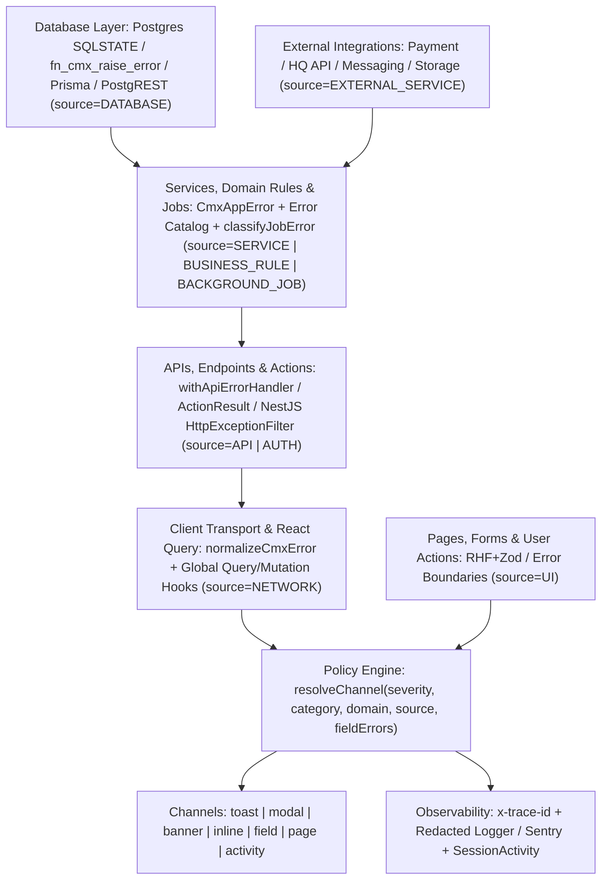

# Error & Messages Module — Architecture & Development Plan

- **Module:** CleanMateX Error & Messages Module (Cmx Feedback & Error System v2)
- **Canonical Folder:** `docs/features/Error_And_Messages_Module/`
- **Scope:** Full-stack across `cleanmatex` — Database (PostgreSQL / Supabase / Prisma), Backend Services & Business Rules, Background Jobs (`WorkOutbox`), APIs / Route Handlers / Server Actions, NestJS (`cmx-api`), Client Transport & React Query, Frontend Pages / Screens / Forms / Shared Cmx UI Channels, Observability, i18n (EN/AR + RTL), Design System, Governance & Testing
- **Status:** `Draft — Ready for Review` (no production code or SQL migrations created yet)
- **Created:** 2026-11-27
- **Authoritative Rules Applied:**
  - `AGENTS.md` (CRITICAL RULES #1–#19)
  - `docs/dev/rules/cmx-design-system.md`
  - `docs/dev/rules/cmx-shared-components.md`
  - `docs/dev/rules/cmx-message.md`
  - `docs/dev/rules/no-silent-money-mutation.md`
  - `docs/dev/rules/time-and-timezone.md`
  - `docs/dev/rules/integration-contracts.md`

---

## 1. Approved Architectural Decisions

| # | Decision | Approved Choice | Rationale |
|---|---|---|---|
| **D1** | **Error & Message Taxonomy** | **6-axis orthogonal model**: `code`, `category` (problem kind), `domain` (business area), `source` (origin layer), `severity` (`level`), `channel`. `'crud'` excluded from `category`. | Prevents conflating business area with problem kind (e.g. a field validation typo inside `PAYMENTS` routes to `field`, whereas a `PAYMENTS` gateway timeout routes to a blocking `modal`). |
| **D2** | **Database Scope** | **Option A**: Draft `fn_cmx_raise_error` SQL helper migration in Phase 2 (created as SQL file only, stopped for user review/apply). Keep HQ-authored DB banners (`sys_msg_banners_mst`, `org_msg_banner_dismiss_tr`) and optional critical incident table in **Phase 6** (separate cross-project declaration). | Delivers full DB-to-UI error normalization immediately with minimal schema surface; respects `integration-contracts.md` §3 for HQ-managed features. |
| **D3** | **Policy Escalation** | **Strict runtime auto-escalation** in production: `critical` severity and `PAYMENTS` / `APPROVALS` / `SECURITY` errors attempting to use `toast` automatically escalate to `modal` (or `banner` for `SYSTEM` outages / `SUBSCRIPTION` notices), plus dev warning. | Guarantees high-stakes financial, approval, security, and critical failures can never silently disappear in a 4-second toast. |
| **D4** | **HTML in Messages** | **Deprecate `options.html`** in `cmxMessage`. Fix `sanitizeHtmlSync()` to **fail closed** (escape/strip HTML synchronously when DOMPurify is not yet loaded) and prefer plain text, `ReactNode`, or structured `items[]`. | Closes the current fail-open XSS vulnerability in `web-admin/src/ui/feedback/utils/html-sanitizer.ts`. |

---

## 2. Current-State Baseline & Defects Being Remediated

Audited against existing repository code on 2026-11-27:

| Area | Existing Files | Confirmed Gaps / Defects |
|---|---|---|
| **Core Feedback API** | `web-admin/src/ui/feedback/cmx-message.ts`, `types.ts`, `message-config.ts`, `useMessage.ts` | Missing `critical` level (`loading` mixed into `MessageType`); no Policy Engine; no `banner` or `modal` channels; `useMessage()` omits `confirm` and runs fragile `msg.includes('.') && !msg.includes(' ')` auto-translation heuristic. |
| **Display Methods** | `web-admin/src/ui/feedback/methods/{toast,alert,inline,console}-method.ts` | `alert-method.ts` calls native `window.alert()` for non-confirm alerts; `toast-method.ts` injects literal `[role="alert"]` in `className` and ignores `dismissible`; `inline-method.ts` uses one global store instead of scoped regions. |
| **Modals & Dialogs** | `web-admin/src/ui/feedback/components/cmx-alert-dialog.tsx`, `utils/alert-dialog-provider.tsx`, `cmx-confirm-dialog.tsx` | Single `dialogState` slot overwrites concurrent `confirm()` calls (orphaning promises); custom modal chrome duplicates `CmxDialog` and nests `role="alertdialog"` inside `role="dialog"`; hardcoded English defaults (`Confirm`, `Cancel`). |
| **Banners & Summaries** | `web-admin/src/ui/feedback/cmx-summary-message.tsx`, `src/ui/forms/cmx-form-status-banner.tsx`, `src/features/setup-health/ui/setup-blocker-banner.tsx` | No `critical` variant; `CmxSummaryMessage` hardcodes `role="alert"` even for `info`/`success` and defaults `dismissLabel="Dismiss"`; no generic `CmxBannerHost` for maintenance, subscription, outage, security, or offline notices. |
| **XSS Sanitizer** | `web-admin/src/ui/feedback/utils/html-sanitizer.ts` | `sanitizeHtmlSync()` returns **unsanitized raw HTML** when `DOMPurify` has not been lazily loaded. |
| **Error Boundaries & Pages** | `web-admin/app/**`, `app/dashboard/orders/[id]/order-detail-error.tsx`, `src/features/orders/ui/PiecesErrorBoundary.tsx` | **Zero** Next.js App Router `error.tsx`, `global-error.tsx`, or `not-found.tsx` files; `PiecesErrorBoundary` has hardcoded English strings; `order-detail-error.tsx` exposes raw `tenantId`/`userId`/`serverError` in UI. |
| **Backend & API Envelopes** | `web-admin/lib/errors/base-errors.ts`, `lib/api/pos-session-finance-errors.ts`, `lib/api/cash-drawer-route-errors.ts`, `lib/services/workflow/workflow-profile-error-catalog.ts`, `cmx-api/src/common/filters/http-exception.filter.ts` | 3+ incompatible JSON error shapes; `cmx-api` `HttpExceptionFilter` overwrites custom domain codes with `HTTP_${status}` and leaks raw unhandled `exception.message`; no standard `fieldErrors[]` or Server Action `ActionResult<T>` contract. |
| **Session Activity & Telemetry** | `web-admin/lib/session-activity/*`, `lib/utils/logger.ts`, `lib/utils/sentry-stub.ts` | Session Activity lacks `critical`, `modal`/`banner` channels, `code`, `domain`, `source`, and `traceId`; `cmxMessage` has no telemetry hook into `logger.ts`. |
| **i18n & Tests** | `web-admin/messages/{en,ar}/messages.json`, `validation.json`, `common.json` | No central `messages/{en,ar}/errors.json`; zero Jest unit tests under `__tests__/ui/feedback/`. |

---

## 3. Core 6-Axis Domain Model & Policy Engine

### 3.1 Canonical Type Definitions (`web-admin/lib/errors/types.ts`)

```ts
/** UI & operational severity (separate from async `loading` progress state). */
export type MessageLevel =
  | 'success'
  | 'info'
  | 'warning'
  | 'error'
  | 'critical';

/** Error-only severity subset for failed operations & API envelopes. */
export type ErrorSeverity = 'warning' | 'error' | 'critical';

/** Presentation surface resolved by the Policy Engine. */
export type MessageChannel =
  | 'toast'     // Ephemeral non-blocking feedback (Sonner, token-styled)
  | 'modal'     // Blocking focal dialog (alert, confirm, approval, payment, critical)
  | 'banner'    // Persistent shell/page strip (maintenance, subscription, outage, security, offline, tenant warnings)
  | 'inline'    // Scoped panel/card/form summary (CmxSummaryMessage / CmxFormStatusBanner)
  | 'field'     // Field-level inline validation (CmxFieldShell / CmxFormField + RHF + cmxFocusField)
  | 'page'      // Full-view recovery state (error.tsx, global-error.tsx, not-found.tsx, 403, 503)
  | 'activity'; // Passive durable session trail & redacted telemetry

/** What kind of problem occurred (strictly problem class — never business domain). */
export type ErrorCategory =
  | 'VALIDATION'      // Missing/invalid fields, schema/format/numeric bounds
  | 'BUSINESS'        // Domain rule violation, state transition blocked, period closed
  | 'PERMISSION'      // RBAC denied, feature/plan gate, RLS/tenant boundary
  | 'AUTHENTICATION'  // Unauthenticated, session expired, account locked, pwd change required
  | 'CONFLICT'        // Unique constraint, optimistic lock, idempotency conflict
  | 'NOT_FOUND'       // Missing or soft-deleted entity
  | 'NETWORK'         // Offline, DNS, request timeout, aborted transport
  | 'INTEGRATION'     // External payment gateway, SMS/email/WhatsApp, HQ API, storage
  | 'RATE_LIMIT'      // Quota/throttling exceeded (429)
  | 'SYSTEM';         // Unhandled 500, DB outage, maintenance, runtime crash

/** Which CleanMateX business area owns the event. */
export type ErrorDomain =
  | 'ORDERS'
  | 'WORKFLOW'
  | 'PAYMENTS'
  | 'FINANCE'
  | 'APPROVALS'
  | 'CUSTOMERS'
  | 'CATALOG'
  | 'INVENTORY'
  | 'POS'
  | 'DELIVERY'
  | 'TAX'
  | 'SUBSCRIPTION'
  | 'AUTH'
  | 'SECURITY'
  | 'NOTIFICATIONS'
  | 'FILES'
  | 'SETTINGS'
  | 'SYSTEM';

/** Architectural layer where the error originated. */
export type ErrorSource =
  | 'UI'
  | 'API'
  | 'SERVICE'
  | 'BUSINESS_RULE'
  | 'DATABASE'
  | 'AUTH'
  | 'NETWORK'
  | 'EXTERNAL_SERVICE'
  | 'BACKGROUND_JOB';

/** Structured per-field validation item (RHF-compatible path). */
export interface CmxFieldError {
  field: string;                           // e.g. 'phone' or 'items.0.quantity'
  code: string;                            // e.g. 'REQUIRED', 'MIN_VALUE', 'DUPLICATE'
  messageKey?: string;                     // e.g. 'validation.minValue'
  message: string;                         // Safe human fallback
  params?: Record<string, string | number>;
}

/** Canonical cross-stack API & Server Action error envelope. */
export interface CmxErrorEnvelope {
  success: false;
  code: string;                            // Canonical SCREAMING_SNAKE_CASE code
  errorCode: string;                       // Backward-compat alias -> mirrors `code`
  error: string;                           // Backward-compat alias -> mirrors `message`
  category: ErrorCategory;
  domain: ErrorDomain;
  source: ErrorSource;
  severity: ErrorSeverity;
  recommendedChannel?: Exclude<MessageChannel, 'activity'>;
  message: string;                         // Safe English staff-facing fallback (never SQL/stack/PII)
  messageKey?: string;                     // i18n key under `errors.*` or feature namespace
  messageParams?: Record<string, string | number>;
  actionHintKey?: string;                  // Recovery guidance i18n key
  fieldErrors?: CmxFieldError[];
  retryable: boolean;
  traceId: string;                         // Propagated x-trace-id
  timestamp: string;                       // UTC RFC 3339 "Z" (time-and-timezone.md)
  details?: Record<string, unknown>;       // Safe allowlisted metadata (e.g. permissionCode, serviceCode)
}
```

### 3.2 End-to-End Architecture Flow



### 3.3 Channel Policy Matrix (`web-admin/lib/errors/channel-policy.ts`)

Deterministic evaluation order (first matching rule wins):

| Priority | Condition | Resolved Channel | Hard Guardrail / Behavior |
|---|---|---|---|
| **1** | `fieldErrors.length > 0` (or `category === 'VALIDATION'` with known field targets) | **`field`** | Binds via `applyServerFieldErrors(form, err)` + `cmxFocusField()`. **NEVER toast** when invalid fields are known. Optional top `CmxFormStatusBanner` summary if `showSummary` or unmapped fields exist. |
| **2** | Uncaught render/route crash, `404`, route-level `403`, tenant suspended, full maintenance | **`page`** | Renders `CmxErrorState` with bilingual copy, Retry/Home CTA, and copyable `traceId`. |
| **3** | `severity === 'critical'` AND (`domain === 'SYSTEM'` OR `category === 'NETWORK'` OR `code === 'SYS_MAINTENANCE'`) | **`banner`** *(or **`modal`** if blocking active mutation)* | Persistent non-dismissible banner in `CmxBannerHost` (`scope: 'platform' \| 'session'`). |
| **4** | `severity === 'critical'` | **`modal`** | Blocking critical escalation modal (non-dismissible backdrop), copyable `code` + `traceId`, recovery CTA. **NEVER toast.** |
| **5** | `domain` in `['PAYMENTS', 'APPROVALS', 'SECURITY']` OR `category === 'AUTHENTICATION'` (for `warning`/`error`, when not field validation) | **`modal`** *(or **`inline`** if explicit `inlineScope` inside a payment/approval dialog)* | Auto-escalated if caller passed `toast` + dev warning logged. Satisfies **No Silent Money Mutation** (permission name + code rendered clearly). |
| **6** | `domain === 'SUBSCRIPTION'` OR `code` in `['SYS_MAINTENANCE', 'SYS_NETWORK_OFFLINE', 'SYS_DEGRADED']` | **`banner`** | Priority-sorted persistent banner (`scope: 'tenant' \| 'platform' \| 'session'`). |
| **7** | Caller explicitly requested `inline` (or `inlineScope` provided for `BUSINESS` / `PERMISSION` / `CONFLICT`) | **`inline`** | Renders in scoped `CmxSummaryMessage` / `CmxFormStatusBanner`. |
| **8** | Caller explicitly requested `modal` (e.g. Delete/Cancel/Archive/Approve/Reject/Payment confirmation) | **`modal`** | Enqueued in FIFO `CmxModalHost`. |
| **9** | Default (`success`, `info`, quick non-blocking `warning`, recoverable CRUD `error`) | **`toast`** | Token-styled Sonner toast, RTL-positioned, `dismissible` honored, durations from config. |
| **Always (Parallel)** | `severity` in `['warning', 'error', 'critical']` or `forceSessionLog` | **`activity`** | PII-redacted record appended to `SessionActivityPanel`; `error`/`critical` also dispatched to `telemetry.ts` → `logger.ts`. |

---

## 4. Full-Stack Layer Specifications

### 4.1 Database Layer (PostgreSQL / Supabase / Prisma)

1. **PL/pgSQL Structured Error Helper (Draft SQL Migration — Phase 2)**:
   - Filename: `supabase/migrations/<next_seq_after_0848>_cmx_error_raise_helper.sql` (created only; **NEVER** applied automatically per CRITICAL RULE #3).
   - Creates `fn_cmx_raise_error(p_code TEXT, p_domain TEXT, p_category TEXT, p_message TEXT, p_details JSONB DEFAULT '{}'::jsonb)` (20 chars ≤ 30-char DB object limit, `TEXT` only, full PostgreSQL `COMMENT ON` metadata, explicit grants only — no default `anon`/`authenticated` grant per `conventions.md`).
   - Raises `ERRCODE = 'P0001'` with `MESSAGE = p_code || ': ' || p_message` and `DETAIL = jsonb_build_object('cmx_error', true, 'code', p_code, 'domain', p_domain, 'category', p_category, 'details', COALESCE(p_details, '{}'::jsonb))::text`.
2. **Database Error Mapper (`web-admin/lib/errors/db-error-mapper.ts` + `cmx-api/src/common/errors/db-error-mapper.ts`)**:
   - Parses structured `P0001` JSON `DETAIL` from `fn_cmx_raise_error` first.
   - Maps standard Postgres SQLSTATEs, Prisma codes, and PostgREST codes deterministically with `source: 'DATABASE'`:
     - `22P02` (invalid text representation) → `VAL_INVALID_INPUT`, `VALIDATION`, HTTP 400
     - `23505` / Prisma `P2002` (unique violation) → `DB_DUPLICATE_RECORD`, `CONFLICT`, HTTP 409 (supports optional per-route constraint→field map to emit `fieldErrors[]`!)
     - `23503` / Prisma `P2003` (FK violation) → `DB_REFERENCE_CONFLICT`, `CONFLICT`, HTTP 409
     - `23514` (check violation) → `VAL_CONSTRAINT_VIOLATION`, `VALIDATION`, HTTP 422
     - `42501` (insufficient privilege / RLS) → `AUTH_FORBIDDEN`, `PERMISSION`, HTTP 403
     - `40001` / `40P01` / Prisma `P2034` (serialization/deadlock) → `DB_CONCURRENCY_CONFLICT`, `SYSTEM`, HTTP 409, `retryable: true`
     - `57014` (query timeout) → `DB_QUERY_TIMEOUT`, `SYSTEM`, HTTP 504, `retryable: true`
     - Prisma `P2025` / PostgREST `PGRST116` (not found) → `SYS_NOT_FOUND`, `NOT_FOUND`, HTTP 404
   - Never leaks raw SQL, constraint names, or `tenant_org_id` to client responses.

### 4.2 Services, Business Rules & Background Jobs

1. **Extended `CmxAppError` (`web-admin/lib/errors/base-errors.ts`)**:
   - Backward-compatible extension of existing `AppError`, `NotFoundError`, `ValidationError`, `UnauthorizedError`, `ForbiddenError`, `ConflictError` so zero existing imports break.
   - Adds `category`, `domain`, `source`, `severity`, `recommendedChannel`, `fieldErrors`, `messageKey`, `messageParams`, `actionHintKey`, `retryable`.
   - Adds factory helpers (`CmxError.validation`, `.business`, `.permission`, `.auth`, `.conflict`, `.notFound`, `.integration`, `.critical`) and domain subclasses (`PaymentError`, `ApprovalError`, `SecurityError`, `SubscriptionError`, `CriticalError`).
2. **Central Error Catalog (`web-admin/lib/errors/error-catalog.ts`)**:
   - Single typed registry covering platform & cross-cutting codes (`SYS_*`, `AUTH_*`, `VAL_*`, `DB_*`, `SUB_*`, `PAY_*`, `FIN_*`, `APR_*`, `WF_*`, `NET_*`), plus pluggable domain catalog registration (preserving `workflow-profile-error-catalog.ts` `PROFILE_*` codes seamlessly).
3. **Background Job Classifier (`web-admin/lib/errors/job-error-classifier.ts`)**:
   - Aligns with CleanMateX's `WorkOutbox` / `BackgroundExecutionModule` (`integration-contracts.md` §14):
     - Classifies thrown errors with `source: 'BACKGROUND_JOB'` into `{ disposition: 'RETRY' | 'PERMANENT_FAILURE', retryable: boolean, envelope: CmxErrorEnvelope }`.
     - Logs structured diagnostics with `traceId`, `tenantOrgId`, `jobName`, `outboxId` (redacted).

### 4.3 APIs, Endpoints & Server Actions

1. **Next.js Route Handlers (`web-admin/lib/api/error-response.ts`)**:
   - `toApiErrorResponse(error, { domain, traceId?, constraintFieldMap?, fallbackCode? })` → returns `NextResponse.json(envelope, { status, headers: { 'x-trace-id': traceId } })`.
   - `withApiErrorHandler(domain, handler)` HOF for clean route adoption.
   - Automatic `ZodError` → `CmxFieldError[]` conversion (preserving nested dot paths like `items.0.quantity` and Zod issue codes).
   - Structured server logging via `logger.error()` / `logger.warn()` with `traceId`, `domain`, `category`, `source`, `code` (full stack server-only; never in JSON body).
2. **Next.js Server Actions (`web-admin/lib/api/action-result.ts`)**:
   - `ActionResult<T> = { ok: true; data: T } | { ok: false; error: CmxErrorEnvelope }`.
   - `runServerAction(domain, fn)` catches thrown `CmxAppError` / Zod / DB errors and returns a serializable `{ ok: false, error }` envelope so custom metadata survives Next.js production error sanitization.
3. **NestJS `cmx-api` (`cmx-api/src/common/errors/` & `http-exception.filter.ts`)**:
   - Add `CmxAppException` + `db-error-mapper.ts` mirroring `CmxErrorEnvelope`.
   - Harden `HttpExceptionFilter`:
     - Preserve domain `code`, `category`, `domain`, `source`, `severity`, `fieldErrors`, `details`, `retryable`.
     - Transform NestJS `ValidationPipe` error arrays into structured `CmxFieldError[]`.
     - Redact raw unhandled `500` `exception.message` outside `NODE_ENV === 'development'`.
     - Echo `x-trace-id` response header from `request-context.storage`.
4. **Pilot Route Migrations (Backward Compatible)**:
   - Update `pos-session-finance-errors.ts` and `cash-drawer-route-errors.ts` to emit the full `CmxErrorEnvelope` while keeping `success: false`, `code`, `errorCode`, and `error` aliases intact.

### 4.4 Client Transport, React Query & Session Layer

1. **Universal Error Normalizer (`web-admin/lib/errors/normalize-error.ts`)**:
   - Pure function `normalizeCmxError(error, context?)` handling: `CmxErrorEnvelope`, `ActionResult` error, `CmxAppError`, `Response` (fetch), `AxiosError`, Supabase PostgREST/Auth error, `DOMException` (`AbortError`), `TypeError` (`Failed to fetch` → `SYS_NETWORK_OFFLINE`, `category: 'NETWORK'`, `source: 'NETWORK'`), plain objects, strings, and unknown values.
2. **React Query Global Interceptors (`web-admin/lib/providers/AppProviders.tsx`)**:
   - Wire `QueryCache({ onError })` and `MutationCache({ onError })` to handle global cross-cutting codes centrally (`AUTH_SESSION_EXPIRED` → single deduplicated modal/redirect, `SYS_MAINTENANCE` / `SYS_NETWORK_OFFLINE` → persistent banner, `SYS_RATE_LIMITED` → throttled warning), while letting individual screens override via `meta: { suppressGlobalError: true }`.

### 4.5 Frontend Pages, Screens, Forms & Shared Cmx UI (`src/ui/`)

All shared components obey `cmx-design-system.md` (zero feature imports in `src/ui/`, theme tokens only, no `dark:`, logical RTL classes only, `<bdi dir="ltr">` / `CmxCodeChip` for codes & `traceId`, WCAG AA contrast, 44px POS touch targets, `print:hidden` for overlays/banners/toasts).

1. **Design Tokens (`lib/theme/brand-palette.ts`, `src/ui/foundations/tokens.css`, `app/globals.css`)**:
   - Add `--cmx-critical-rgb`, `--cmx-critical-bg-rgb`, `--cmx-critical-border-rgb`, `--cmx-critical-text-rgb` for Light and Dark modes, verified `>= 4.5:1` contrast via `status-tokens.test.ts` and `seeded-theme-contrast.test.ts`.
2. **Modal Channel (`src/ui/feedback/stores/modal-queue-store.ts`, `components/cmx-message-modal.tsx`, `components/cmx-modal-host.tsx`)**:
   - FIFO queue store — concurrent `cmxMessage.modal()` / `cmxMessage.confirm()` calls queue cleanly without overwriting active dialogs or leaking unresolved promises.
   - `CmxMessageModal` built on `CmxDialog` (portal, focus trap, Escape stack, focus restoration, single semantic `role="alertdialog"`).
   - Supports 4 modes: `alert` (replaces all `window.alert()`), `confirm` (Approve/Reject/Delete/Cancel/Archive/Payment), `confirm-with-reason` (audited reason textarea or typed confirmation phrase), and `critical` (non-dismissible backdrop, error code + copyable `traceId` via `CmxCodeChip`, recovery action).
   - `CmxModalHost` mounted in `AppProviders.tsx`; `AlertDialogProvider` exported as a backward-compatible alias.
3. **Banner Channel (`src/ui/feedback/stores/banner-store.ts`, `components/cmx-banner.tsx`, `components/cmx-banner-host.tsx`)**:
   - Priority-sorted multi-scope store (`platform > tenant > session > page`, then `critical > error > warning > info > success`).
   - Supports `dismissPolicy: 'none' | 'session' | 'user'` (with `sessionStorage` / `localStorage` keyed by `dismissKey`), deduplication by `id`, max 2 visible banners + collapsible overflow summary, and `print:hidden`.
   - Built-in `navigator.onLine` / `online` / `offline` listener auto-publishes/clears the `SYS_NETWORK_OFFLINE` session banner.
   - Mounted in `DashboardLayout` above `<main>` AND in public auth layout (`/login`) for platform/offline notices.
   - Refactor `SetupBlockerBanner` to compose `CmxBanner` cleanly (preserving its non-dismissible collapsible semantics).
4. **Toast Channel (`src/ui/feedback/methods/toast-method.ts`, `AppProviders.tsx`)**:
   - Replace raw Sonner `richColors` with CleanMateX `--cmx-*` semantic token classes so Light, Dark, and Tenant Brand themes remain consistent and contrast-safe.
   - Remove fake `[role="alert"]` inside `className`; honor `options.dismissible`; remove unsafe `html` passthrough.
5. **Inline Channel (`src/ui/feedback/cmx-summary-message.tsx`, `methods/inline-method.ts`, `src/ui/forms/cmx-form-status-banner.tsx`)**:
   - Upgrade `CmxSummaryMessage` & `CmxFormStatusBanner` to support all 5 `MessageLevel` values (`+critical`), optional `code` / `traceId` footer chip, optional `actions` slot, semantic ARIA (`role="status" aria-live="polite"` for `success`/`info`; `role="alert" aria-live="assertive"` for `warning`/`error`/`critical`), and translated `dismissLabel` (zero hardcoded English).
   - Replace single global `inlineMessageStore` with keyed/scoped `Map<string, InlineMessage>` + React hook `useInlineMessage(scopeKey)`.
6. **Field Validation Pipeline (`src/ui/forms/apply-server-field-errors.ts`)**:
   - `applyServerFieldErrors(form, normalizedError, { t?, focusFirst?: true })`:
     - Maps each `CmxFieldError` to `form.setError(field, { type: code, message: resolvedCopy })`.
     - Calls `cmxFocusField({ name: firstField })` so keyboard & screen-reader focus jumps straight to the invalid control.
     - Returns any unmapped/global errors so the form can display them in `CmxFormStatusBanner` without leaking field errors to a toast.
7. **Page Channel & Error Boundaries (`src/ui/feedback/components/cmx-error-state.tsx`, `cmx-error-boundary.tsx`, `web-admin/app/**`)**:
   - `CmxErrorState`: reusable bilingual full-page / section recovery card (`403`, `404`, `500`, `offline`, `maintenance`, `suspended`) with `CmxCodeChip` for `code` & `traceId`, Retry / Back / Dashboard actions.
   - `CmxErrorBoundary`: shared React Error Boundary dispatching redacted crash metadata to `telemetry.ts` and rendering `CmxErrorState` (allowing `PiecesErrorBoundary` and `PaymentDialogErrorBoundary` to converge).
   - Add Next.js App Router files:
     - `web-admin/app/error.tsx`
     - `web-admin/app/global-error.tsx`
     - `web-admin/app/not-found.tsx`
     - `web-admin/app/dashboard/error.tsx`
   - Fix `web-admin/app/dashboard/orders/[id]/order-detail-error.tsx` to hide raw `tenantId`/`userId`/`serverError` in production and display `traceId` instead.
8. **Unified `cmxMessage` v2 & `useMessage()` v2**:
   - 100% backward compatible with all existing `cmxMessage.success/info/warning/error/loading/errorFrom/confirm/promise/batch` call sites.
   - New additive APIs:
     - `cmxMessage.critical(message, options)`
     - `cmxMessage.modal(options)`
     - `cmxMessage.banner(options)` / `cmxMessage.dismissBanner(id)`
     - `cmxMessage.handleError(error, { form?, domain?, category?, inlineScope?, channel?, fallback? })`
   - `useMessage()` v2 adds `confirm`, `showCritical`, `showModal`, `showBanner`, `dismissBanner`, `handleError`; replaces the fragile dot-heuristic with explicit `t` lookup via `messageKey` (safe fallback without corrupting filenames/URLs/codes).
9. **Session Activity & Observability (`web-admin/lib/session-activity/`, `web-admin/lib/errors/telemetry.ts`)**:
   - Extend `SessionActivityEntry` with `severity` (`+critical`), `channel` (`toast | modal | banner`), `domain`, `category`, `source`, `code`, `traceId` (still strictly PII-redacted via `redact-session-message.ts`).
   - Wire `telemetry.ts` adapter (`registerErrorTelemetryAdapter`) to `logger.ts` + Sentry stub, capturing `error` (5xx/integration/security) and `critical` events + Policy Engine auto-escalation audit signals.

### 4.6 Bilingual i18n Catalog (`web-admin/messages/{en,ar}/errors.json`)

- Create `web-admin/messages/en/errors.json` and `web-admin/messages/ar/errors.json` (verified against `docs/dev/i18n_docs/GLOSSARY.md` and `npm run check:i18n`):
  - `errors.codes.*` — staff-safe bilingual messages & `errors.hints.*` recovery guidance for all canonical catalog codes.
  - `errors.ui.*` — shared UI copy for modals, banners, error pages (`dismiss`, `retry`, `goHome`, `goBack`, `copyReferenceId`, `referenceCopied`, `supportReference`, `offlineTitle`, `offlineDesc`, `moreNotices`, `confirm`, `cancel`, `reasonLabel`, `reasonPlaceholder`, `unexpectedTitle`, `unexpectedDesc`, `notFoundTitle`, `notFoundDesc`, `forbiddenTitle`, `forbiddenDesc`).

---

## 5. Phased Implementation Plan & File Inventory

### Phase 1 — Core 6-Axis Foundation, Security Hardening, Tokens & i18n
- **Create**:
  - `web-admin/lib/errors/types.ts`
  - `web-admin/lib/errors/error-catalog.ts`
  - `web-admin/lib/errors/db-error-mapper.ts`
  - `web-admin/lib/errors/normalize-error.ts`
  - `web-admin/lib/errors/channel-policy.ts`
  - `web-admin/lib/errors/telemetry.ts`
  - `web-admin/lib/errors/job-error-classifier.ts`
  - `web-admin/lib/errors/index.ts`
  - `web-admin/messages/en/errors.json`
  - `web-admin/messages/ar/errors.json`
- **Edit**:
  - `web-admin/lib/errors/base-errors.ts` (backward-compatible extension)
  - `web-admin/src/ui/feedback/utils/html-sanitizer.ts` (fail-closed XSS fix; deprecate `html: true`)
  - `web-admin/lib/theme/brand-palette.ts`, `web-admin/src/ui/foundations/tokens.css`, `web-admin/app/globals.css` (`--cmx-critical-*` tokens, Light + Dark)
- **Exit Criteria**: Unit tests for Policy Engine, Normalizer, DB Error Mapper, XSS sanitizer, `tokens-css.test.ts`, `status-tokens.test.ts`, `seeded-theme-contrast.test.ts`, and `npm run check:i18n` all green.

### Phase 2 — Database SQL Helper, Backend APIs, Server Actions & `cmx-api`
- **Create**:
  - `supabase/migrations/<next_seq>_cmx_error_raise_helper.sql` *(SQL file only — STOP & notify user to review/apply; never execute)*
  - `web-admin/lib/api/error-response.ts` (`toApiErrorResponse`, `withApiErrorHandler`, Zod → `fieldErrors[]`)
  - `web-admin/lib/api/action-result.ts` (`ActionResult<T>`, `runServerAction`)
  - `cmx-api/src/common/errors/cmx-app.exception.ts`
  - `cmx-api/src/common/errors/db-error-mapper.ts`
- **Edit**:
  - `cmx-api/src/common/filters/http-exception.filter.ts` (preserve domain codes & `fieldErrors[]`, redact prod 500s, canonical `CmxErrorEnvelope`)
  - `web-admin/lib/api/pos-session-finance-errors.ts` (pilot envelope upgrade, aliases preserved)
  - `web-admin/lib/api/cash-drawer-route-errors.ts` (pilot envelope upgrade, aliases preserved)
- **Exit Criteria**: Unit tests for `toApiErrorResponse`, `runServerAction`, `classifyJobError`, and `cmx-api` `HttpExceptionFilter`; `cmx-api` builds cleanly.

### Phase 3 — Shared Cmx UI Channels & Form Validation Pipeline
- **Create**:
  - `web-admin/src/ui/feedback/stores/modal-queue-store.ts`
  - `web-admin/src/ui/feedback/stores/banner-store.ts`
  - `web-admin/src/ui/feedback/methods/modal-method.ts`
  - `web-admin/src/ui/feedback/methods/banner-method.ts`
  - `web-admin/src/ui/feedback/components/cmx-message-modal.tsx`
  - `web-admin/src/ui/feedback/components/cmx-modal-host.tsx`
  - `web-admin/src/ui/feedback/components/cmx-banner.tsx`
  - `web-admin/src/ui/feedback/components/cmx-banner-host.tsx`
  - `web-admin/src/ui/feedback/components/cmx-error-state.tsx`
  - `web-admin/src/ui/feedback/components/cmx-error-boundary.tsx`
  - `web-admin/src/ui/forms/apply-server-field-errors.ts`
- **Edit**:
  - `web-admin/src/ui/feedback/methods/alert-method.ts` (delegate to `modal-method.ts`; zero `window.alert()`)
  - `web-admin/src/ui/feedback/methods/toast-method.ts` (semantic token classes, real ARIA, `dismissible`, no unsafe HTML)
  - `web-admin/src/ui/feedback/methods/inline-method.ts` (scoped keyed map + `useInlineMessage`)
  - `web-admin/src/ui/feedback/cmx-summary-message.tsx` (`+critical`, proper `role`/`aria-live`, `code`/`traceId`, `actions`, i18n-clean)
  - `web-admin/src/ui/feedback/cmx-confirm-dialog.tsx` (optional `level`/`variant`, backward compatible)
  - `web-admin/src/ui/forms/cmx-form-status-banner.tsx` (`+critical`, `code`)
  - `web-admin/src/ui/feedback/utils/alert-dialog-provider.tsx` (delegate to `CmxModalHost` for backward compat)
  - `web-admin/src/features/setup-health/ui/setup-blocker-banner.tsx` (compose `CmxBanner`)
- **Exit Criteria**: All shared UI tests pass; `npm run check:ui` reports 0 errors on `src/ui/`.

### Phase 4 — Unified `cmxMessage` v2, App Hosts, Query Hooks, App Router Boundaries & Activity
- **Create**:
  - `web-admin/app/error.tsx`
  - `web-admin/app/global-error.tsx`
  - `web-admin/app/not-found.tsx`
  - `web-admin/app/dashboard/error.tsx`
- **Edit**:
  - `web-admin/src/ui/feedback/types.ts`, `cmx-message.ts`, `useMessage.ts`, `message-config.ts`, `index.ts`
  - `web-admin/lib/providers/AppProviders.tsx` (`CmxModalHost`, token-styled `<Toaster className="print:hidden" />`, global `QueryCache`/`MutationCache` error hooks, telemetry registration)
  - `web-admin/app/dashboard/layout.tsx` (mount `<CmxBannerHost />` above `<main>`)
  - `web-admin/app/(auth)/layout.tsx` *(or login shell if present — verified before editing)* for platform/offline banners
  - `web-admin/lib/session-activity/*` & `web-admin/src/features/session-activity/*` (capture `critical`, `modal`/`banner`, `domain`, `category`, `source`, `code`, `traceId`)
  - `web-admin/app/dashboard/orders/[id]/order-detail-error.tsx` (stop exposing raw internal IDs/server errors in production)
- **Exit Criteria**: `tsc --noEmit`, `eslint`, `npm run build` (both `web-admin` and `cmx-api`) all green.

### Phase 5 — Governance, Test Suite, Storybook & Feature Documentation Pack
- **Create**:
  - `web-admin/__tests__/lib/errors/*.test.ts` (Policy Engine, Normalizer, DB Error Mapper, `toApiErrorResponse`, `runServerAction`, `classifyJobError`)
  - `web-admin/__tests__/ui/feedback/*.test.tsx` (`cmx-message-v2`, `modal-queue-store`, `banner-store`, `cmx-banner`, `cmx-message-modal`, `cmx-summary-message`, `cmx-error-state`, `apply-server-field-errors`, `html-sanitizer`)
  - Storybook stories for `CmxMessageModal`, `CmxBanner`, `CmxErrorState`, and updated `CmxSummaryMessage`
  - `docs/dev/rules/error-handling.md` (canonical full-stack error rule covering DB, Backend, API, Server Actions, Jobs, Client)
  - Remaining feature docs under `docs/features/Error_And_Messages_Module/` (`README.md`, `developer_guide.md`, `testing_guide_and_scenarios.md`, `current_status.md`)
- **Edit**:
  - `docs/dev/rules/cmx-message.md` & `.cursor/rules/cmx-message.mdc` (update with 6-axis taxonomy & Channel Policy Matrix)
  - `web-admin/.clauderc` (`ui_components` import snippets for `CmxBanner`, `CmxErrorState`, `CmxErrorBoundary`, `CmxModalHost`)
  - `web-admin/scripts/ui/check-design-system.js` (strengthen `UI002` checks)
- **Exit Criteria**: All verification gates in §6 pass, plus `/cmx-ui-design-review` run with 0 Critical/Important findings.

### Phase 6 — Optional Cross-Project Milestone (Deferred Until Separate Approval)
- **Scope**: HQ-authored persistent DB banners (`sys_msg_banners_mst`, `org_msg_banner_dismiss_tr`) and optional `critical` incident lookup table (`org_err_incident_tr`).
- **Prerequisite**: Formal Cross-Project Scope Declaration & user approval per `docs/dev/rules/integration-contracts.md` §3 before creating migrations or touching `cleanmatexsaas`.

---

## 6. Verification & Acceptance Gates

Every gate must pass before implementation is declared done:

1. **Design System Check**: `cd web-admin && npm run check:ui` → `0` errors on all new/changed files
2. **ESLint**: `cd web-admin && npx eslint <changed-files> --quiet` → `0` errors
3. **Unit & Guard Tests**: `cd web-admin && npx jest __tests__/lib/errors __tests__/ui/feedback __tests__/ui/foundations __tests__/lib/theme __tests__/scripts/check-design-system.test.ts` → all green (including `tokens-css`, `status-tokens`, `seeded-theme-contrast`)
4. **i18n Parity**: `cd web-admin && npm run check:i18n` → `0` missing EN/AR keys
5. **Typecheck**: `cd web-admin && NODE_OPTIONS=--max-old-space-size=8192 npx tsc --noEmit` → `0` errors
6. **Production Builds**: `cd web-admin && npm run build` AND `cd cmx-api && npm run build` → both succeed
7. **Design Review**: Run `/cmx-ui-design-review` and verify EN/AR (RTL), Light/Dark, 320px/Desktop, keyboard/focus, and Print preview (`data-mode="LIGHT"`, banners/toasts hidden)

---

## 7. Risks, Compatibility & Rollback Strategy

| Risk | Mitigation |
|---|---|
| Breaking existing `cmxMessage.*`, `useMessage()`, or `AlertDialogProvider` callers | 100% additive API; preserve `MessageType`, `DisplayMethod`, `AlertDialogProvider`, `CmxAlertDialog`, and envelope `error`/`errorCode` aliases. |
| Production Policy auto-escalation affecting an unexpected caller | Escalation triggers strictly on `severity: 'critical'` or non-validation `PAYMENTS`/`APPROVALS`/`SECURITY`/`AUTHENTICATION` routed to `toast`; telemetry + dev warning makes every escalation visible immediately. |
| Banner stack cluttering small / POS screens | Cap `CmxBannerHost` at 2 visible banners sorted by priority (`platform > tenant > session > page`, `critical > error > warning > info`), collapse overflow into one expandable strip, and apply `print:hidden`. |
| SQL migration timing (`fn_cmx_raise_error`) | Application DB error mapper gracefully handles both structured `P0001` JSON `DETAIL` and standard Postgres/Prisma/PostgREST errors, so web-admin & `cmx-api` work immediately even before the user applies the Phase 2 SQL migration. |
| `tokens.css` drift against `brand-palette.ts` | Generate/update `brand-palette.ts`, `tokens.css`, and `globals.css` in lockstep and gate on `tokens-css.test.ts`, `status-tokens.test.ts`, and `seeded-theme-contrast.test.ts`. |
