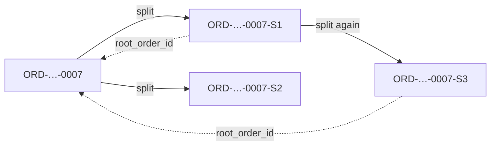
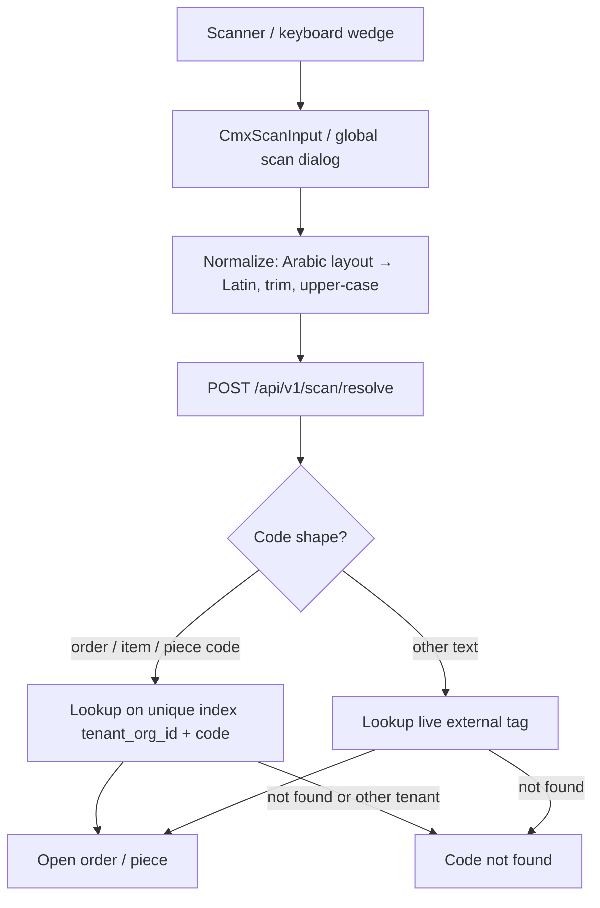
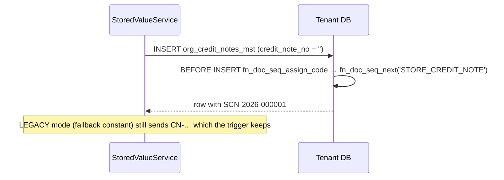
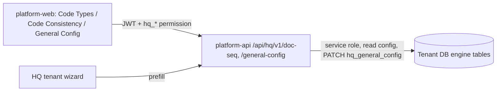

# Developer Guide (diagrams) — Human-Friendly Codes

Text version: [`developer_guide.md`](./developer_guide.md).

## 1. Create an order → order number

```mermaid
sequenceDiagram
  participant UI as web-admin UI
  participant API as web-admin API / OrderService
  participant DB as Tenant DB
  UI->>API: create order
  API->>DB: BEGIN; insert order (last step)
  DB->>DB: generate_order_number(tenant)
  DB->>DB: fn_doc_seq_next('ORDER', tenant, now, tz)
  Note over DB: INSERT … ON CONFLICT DO UPDATE … RETURNING on sys_doc_seq_counter_tr
  DB-->>API: ORD-20261031-0001
  API->>DB: COMMIT
  API-->>UI: order with order_no
```

## 2. Split an order



## 3. Scan



## 4. Store credit note (P5)



## 5. HQ screens


