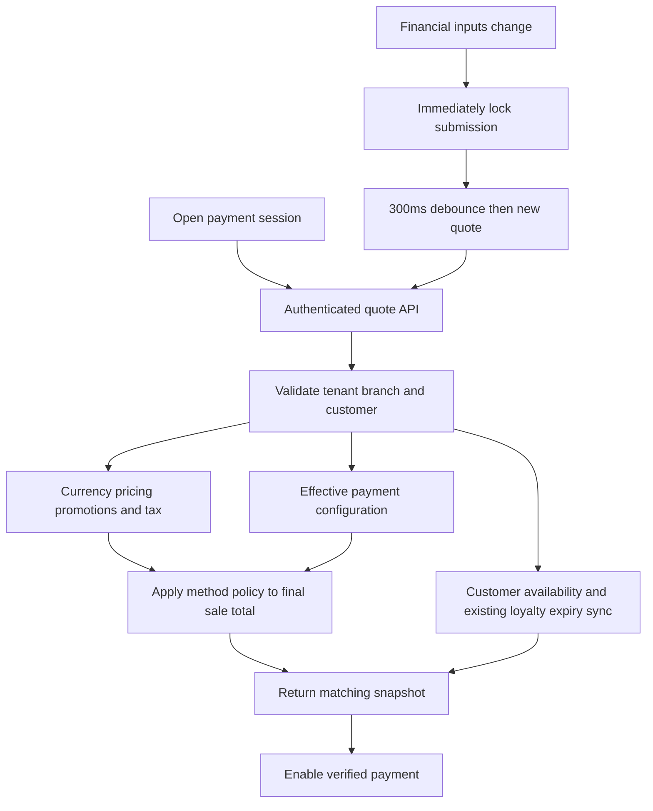

# Payment V4 coordinated quote

Date: 2026-10-24. Scope: the shared New/Edit Order Payment V4 initialization and refresh path.

## Behavior

Opening payment prepares one authenticated snapshot through `POST /api/v1/orders/payment-quote`. The browser no longer sequences a currency action, tax-profile action, financial preview, checkout-options GET, and a separate stored-value summary GET. Existing preview, checkout-options, and customer balance endpoints remain available to their other consumers.

The response contains authoritative currency/precision, totals, selected tax-profile identities, eligible methods for that exact sale total, credit-limit information, and a separately permission-gated balance summary. The engine keeps its existing form, payment legs, payload builder, cash-drawer workflow, Simple/Advanced modes, and independent final submission.

## Service and transport contracts

- Tenant/user scope comes from the validated session. Customer and branch identifiers must belong to that tenant. Every new tenant-table query explicitly filters `tenant_org_id`.
- CSRF and `orders:create` protect the quote POST, matching the existing preview boundary. Price overrides still require `pricing:override`.
- Rich balance details additionally require `stored_value:view_balances`; the operational method/balance subset preserves the previous checkout-options behavior.
- The quote schema reuses the preview commercial schema, validates branch/customer UUIDs, limits line count to 1,000, and counts streamed bytes against a 1 MiB body limit. The server quote deadline is 15 seconds after authentication; the browser has a 30-second transport deadline.
- Errors use stable codes with localized UI feedback. Missing currency remains HTTP 422 `MISSING_TENANT_CURRENCY`; unreadable currency remains HTTP 503 `TENANT_CURRENCY_UNAVAILABLE`. Existing currency-settings and sign-out/re-login recovery remain available.
- Quote responses are `private, no-store`. Structured telemetry contains stage durations, item count, and a server request ID, without customer names, payment credentials, gift-card codes, or balances. `Server-Timing` exposes coarse durations to authenticated browser DevTools.
- A response deadline bounds the HTTP wait; it does not cancel a Prisma query or an expiration transaction already executing. Client cancellation and quote identity prevent a superseded response from becoming financial authority.

## Efficiency and invariants

Currency resolves once per calculation. The totals path uses a lightweight authoritative base-price lookup, eliminating unused item metadata and per-item VAT reads. Identical complete lookup inputs are deduplicated, including quantity; at most six scalar lookups run together. Quantities on separate lines are not aggregated. Existing full-price consumers retain their behavior.

Automatic promotion evaluation reuses currency/customer facts and groups usage counts. Existing candidate limits, stacking, winner/tie behavior, price-list precedence, fallback rules for successful absent price lists, and currency rounding remain unchanged. New quotes reject required financial transport failures instead of presenting fabricated zero values; legacy interfaces retain their documented defaults.

Effective methods and customer availability load in parallel with financial calculation. One availability read feeds both checkout choices and permitted balance details. Loyalty expiry synchronization and final stored-value locking/idempotency remain in place. The exhausted-lot fallback now reads the current account balance instead of a stale balance taken before expiration.

Method eligibility has one server predicate shared by catalog/quote and submission. Disabled tenant/platform/gateway methods, POS restrictions, order thresholds, and selected-leg thresholds are checked before order writes. Final submission recalculates monetary amounts and applies its independent transactional debit checks; a quote is never a reservation or a substitute for submit validation.

## Browser freshness and recovery

Each opening has a unique session identity. Scope includes tenant, user, branch and customer. Every financial edit/revert creates a fresh revision. The shell and engine share the first request; subsequent refreshes keep the mounted form and last confirmed display values, immediately block submission, debounce, and replace totals/options together. Superseded requests are aborted and their results cannot overwrite the active query.

The final confirmation is bound to the same session, revision, and response request ID. A pending, failed, or replaced quote invalidates that confirmation; the cashier must review the refreshed amounts before confirming again. Tax display and calculation use one request-local effective-profile snapshot, including a successfully empty selection, so another read cannot change profile selection halfway through the quote.

Initialization can be cancelled. Empty orders get actionable guidance. Retry uses current inputs. Failed currency, catalog, tax, or balance reads remain explicit failures rather than successful empty arrays or zero balances. Terminal/brand lookup errors are distinct from an empty configuration and only block the affected payment flow.

## Required related areas

- Pages/screens: existing New Order and shared Edit Payment V4; collection keeps its existing routes.
- Navigation: no new screen or sidebar entry.
- RBAC: existing permissions only; no new permission seed.
- Tenant settings: existing tax and B2B policy resolution; no new setting.
- Feature flags and plan limits: no new flags, mappings, or limits.
- Database: no schema or index change and no migration required. Existing loyalty maintenance writes remain intentional domain behavior.
- Environment/dependencies: no new variables, services, caches, or packages.
- i18n: matching EN/AR `newOrder.payment.messages` loading/recovery keys; existing common Retry/Cancel labels reused.
- Access contracts: quote POST registered for `/dashboard/orders/new` and `/dashboard/orders/[id]/edit`, with generated inventories refreshed.

## Validation and release evidence

Automated checks cover existing monetary golden fixtures and payload fixtures, base-price deduplication/concurrency, grouped promotion reads, quote transport/authentication, tenant/context isolation, strict financial failures, shared opening-request deduplication, immediate debounce locking, out-of-order responses, retry, context changes, method-policy boundaries, and loyalty expiration fallback.

Captured implementation checks:

- Consolidated focused Jest run: 22 suites, 393 tests passed. This includes existing money/payload golden fixtures and the new quote, freshness, tax-snapshot, configuration-failure, eligibility, and loyalty regressions.
- Full web-admin ESLint, TypeScript checking with a 6 GiB heap, and `npm run build` passed. EN/AR i18n checking passed with existing catalog warnings. The final E2E-only edits also passed scoped ESLint.
- Both New/Edit scoped UI access-contract checks passed; synchronization covered 166 routes. Inventory regeneration completed, but strict inventory validation retains the same six navigation mismatches present in the baseline (delivery, catalog/preferences, settings/roles, settings/permissions, settings/payments). Those unrelated contracts were not changed or allowlisted.
- Authenticated Chromium login succeeded against the local production server. A real quote POST rejected an unowned branch with HTTP 400 `PAYMENT_CONTEXT_NOT_FOUND` before pricing. A real catalog-item quote returned HTTP 422 `MISSING_TENANT_CURRENCY`, confirming fail-closed handling but blocking the successful-quote integration assertion.
- Payment UI acceptance is blocked because the configured local tenant/cashier has no active POS session. The test checks that prerequisite and reports a skip; it does not bypass the Session Hub gate. The fixture also needs an active base currency before successful payment initialization can be measured. No test submitted a real order or payment, and no configuration was fabricated to make the checks pass.
- The integration test uses browser fetch for CSRF-protected POSTs so production Secure cookies on the local trustworthy origin follow the same transport as the cashier UI. No application CSRF or authentication control was changed for testing.

The checkout contains concurrent work outside this scope. These results describe the captured payment validation runs, not independent certification of every other pending change. No migration was required, created, or applied for this fix.

Runtime acceptance requires a production build against the intended environment: capture a cold open, warm reopen, discount refresh, and New/Edit session. Verify one core opening quote, no preliminary V4 currency/tax/options/balance request chain, correct EN/AR recovery, unchanged typed money, and final submission behavior. Measure click-to-dialog and click-to-ready separately; compare p50/p95, query counts, promotion-candidate counts, database lock waits and pool pressure for representative order sizes and concurrent cashiers.

Unit/hook tests and a successful build do not establish deployed database plans, production latency, provider behavior, or real concurrent debit correctness. No numerical production speed claim is made without that runtime evidence. Deployment/rollback uses the existing application release process; older endpoints remain compatible.
