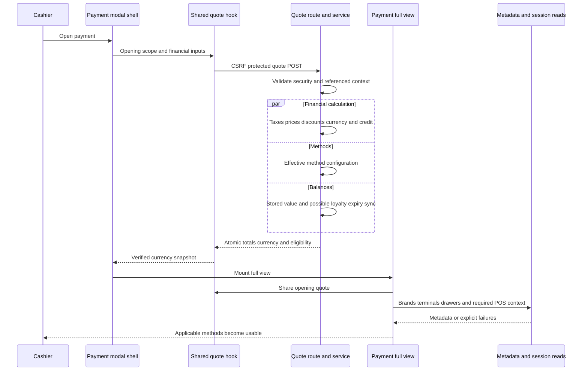
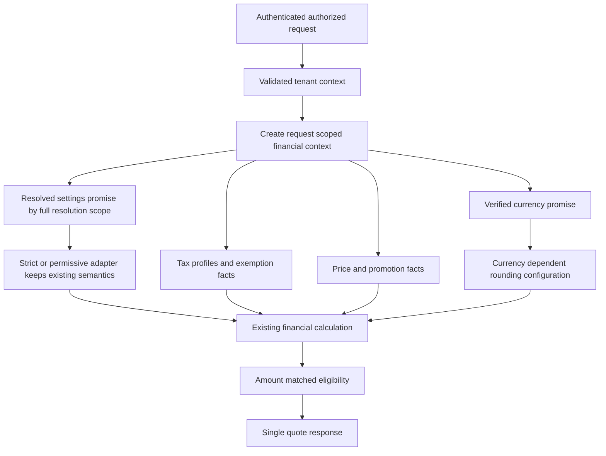
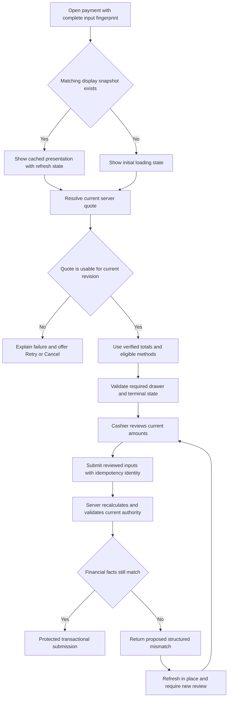
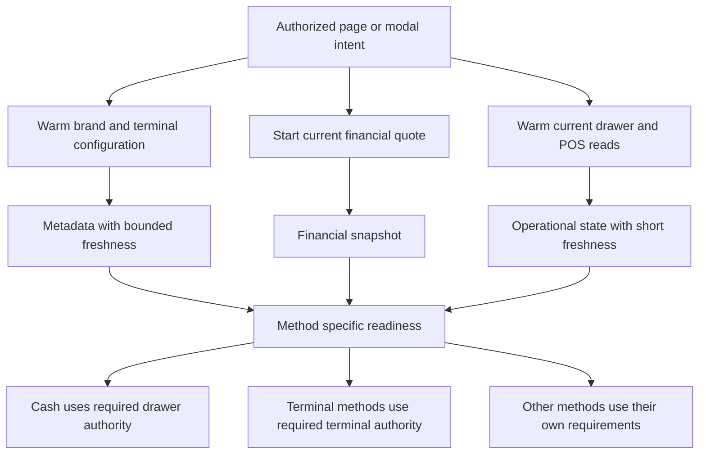

# Developer flow diagrams

Status: **documentation only**. The first diagram describes observed source structure. All subsequent diagrams are proposed and unimplemented. See [developer guide](developer_guide.md) and [financial contract](technical_docs/financial_snapshot_contract.md).

## Current source flow

## Proposed request-local reuse

The graph is an orchestration proposal, not an assertion that every fact can be loaded in one round trip. Request-local promise reuse does not require a shared Redis cache.

## Proposed display reuse and review

The proposed submit identity, server comparison, and in-place mismatch response need implementation across create/edit paths. A cache hit never skips those checks.

## Proposed independent metadata preparation

Warm operations remain scoped and authorized. Long-lived static catalog caching must not be applied to active drawer/POS session state.
