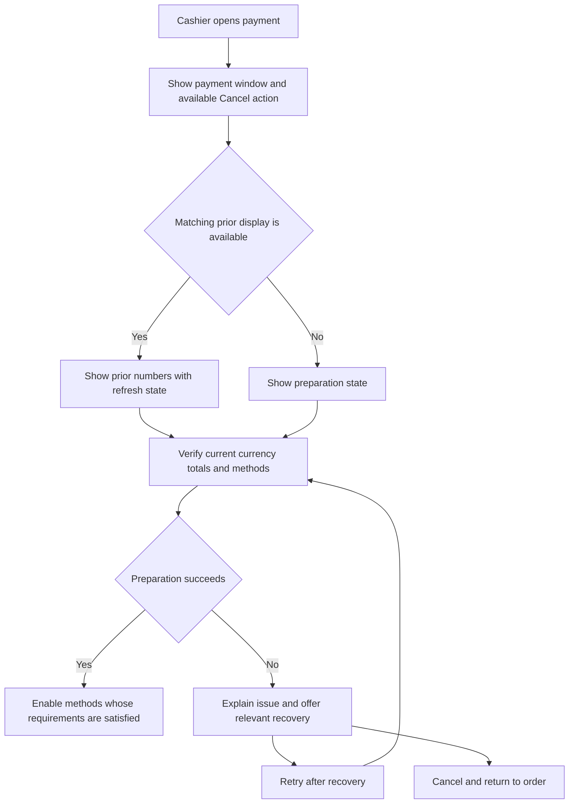
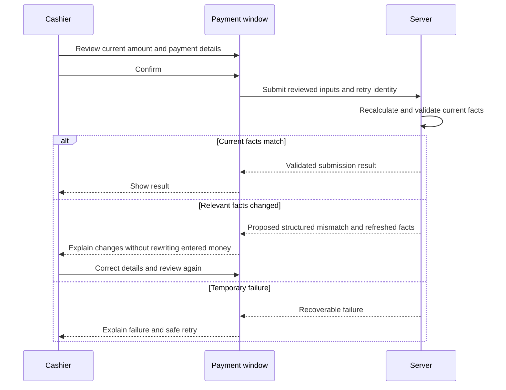
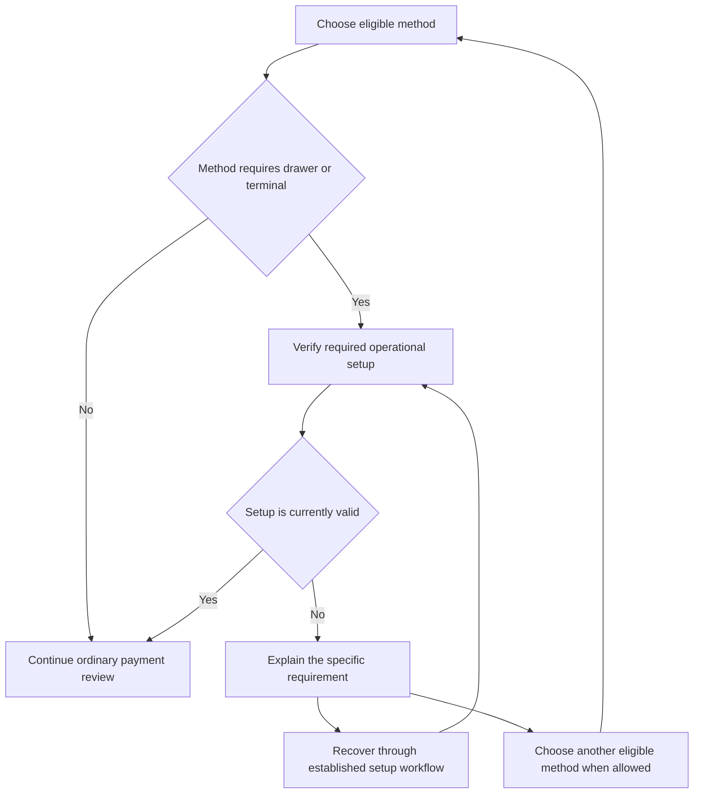

# Cashier flow diagrams

Status: **proposed cashier experience; implementation pending**. See [user guide](user_guide.md). Diagrams describe behavior, not final localized labels or a deployed screen contract.

## Open and prepare payment

Displaying prior numbers does not enable posting before current required checks succeed.

## Explicit review when facts change

The new mismatch and retry contract still requires implementation. Existing confirmation safeguards must be preserved during that work.

## Required operational setup

A stale cache, an optional event notification, or a loading placeholder never substitutes for the required operational checks.
