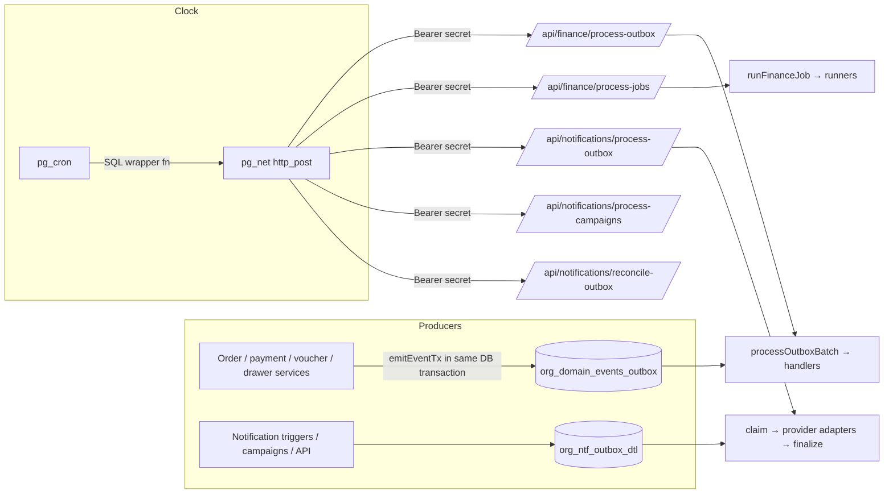
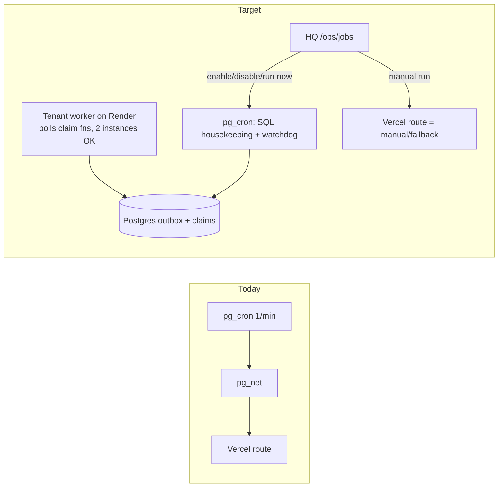

# Jobs, Events & Outboxes — Complete Reference, Findings & Redesign Options

**Scope:** every scheduled job, every domain/notification event, the outbox queues, the triggering mechanism, secrets/config, environments, observability, known problems, and architecture recommendations.
**Repo:** `cleanmatex` (tenant app, owns all migrations) · HQ console: `cleanmatexsaas` (`/ops/jobs`).
**Snapshot date:** 2026-10-16 · Data source: remote Supabase (read-only queries) + code + migrations.
**Status of this doc:** analysis / decision support. **Nothing in the system was changed to produce it.**

> **How to read this document**
> - §1 = the 2-minute summary. §2–§4 explain how things work. §5–§8 are the detailed catalogs (jobs, events, outboxes).
> - §9–§11 = config/secrets, environments, observability. §12 = **findings register**. §13–§15 = **recommendations, target architecture, and the decision matrix you fill in**.
> - Confidence tags: **[V]** verified in code/DB · **[I]** inferred from code reading, not run · **[?]** unknown / needs a check.

---

## Table of contents
1. [Executive summary](#1-executive-summary)
2. [Mental model: jobs vs events vs outboxes](#2-mental-model)
3. [End-to-end architecture](#3-end-to-end-architecture)
4. [Trigger mechanisms & how a job is invoked](#4-trigger-mechanisms)
5. [Job catalog (18 jobs)](#5-job-catalog)
6. [Finance job runner internals](#6-finance-job-runner-internals)
7. [Domain event outbox (finance/order events)](#7-domain-event-outbox)
8. [Notification outbox & campaigns](#8-notification-outbox--campaigns)
9. [Config, secrets & auth map](#9-config-secrets--auth-map)
10. [Environments (local / remote / production)](#10-environments)
11. [Observability & read-only SQL cookbook](#11-observability--sql-cookbook)
12. [Findings register](#12-findings-register)
13. [Recommendations & design principles](#13-recommendations)
14. [Target architecture options](#14-target-architecture-options)
15. [Per-job decision matrix (fill in)](#15-per-job-decision-matrix)
16. [Phased action plan](#16-phased-action-plan)
17. [Decision log](#17-decision-log)
18. [Appendix: sources, glossary](#18-appendix)

---

## 1. Executive summary

**What exists**
- **18 pg_cron jobs** on the remote database, all registered in `sys_ops_job_cf` (registry is complete — no hidden jobs). [V]
- **7 finance job codes** in code ↔ 7 `fin-*` cron jobs. [V]
- **1 domain-event outbox** (`org_domain_events_outbox`), drained by one job (`fin-outbox-processor`) through a handler registry. [V]
- **1 notification outbox** (`org_ntf_outbox_dtl`), drained by `ntf-outbox-processor` (+ retry, reconcile, campaigns). [V]
- **No** BullMQ / Vercel cron / deployed edge functions in the tenant app. `platform-workers` belongs to HQ (separate repo). [V]
- All jobs are created **by migrations only**; the HQ UI can enable/disable/reschedule/run-now but never edit SQL. [V]

**Where things stand today (remote, 2026-10-16)**

| Area | State |
|---|---|
| Registry vs live cron | Intended state = *enabled* for all 18; **6 are inactive** and **1 runs at the wrong schedule** (drift) |
| Finance outbox | **98 events PENDING** (95 due now), none processed since **2026-09-19**; job inactive since ~**2026-09-25** |
| Notification outbox | Healthy: 0 queued, 385 sent, 44 permanent failures, 1 stuck `FAILED_TEMPORARY` (since 2026-09-17) |
| Cron → app auth | Working (all remote calls 200) |
| Local DB cron | Posts every minute to the **production** URL → ~180 junk 401s/hour in Vercel logs |

**Top findings (full list in §12)**
1. Finance outbox inactive → backlog (cash-drawer, voucher, order events). *High*
2. Local database cron points at the production URL (401 flood, and a latent risk). *Medium*
3. Six payment-lifecycle events are emitted but **not routed** to the order-history handler → silently marked processed with no history. *Medium* [I]
4. `VOUCHER_REVERSED` is emitted with a raw string, absent from the event constants, with no handler. *Medium*
5. Two different secret/config mechanisms for the same job pattern (notifications: Vault + registry; finance: plain-text table + env var). *Medium*
6. `org_domain_events_outbox` has **no retention job** → unbounded growth. *Medium*
7. Cron→HTTP→Vercel function pattern has structural limits (timeouts, fire-and-forget, no alert on 401). *Design*

**My headline recommendation** (§13–§14): keep the Postgres outbox + claim pattern (it is correct), stop treating "cron → HTTP → Vercel" as the long-term runner for the two queue processors, and move those to a small always-on **tenant worker** (Render Background Worker polling the same claim functions — no Redis). Keep pg_cron for pure-SQL housekeeping. Unify secrets/config, make the registry the single source of truth, and add CI guards so events can't be emitted without a declared consumer.

---

## 2. Mental model

| Concept | What it is | Example |
|---|---|---|
| **Job** | A *schedule* (pg_cron) that fires on a clock | `fin-outbox-processor` every minute |
| **Event** | A *row* written when something happens in the business | `CASH_DRAWER_SESSION_CLOSED` |
| **Outbox** | The table events/messages wait in until a processor handles them | `org_domain_events_outbox`, `org_ntf_outbox_dtl` |
| **Processor** | Code that claims a batch of outbox rows and runs handlers | `processOutboxBatch()` |
| **Handler** | Code owning one event type's side effect | `cash-over-short.handler.ts` |
| **Sweep** | A job that finds due rows by *time rule* and acts | gift-card expiry, session sweep |

Rule of thumb: **events are data, jobs are clocks, processors turn data into effects.** A pending event does nothing until a job (or manual run) runs its processor.



---

## 3. End-to-end architecture

### 3.1 Flow A — finance/domain events
1. A write path (payment, voucher, drawer, order completion…) calls `emitEventTx(tx, …)` **inside its own DB transaction** → a `PENDING` row appears atomically with the business change (true transactional outbox). [V]
2. `fin-outbox-processor` (pg_cron) → `fin_trigger_outbox_proc()` → `pg_net` POST → `/api/finance/process-outbox`.
3. Route → `runFinanceJob('outbox_processor')` → `processOutboxBatch(50)`:
   - `claim_outbox_batch(50, now)` uses `SELECT … FOR UPDATE SKIP LOCKED` (safe with concurrent callers).
   - For each event: find handlers by `event_type`; none → mark **PROCESSED (skipped)**; handlers OK → **PROCESSED**; handler throws → **FAILED** with backoff, or **DEAD_LETTERED** after budget.

### 3.2 Flow B — scheduled finance sweeps
`fin-*` cron → `fin_trigger_job('<code>')` → POST `/api/finance/process-jobs` `{job: code}` → `runFinanceJob(code)` → runner loops **every active tenant** (expiry jobs) or runs one SQL (cleanup).

### 3.3 Flow C — notifications
Rows enter `org_ntf_outbox_dtl` as `QUEUED` → `ntf-outbox-processor` → POST `/api/notifications/process-outbox` → claim row (lease) → provider adapter (EMAIL/SMS/WHATSAPP/PUSH; IN_APP written directly) → finalize with attempt log. Retry / reconcile / campaign jobs support this.

### 3.4 Flow D — pure-SQL jobs
`auth-session-sweep`, `ntf-outbox-retry`, `ntf-quota-rsv-sweep`, `ntf-retention-sweep`, `cleanup-*`, `ops-job-run-capture` run **entirely inside Postgres** (no HTTP, no app, no secret).

---

## 4. Trigger mechanisms

| Mechanism | Used by | Notes |
|---|---|---|
| **pg_cron → SQL function** (pure SQL) | 8 jobs (§5, group D) | No network. Most robust. |
| **pg_cron → wrapper → `pg_net.http_post` → Next.js route** | 10 jobs (outbox processors, campaigns, reconcile, finance sweeps) | Fire-and-forget: pg_net records *request sent*, not *work finished*. Registry `completion_mode = ASYNC_HTTP`. |
| **Manual "Run now"** from HQ `/ops/jobs` | any registered job with `run_now_allowed` | Executes the stored cron command once. Disabled for data-deleting jobs. Logged as MANUAL. |
| **Finance manual API** `POST /api/v1/finance/jobs/[jobCode]/run` | 7 finance codes | Logged as `MANUAL` in `sys_fin_job_run_log`. UI: `/dashboard/internal_fin/outbox`. |
| **Inline (not a job)** | order-history, loyalty, etc. are *handlers* triggered by the processor | |

**Who creates a job:** a developer, in a migration, with `cron.schedule(...)`; the same migration must also seed `sys_ops_job_cf` (rule in `job_manager_guide.md`). Two housekeeping jobs (`cleanup-*`) were found live with **no migration** (see F-10).
**Who changes it at runtime:** an HQ admin with `hq_ops:manage_jobs` via `/ops/jobs` (enable/disable/schedule only).

---

## 5. Job catalog

Legend — **Live** = remote `cron.job` at snapshot; **Intended** = `sys_ops_job_cf` (all `desired_enabled = true`).

### 5.0 Overview (all 18)

| # | Job | Group | Mechanism | Intended schedule | Live schedule | Live state | Drift |
|---|---|---|---|---|---|---|---|
| 1 | `auth-session-sweep` | D Security | SQL | `*/5 * * * *` | same | active | — |
| 2 | `ntf-outbox-retry` | D Notif | SQL | `*/5 * * * *` | same | active | — |
| 3 | `ntf-quota-rsv-sweep` | D Notif | SQL | `*/5 * * * *` | same | active | — |
| 4 | `ntf-retention-sweep` | D Notif | SQL | `0 4 * * *` | same | active | — |
| 5 | `ntf-sweep-stale-push-subs` | D Notif | SQL | `0 3 * * 0` | same | **inactive** | STATE |
| 6 | `cleanup-cron-job-run-details` | D Housekeeping | SQL | `30 3 */14 * *` | same | active | no migration |
| 7 | `cleanup-net-http-response` | D Housekeeping | SQL | `0 3 */14 * *` | same | active | no migration |
| 8 | `ops-job-run-capture` | D Ops | SQL | `*/5 * * * *` | same | active | — |
| 9 | `ntf-outbox-processor` | A Queue | HTTP | `* * * * *` | `*/30 * * * *` | active | **SCHEDULE** |
| 10 | `ntf-campaign-scheduler` | A Queue | HTTP | `* * * * *` | `*/30 * * * *` | **inactive** | STATE+SCHEDULE |
| 11 | `ntf-reconcile-outbox` | A Queue | HTTP | `*/5 * * * *` | same | active | — |
| 12 | `fin-outbox-processor` | A Queue | HTTP | `* * * * *` | `*/30 * * * *` | **inactive** | STATE+SCHEDULE |
| 13 | `fin-pos-session-rollover` | B Finance sweep | HTTP | `*/15 * * * *` | same | active | — |
| 14 | `fin-credit-note-expiry` | B Finance sweep | HTTP | `5 2 * * *` | same | active | — |
| 15 | `fin-loyalty-points-expiry` | B Finance sweep | HTTP | `10 2 * * *` | same | active | — |
| 16 | `fin-gift-card-expiry` | B Finance sweep | HTTP | `0 2 * * *` | same | **inactive** | STATE |
| 17 | `fin-idempotency-cleanup` | B Finance sweep | HTTP | `0 3 * * *` | same | **inactive** | STATE |
| 18 | `fin-erp-posting-retry` | B Finance sweep | HTTP | `15 * * * *` | same | **inactive** | STATE |

Cron times are **UTC**. Dubai = UTC+4 (e.g., `0 2 * * *` fires 06:00 Dubai).

### 5.1 Group A — queue processors (HTTP)

#### `ntf-outbox-processor`
- **Does:** dispatches `QUEUED` notifications (EMAIL, SMS, WHATSAPP, PUSH) to providers; IN_APP is written directly elsewhere. Batch 50 + retry batch 25 per call.
- **Chain:** cron → `ntf_trigger_outbox_proc()` → `fn_ntf_cron_post('/api/notifications/process-outbox')` (Vault secret, registry base URL) → route.
- **Reads/writes:** `org_ntf_outbox_dtl` (claim, finalize), `org_ntf_delivery_log_dtl` (immutable attempt log), campaign target sync.
- **Safety:** per-row claim token + **5-minute lease**; `ACCEPTANCE_UNCERTAIN` reconcile state when a provider call's outcome is unknown (never auto-retried → avoids duplicate sends). Retry delays 5/15/60/240/720 min. [V]
- **Created by:** migrations 0350, 0355, 0616 (wrapper). **Run history (durable log):** 279 successes. [V]
- **Why every minute:** notification latency. At `*/30` a message can wait up to 30 min (currently harmless: queue empty).

#### `ntf-campaign-scheduler`
- **Does:** Phase A activates due `APPROVED/SCHEDULED` campaigns → `RUNNING` and creates targets (10 per run). Phase B processes `PENDING` targets (50 per running campaign per run): consent check → enqueue outbox or skip → complete campaign.
- **Chain:** `ntf_trigger_campaign_proc()` → `/api/notifications/process-campaigns`. Created by 0362.
- **Needs a clock** because tenants schedule campaigns for a future time.
- **State:** inactive on remote → scheduled campaigns will **never start**. [V]

#### `ntf-reconcile-outbox`
- **Does:** resolves rows stuck in `ACCEPTANCE_UNCERTAIN` or with expired claim lease; never dispatches itself. Per-tenant, isolated failures.
- **History:** 1,388 FAILED runs until 2026-10-15 02:25 (before migration 0616 fixed the NULL-GUC bug), SUCCESS since. [V]

#### `fin-outbox-processor`
- **Does:** drains `org_domain_events_outbox` (see §7). Wrapper `fin_trigger_outbox_proc()` reads `sys_fin_runtime_cf`.
- **History (run log):** 101 SUCCESS and 38 scheduled FAILED (last failure 2026-09-17), 3 manual FAILED; **last run 2026-09-25 06:30**. Cause of the historical failures: **[?] not investigated**.
- **State:** inactive → backlog (§7.5).

### 5.2 Group B — finance sweeps (HTTP → `/api/finance/process-jobs`)

All wrapped by `runFinanceJob()` (§6): single-flight lock, run log, per-tenant isolation.

| Job code | What it does | Scope | Money-sensitive? | UI |
|---|---|---|---|---|
| `gift_card_expiry` | expires gift cards past expiry via ledger + GL (`expireGiftCards`) | every active tenant | **Yes** (customer balance) | `/dashboard/marketing/gift-cards` |
| `credit_note_expiry` | expires credit notes via ledger-aware `expireCreditNotes` (replaced an old raw-SQL cron) | every active tenant | **Yes** | `/dashboard/customers/stored-value` |
| `loyalty_points_expiry` | catch-up FIFO expiry of loyalty points (live balance already synced on checkout/read) | every active tenant | **Yes** (points) | `/dashboard/marketing/loyalty` |
| `idempotency_cleanup` | deletes expired `org_idempotency_keys` via `cleanup_expired_idempotency_keys()` | cross-tenant single SQL | No | — |
| `erp_posting_retry` | retries `SYSTEM_ERROR` posting exceptions (last 24 h window) through the ERP-Lite posting engine; marks exception `RETRIED` | per exception | **Yes** (GL posting) | `/dashboard/erp-lite/exceptions` |
| `pos_session_rollover` | pauses/force-closes POS sessions past branch local midnight; flags sessions open too long (mig 0558) | branches | **Yes** (cash custody) | `/dashboard/internal_fin/pos-sessions` |
| `outbox_processor` | see §5.1 | — | **Yes** | `/dashboard/internal_fin/outbox` |

Observed run history (`sys_fin_job_run_log`, last 30 days): `pos_session_rollover` 1,211 SUCCESS (still running); `credit_note_expiry` 29, `loyalty_points_expiry` 28 SUCCESS (running); `gift_card_expiry`, `idempotency_cleanup`, `erp_posting_retry`, `outbox_processor` **stopped between 2026-09-24 and 09-25** — consistent with someone disabling them at that time. [V]

Deliberately **not** implemented (comment in code): wallet expiry (no policy surface), pending-payment aging.

### 5.3 Group D — pure-SQL jobs

| Job | Does | Notes |
|---|---|---|
| `auth-session-sweep` | `fn_auth_sessions_sweep(180)` ends expired sessions | security; 2,150 successful captured runs |
| `ntf-outbox-retry` | `UPDATE … SET status='QUEUED' WHERE status='FAILED_TEMPORARY' AND next_retry_at<=now() AND retry_count<max_retries` | rows with `retry_count>=max_retries` stay `FAILED_TEMPORARY` forever (F-09) |
| `ntf-quota-rsv-sweep` | `fn_ntf_quota_rsv_sweep(30)` expires unsettled quota reservations, purges settled >30 d | |
| `ntf-retention-sweep` | `fn_ntf_retention_run()` purges terminal notification rows beyond retention (registry key `ntf.retention.days`, default 180, allowed 30–3650, mig 0629) | |
| `ntf-sweep-stale-push-subs` | weekly: deactivate push subscriptions with repeated failures / unverified 90+ d | inactive |
| `cleanup-cron-job-run-details` | `TRUNCATE cron.job_run_details` every 14 d | history preserved by `ops-job-run-capture` |
| `cleanup-net-http-response` | `TRUNCATE net._http_response` every 14 d | also wipes the only record of HTTP statuses (see F-11) |
| `ops-job-run-capture` | copies finished runs into `sys_ops_job_run_dtl` (90-day log) | feeds the Jobs screen |

---

## 6. Finance job runner internals

`runFinanceJob({jobCode, triggerSource, triggeredBy})` [V]
1. **Release stale locks:** a `RUNNING` row older than **15 min** is released.
2. **Single-flight:** if a run is already `RUNNING` for the code → returns `skippedBecauseRunning` (HTTP 200, not an error).
3. Inserts `sys_fin_job_run_log` `RUNNING` → runs the runner → `SUCCESS` / `FAILED` with `processedCount` / `failedCount`.
4. Idle every-minute `outbox_processor` SUCCESS rows older than **36 h** are pruned.
5. Manual API: `POST /api/v1/finance/jobs/[jobCode]/run`; list: `GET /api/v1/finance/jobs`; history: `…/runs`.

Per-tenant sweeps never let one tenant's failure block others (try/catch per tenant, `failedCount++`).

---

## 7. Domain event outbox

### 7.1 Table `org_domain_events_outbox` [V]
`id, tenant_org_id, event_type, aggregate_type, aggregate_id, payload (jsonb), status, attempts, max_attempts (6), next_retry_at, processed_at, error_message, created_at`

### 7.2 Status machine
```
PENDING ──claim──▶ PROCESSING ──handlers OK / no handler──▶ PROCESSED
                         └──throws──▶ FAILED (retry) ──budget exhausted──▶ DEAD_LETTERED
FAILED / DEAD_LETTERED ──manual retry (ops, ≤50 bulk)──▶ PENDING
```
Retry back-off (minutes): **1 → 5 → 15 → 60 → 240 → dead-letter**. Error text capped at 2,000 chars. Ops UI: `/dashboard/internal_fin/outbox`.

### 7.3 Handler registry (`outbox-processor.service.ts`) [V]

| Handler | Event types it owns | Effect | Idempotent? |
|---|---|---|---|
| `order-history` | `ORDER_COMPLETED`, `VOUCHER_POSTED_AND_WIRED`, `AR_INVOICE_ISSUED`, `PAYMENT_VERIFIED` | upsert `org_order_history` (unique `(tenant_org_id, outbox_event_id)`, mig 0330) | **Yes** [V] |
| `loyalty-earn` | `LOYALTY_EARN` | earns loyalty points | [?] |
| `cash-over-short` | `CASH_DRAWER_OVER_SHORT` | posts `ADJUSTMENT_VOUCHER` / `CASH_OVER_SHORT` voucher | [?] **verify** — it posts money |
| `order-change-applied` | `ORDER_CHANGE_APPLIED` | confirms the Change row exists (no settlement) | [?] |

**No handler → event is marked PROCESSED immediately** (by design: "nothing was supposed to consume it").

### 7.4 Event catalog (all event types)

Constants live in `lib/constants/order-financial.ts` (`OUTBOX_EVENT_TYPES`). "Routed" = included in a handler's `eventTypes` set.

| Event type | Meaning | Consumer today | Routed? | Note |
|---|---|---|---|---|
| `ORDER_COMPLETED` | order finished | order-history | ✅ | |
| `VOUCHER_POSTED_AND_WIRED` | BVM voucher posted + lines wired atomically | order-history | ✅ | |
| `AR_INVOICE_ISSUED` | AR invoice issued | order-history | ✅ | |
| `PAYMENT_VERIFIED` | pending payment verified → completed | order-history | ✅ | |
| `PAYMENT_CANCELLED` | back-office cancel of pending leg | **consumer supports it** | ❌ **not routed** | F-03 |
| `PAYMENT_FAILED` | bounce/reject | consumer supports it | ❌ **not routed** | F-03 |
| `PAYMENT_VOIDED` | never-effective tender cancelled | consumer supports it | ❌ **not routed** | F-03 |
| `PAYMENT_REVERSED` | error-correction negation | consumer supports it | ❌ **not routed** | F-03 |
| `PAYMENT_CAPTURED` | gateway leg captured | consumer supports it | ❌ **not routed** | F-03 |
| `PAYMENT_SETTLED` | gateway funds settled | consumer supports it | ❌ **not routed** | F-03 |
| `LOYALTY_EARN` | earn points | loyalty-earn | ✅ | |
| `CASH_DRAWER_OVER_SHORT` | opening/closing variance outside tolerance | cash-over-short | ✅ | financial posting |
| `ORDER_CHANGE_APPLIED` | commercial Change applied | order-change-applied | ✅ | |
| `PAYMENT_RECEIVED` | payment received | — | ❌ | future GL (B6) |
| `REFUND_PROCESSED` | refund processed | — | ❌ | future GL |
| `ORDER_FINANCIAL_ADJUSTMENT_CREATED` | adjustment created | — | ❌ | |
| `STORED_VALUE_CHANGED` | redemption/debit | — | ❌ | |
| `STORED_VALUE_FUNDING_COMPLETED` | gift card sale / top-up / advance credited | — | ❌ | future GL liability |
| `GIFT_CARD_REDEEMED` | gift card used | — | ❌ | |
| `AR_PAYMENT_ALLOCATED`, `AR_PAYMENT_ALLOCATION_REVERSED`, `AR_OVERPAYMENT_CREDIT_CREATED`, `AR_CREDIT_MEMO_POSTED`, `AR_DEBIT_NOTE_POSTED`, `AR_WRITE_OFF_POSTED`, `AR_INVOICE_VOIDED` | AR lifecycle | — | ❌ | audit only today |
| `ORDER_CANCEL_FINANCIAL_UNWIND` | historical (cancel no longer emits) | ignored by design | ❌ | kept for old rows |
| `CASH_FACT_REDIRECTED` | cash line attached to a different drawer session than hinted | — | ❌ | audit only |
| `CASH_DRAWER_SESSION_OPENED` / `_CLOSING` / `_CLOSED` | drawer lifecycle | — | ❌ | "Notification Hub, future" |
| `CASH_DRAWER_TRX_POSTED` | custody transaction posted | — | ❌ | "Notification Hub, future" |
| `VOUCHER_REVERSED` | voucher line reversal | — | ❌ | **not in constants** — emitted as raw string in `voucher-line-reversal.service.ts:401` (F-04) |

> `ORDER_COMPLETED`, `AR_INVOICE_ISSUED` etc. appear many times in code because they are referenced by emitters, the consumer, tests and constants — the count is *not* the number of emit sites.

### 7.5 Backlog snapshot (remote, 2026-10-16) [V]

| Status | Rows |
|---|---|
| PENDING | **98** (95 due now) — all on 2 demo tenants, `attempts = 0`, no errors |
| PROCESSED | 47 (last 2026-09-19) |
| DEAD_LETTERED | 22 (May; all `fk_history_order` violation in `org_order_history.upsert`) |

Pending breakdown: `CASH_DRAWER_TRX_POSTED` 26 · `…SESSION_OPENED` 18 · `…SESSION_CLOSING` 15 · `…SESSION_CLOSED` 13 · `VOUCHER_POSTED_AND_WIRED` 11 · `CASH_DRAWER_OVER_SHORT` 9 · `ORDER_COMPLETED` 5 · `VOUCHER_REVERSED` 1.
Effect if processed: **73** no-handler (skipped), **16** order-history rows, **9** over/short vouchers (real financial posting).

---

## 8. Notification outbox & campaigns

### 8.1 `org_ntf_outbox_dtl` lifecycle [V]
`QUEUED → PROCESSING (claim_token, claimed_by, lease_expires_at 5 min) → SENT | FAILED_TEMPORARY | FAILED_PERMANENT | SKIPPED`
- `FAILED_TEMPORARY` → back to `QUEUED` by `ntf-outbox-retry` while `retry_count < max_retries` and `next_retry_at ≤ now`.
- `reconcile_state = 'ACCEPTANCE_UNCERTAIN'` holds a row the processor could not confirm; `ntf-reconcile-outbox` resolves it. These are **excluded from automatic retry** to prevent double-sending.
- Every attempt appends an immutable row to `org_ntf_delivery_log_dtl`.
- Webhooks (e.g., Resend) update delivery state asynchronously.
- IN_APP bypasses the outbox (written to the inbox directly).

### 8.2 Snapshot [V]
SENT 385 · FAILED_PERMANENT 44 · FAILED_TEMPORARY 1 (since 2026-09-17) · QUEUED 0.

### 8.3 Related components
Quota reservation ledger (mig 0623) + sweep; retention (180 d default via registry); campaign segments → `org_ntf_*` targets; HQ transport (platform-api/platform-workers) is a **separate** dispatch path for platform-provider sends.

---

## 9. Config, secrets & auth map

The same "cron calls the app" pattern is implemented **twice with different plumbing**:

| | Notification jobs | Finance jobs |
|---|---|---|
| Base URL source | Registry key `ntf.app.base_url` (legacy table fallback) | `sys_fin_runtime_cf.base_url` (plain table) |
| Secret stored in DB | **Supabase Vault** `ntf_outbox_secret` (mig 0616; rotation fn `fn_ntf_rotate_outbox_secret`) | `sys_fin_runtime_cf.outbox_secret_key` **plain text** |
| Secret expected by app | Registry `ntf.app.outbox_secret` (ENV `NOTIFICATIONS_OUTBOX_SECRET` wins under policy) | **Env `FINANCE_OUTBOX_SECRET` only** |
| App check | constant-time compare (`outbox-auth.ts`) | plain string `===` |
| Dispatcher | `fn_ntf_cron_post(path)` (SECURITY DEFINER, revoked from API roles) | `fin_trigger_outbox_proc()` / `fin_trigger_job(code)` |
| Missing config | warning + skip | warning + skip |

Notes: both fail **closed** (401 / skip). The migration 0616 header states the original notification secret is "burned" (committed in 0355) and must be rotated; finance has no equivalent rotation function. (F-05, F-06)

---

## 10. Environments

| Env | DB | Cron base URL | Result |
|---|---|---|---|
| **Remote / production** | `ndjjycdgtponhosvztdg` | production URL | Correct: legit calls return 200 (reconcile every 5 min, notification processor every 30 min) |
| **Local dev** | local Supabase (54322) | **`https://cmx.cleanmatex.com` (production)** | Every-minute jobs POST to production with a *local* secret → **401** (~180/h; observed 197 in one hour) |

Local jobs active: all `ntf-*`, `fin-*`, `auth-session-sweep`, `ops-job-run-capture`. Fix: point local `ntf.app.base_url` at the local app (`http://host.docker.internal:3000`) or deactivate the HTTP jobs locally (statements provided in chat; see F-01).

---

## 11. Observability & SQL cookbook

**Where to look**
| Need | Place |
|---|---|
| Job list, drift, last run, enable/disable | HQ `/ops/jobs` |
| Durable run history (90 d) | `sys_ops_job_run_dtl` |
| Finance job runs | `sys_fin_job_run_log`, UI `/dashboard/internal_fin/outbox` |
| HTTP status of cron calls | `net._http_response` (wiped every 14 d) and Vercel → Logs (filter `pg_net`) |
| Domain event queue | `org_domain_events_outbox` |
| Notification queue/attempts | `org_ntf_outbox_dtl`, `org_ntf_delivery_log_dtl` |

**Read-only queries** (run on remote)
```sql
-- 1. Live cron vs registry (drift)
select j.job_code, j.default_schedule, c.schedule live_schedule, j.desired_enabled, c.active live_active
from sys_ops_job_cf j left join cron.job c on c.jobname = j.cron_job_name
where j.rec_status = 1 order by 1;

-- 2. Domain outbox health
select status, count(*), min(created_at) oldest, count(*) filter (where next_retry_at <= now()) due_now
from org_domain_events_outbox group by status;

-- 3. Notification outbox health
select status, reconcile_state, count(*), min(created_at) from org_ntf_outbox_dtl group by 1,2;

-- 4. Last result per job
select job_code, status, count(*), max(started_at) from sys_ops_job_run_dtl group by 1,2 order by 1,2;

-- 5. Recent cron HTTP statuses
select status_code, count(*), max(created) from net._http_response
where created > now() - interval '2 hours' group by 1;
```

**Gap:** nothing alerts when (a) a job is disabled/drifts, (b) cron calls return 401, (c) the pending event age exceeds a threshold. The 401 flood was noticed by chance. (F-11)

---

## 12. Findings register

Severity: **H** high · **M** medium · **L** low · **D** design. Confidence tags as in the header.

| ID | Sev | Finding | Evidence | Impact | Recommended action |
|---|---|---|---|---|---|
| F-01 | M | Local DB cron posts to **production** URL every minute | local `ntf.app.base_url` = prod; 197 × 401/h | log noise, hides real alerts, looks like probing; cross-environment risk if secrets ever matched | Point local at local / deactivate local HTTP jobs; guard: refuse non-local URL when `current_database()` is local [V] |
| F-02 | H | `fin-outbox-processor` (and 5 other jobs) inactive; registry still says enabled | cron.job active=false; run log stops 2026-09-25; 98 PENDING | finance events not processed (history rows, over/short vouchers); scheduled campaigns never start; gift-card expiry off | Decide each job (§15), then set `desired_enabled` to match reality; activate the outbox processor [V] |
| F-03 | M | Six payment lifecycle events (`PAYMENT_CANCELLED/FAILED/VOIDED/REVERSED/CAPTURED/SETTLED`) are emitted and the history consumer supports them, but the processor's `order-history` handler set contains only 4 types → they are **marked PROCESSED with no history row** | `outbox-processor.service.ts:29` vs `order-history-consumer.service.ts:82-93` | order timeline silently misses payment lifecycle entries | Add the six types to the handler set + a test that every consumer-supported type is routed [I — confirm by emitting one in a test] |
| F-04 | M | `VOUCHER_REVERSED` emitted as a raw string literal; not in `OUTBOX_EVENT_TYPES`; no handler | `voucher-line-reversal.service.ts:401` | violates DB-mirror/constants rule (CRITICAL RULE #12); typo-prone; no consumer | Add to constants; declare consumer or "audit-only" [V] |
| F-05 | M | Finance cron secret stored **plain-text** in `sys_fin_runtime_cf` and compared with `===` against env; notifications use Vault + constant-time compare | §9 | weaker secret handling; no rotation function | Move finance onto the Vault/registry mechanism (same dispatcher) [V] |
| F-06 | D | Two parallel config mechanisms for URL/secret (registry vs `sys_*_runtime_cf`) | §9 | drift, double maintenance, confusing failures | Single dispatcher + single registry keys for all HTTP jobs |
| F-07 | L | Production `ntf-outbox-processor` at `*/30` vs designed `* * * * *` | cron.job | up to 30 min delivery latency (queue empty now) | `* * * * *`, or move to worker (§14) |
| F-08 | D | Handler failures that can never succeed (e.g., FK `fk_history_order` when the order no longer exists) are **retried 6 times then dead-lettered** | 22 DEAD_LETTERED rows (May) | noise, wasted retries, dead-letter queue polluted | Classify errors: *permanent/unlinked* → mark `PROCESSED (skipped)` with reason, not retry |
| F-09 | L | `FAILED_TEMPORARY` notification row stuck since 2026-09-17: retry job requires `retry_count < max_retries`, so exhausted rows never move | 1 row; retry SQL | permanently ambiguous state | Add terminal transition (`FAILED_PERMANENT` after max retries) [I] |
| F-10 | L | `cleanup-*` jobs exist live with **no migration** | registry notes | not reproducible in a fresh environment | Add a migration that (re)creates them idempotently |
| F-11 | D | HTTP-trigger pattern is fire-and-forget: success = request handed to pg_net; no end-to-end alert; response table truncated every 14 d | `completion_mode = ASYNC_HTTP` | silent failures (401, timeouts) go unseen | Alerting rules (§13-R7) or move processors to a worker (§14) |
| F-12 | L | `org_domain_events_outbox` has **no retention job** (cron inventory has none) | §5 list | unbounded growth; audit-only events accumulate | Purge/archive `PROCESSED` beyond N days |
| F-13 | ? | Historical `outbox_processor` FAILED runs (38 scheduled, 3 manual, until 2026-09-17) — root cause not investigated | run log | possible latent bug | Read `sys_fin_job_run_log.error_message` for those rows |
| F-14 | ? | Idempotency of `cash-over-short`, `loyalty-earn`, `order-change-applied` handlers unverified; `markProcessed` runs *after* handlers → a crash between them replays the handler | code | duplicate vouchers/points on replay | Audit each handler for an idempotency key; add tests |
| F-15 | ? | `claim_outbox_batch` is global FIFO across tenants | §3.1 | one noisy tenant can starve others | Verify; consider per-tenant fair claiming |
| F-16 | D | Expiry jobs act on every active tenant; per-tenant opt-out/policy visibility not seen in runners | `finance-jobs.service.ts` | can't pause expiry for one tenant; policy lives deeper in services | Review `expire*` services; consider a tenant setting |
| F-17 | L | `ops` registry `desired_enabled` is `true` for all jobs while 6 are intentionally/accidentally off | §5 | drift badges never clear; can't tell intent from accident | Record decisions in the registry (§15) |

---

## 13. Recommendations

### Design principles I recommend
1. **Keep the transactional outbox + `SKIP LOCKED` claim.** It is the right pattern: atomic with business writes, no Redis dependency, idempotent replay. Do **not** move tenant events to BullMQ (loses atomicity).
2. **Separate three kinds of work** and give each the right runner:
   - *Pure-SQL housekeeping* → **pg_cron only** (no HTTP).
   - *Queue processors* (domain outbox, notification outbox, campaigns, reconcile) → an **always-on worker** (§14), cron kept only as a safety-net trigger.
   - *Business sweeps with money effects* (expiry, ERP retry, session rollover) → keep scheduled, but put **policy and visibility** in front of them (tenant setting, dry-run, run history on a screen).
3. **One mechanism for cron → app auth and config** (Vault + registry), retire `sys_fin_runtime_cf` plain-text secrets.
4. **Registry is the single source of truth.** `desired_enabled`, schedule and an `owner/decision` note must always reflect intent; a CI check fails any migration that schedules a job without seeding `sys_ops_job_cf`.
5. **Events must declare their consumer.** Every `OUTBOX_EVENT_TYPES` entry is either routed to a handler or listed in an explicit `AUDIT_ONLY_EVENTS` set; a unit test enforces it (would have caught F-03/F-04).
6. **Classify failures** (transient / permanent / not-applicable) in every handler so dead-letter means "needs a human", nothing else.
7. **Alert on the things that actually hurt** (see below).
8. **Environment safety:** local/dev databases must never be able to call production (hard guard in the dispatcher function + default local base URL).

- My recommendation, in short:

Keep the Postgres outbox (Redis isn't needed).
Harden what exists now: activate the finance processor, fix the payment-event routing, add retention, and set the registry to match your decisions.
Move the four queue processors to a small always-on tenant worker on Render. This removes the Vercel timeout limits and the blind spot where cron only knows a request was sent, not that the work finished.
Keep pg_cron for the pure-SQL housekeeping jobs.
Make expiry of gift cards, credit notes and loyalty points a tenant policy, because it touches customer money.


### R-list (actionable)
| ID | Recommendation | Closes |
|---|---|---|
| R1 | Activate/decide the six inactive jobs; set registry `desired_enabled` accordingly | F-02, F-17 |
| R2 | Add the six payment events to the order-history handler set + routing test | F-03 |
| R3 | Add `VOUCHER_REVERSED` to constants; add `AUDIT_ONLY_EVENTS` + CI test | F-04 |
| R4 | Error classification in outbox processor (permanent/unlinked → skipped) | F-08 |
| R5 | Retention job for `org_domain_events_outbox` (e.g., PROCESSED > 90 d; DEAD_LETTERED kept until reviewed) | F-12 |
| R6 | Migrate finance cron auth/config to the Vault+registry dispatcher | F-05, F-06 |
| R7 | Alerts in Ops Console: job drift, cron 401 rate, oldest-pending age, DEAD_LETTERED > 0, no run in 2× schedule | F-11 |
| R8 | Local environment guard + point local base URL at local | F-01 |
| R9 | Terminal transition for exhausted `FAILED_TEMPORARY` | F-09 |
| R10 | Migration to codify the two `cleanup-*` jobs | F-10 |
| R11 | Handler idempotency audit + tests (voucher, loyalty, order-change) | F-14 |
| R12 | Investigate historical `outbox_processor` failures | F-13 |
| R13 | Decide tenant-level policy for expiry jobs (auto / manual-approve / off) | F-16 |

---

## 14. Target architecture options

| | **Option A — Harden current** | **Option B — Worker for processors (recommended)** | **Option C — Everything event-driven** |
|---|---|---|---|
| Idea | Keep cron→pg_net→Vercel; fix findings R1–R13 | Add a small Node worker (Render Background Worker, same region as the app) that loops calling the same claim functions/services; keep cron for SQL jobs and as a watchdog | DB triggers/NOTIFY or Supabase DB webhooks invoke processors on insert; cron only as safety net |
| Latency | ≤ 1 min (with `* * * * *`) | seconds (poll 1–5 s) | near-instant |
| Vercel limits (timeouts, cold starts, per-minute invocations) | **still apply** | removed | partly (still HTTP) |
| Secrets in DB / pg_net | still needed | **not needed** for processors | needed |
| Observability | indirect (Vercel logs + pg_net) | direct (worker logs, queue-depth heartbeat, health) | indirect |
| Redis needed? | no | **no** (poll Postgres claims) | no |
| Effort | small | medium | medium–large; storm/ordering risks |
| Risk | low | low–medium (new deployable) | higher (debounce, ordering, retries) |

**My recommendation:** do **A now** (it closes the correctness findings and costs little), then **B** for `fin-outbox-processor`, `ntf-outbox-processor`, `ntf-campaign-scheduler`, `ntf-reconcile-outbox`. Keep `pg_cron` for Group D (pure SQL) and for the low-frequency finance sweeps. Skip C unless sub-second latency becomes a requirement.

**Why B, concretely**
- Removes the Hobby/function time limit on provider-call batches and the pg_net fire-and-forget blind spot.
- One deployable with the same shape as HQ `platform-workers` (known Render setup), but **separate** from it (tenant vs platform boundary).
- Reuses existing service code (`processOutboxBatch`, notification processor logic) — the worker is a thin loop, not a rewrite. The HTTP routes stay as the manual/"run now" path and as a fallback.
- Keeps the claim/lease/SKIP LOCKED safety, so running 2 worker instances is safe.

**Worker guardrails** (mirror the HQ worker rules): idempotent handlers, graceful shutdown, structured logs without secrets, queue-depth heartbeat, no business logic in the loop, explicit `tenant_org_id` on every `org_*` query (CLAUDE.md Rule #4).



---

## 15. Per-job decision matrix

**How to use:** for each job, pick a disposition, write the decision and date. Options:
**KEEP-CRON** · **KEEP-CRON+HARDEN** · **MOVE-TO-WORKER** · **USER-TRIGGERED** (button/screen, no schedule) · **POLICY-DRIVEN** (cron + tenant setting) · **EVENT-DRIVEN** · **DISABLE** · **REMOVE**.

| Job | Why it exists | My recommendation | Alternatives to consider | **Your decision** | Date / notes |
|---|---|---|---|---|---|
| `auth-session-sweep` | ends expired sessions (security) | KEEP-CRON (pure SQL) | — | | |
| `ntf-outbox-retry` | re-queue temporary failures | KEEP-CRON + terminal-state fix (R9) | fold into the processor | | |
| `ntf-quota-rsv-sweep` | expire unsettled reservations | KEEP-CRON | — | | |
| `ntf-retention-sweep` | purge old notification rows | KEEP-CRON | — | | |
| `ntf-sweep-stale-push-subs` | deactivate dead push subscriptions | KEEP-CRON **enable**, or fold into retention sweep | USER-TRIGGERED (HQ) | | |
| `cleanup-cron-job-run-details` | truncate pg_cron history | KEEP-CRON + codify migration (R10) | — | | |
| `cleanup-net-http-response` | truncate pg_net history | KEEP-CRON; consider keeping 14 d of 401s for alerting before truncating | — | | |
| `ops-job-run-capture` | durable run history | KEEP-CRON | — | | |
| `ntf-outbox-processor` | send queued notifications | **MOVE-TO-WORKER** (until then `* * * * *`) | KEEP-CRON+HARDEN | | |
| `ntf-campaign-scheduler` | start/dispatch scheduled campaigns | **MOVE-TO-WORKER**; enable only if campaigns are used | KEEP-CRON | | |
| `ntf-reconcile-outbox` | resolve uncertain/lease-expired rows | MOVE-TO-WORKER (or keep `*/5`) | KEEP-CRON | | |
| `fin-outbox-processor` | drain domain events | **Activate now** (R1), then MOVE-TO-WORKER | `*/5` interim | | |
| `fin-pos-session-rollover` | midnight rollover, stale sessions | KEEP-CRON `*/15` (clock-dependent, 1,200+ clean runs) | MOVE-TO-WORKER later | | |
| `fin-gift-card-expiry` | expire gift cards | **POLICY-DRIVEN**: cron + per-tenant setting (auto / off) + dry-run report | USER-TRIGGERED with preview; DISABLE | | |
| `fin-credit-note-expiry` | expire credit notes | **POLICY-DRIVEN** (same) | USER-TRIGGERED | | |
| `fin-loyalty-points-expiry` | catch-up loyalty expiry | POLICY-DRIVEN; live balance already syncs on read, so the sweep is a catch-up only | USER-TRIGGERED / DISABLE | | |
| `fin-idempotency-cleanup` | purge expired keys | KEEP-CRON (pure SQL; could be moved to SQL-only without HTTP) | — | | |
| `fin-erp-posting-retry` | retry failed ERP postings | **KEEP-CRON + USER-TRIGGERED retry button** (exceptions screen already exists); disable if ERP-Lite posting is not live | DISABLE | | |

**Event decisions to make (not jobs)**

| Question | My recommendation | **Your decision** |
|---|---|---|
| Route the 6 payment lifecycle events to order-history? | **Yes** (R2) | |
| `CASH_DRAWER_*` (session/trx) — keep emitting as audit-only? Or drive notifications? | Declare `AUDIT_ONLY` now; connect to Notification Hub when built | |
| `AR_*`, `PAYMENT_RECEIVED`, `REFUND_PROCESSED`, stored-value events — keep emitting? | Keep (cheap, future GL), declare `AUDIT_ONLY`, add retention | |
| `VOUCHER_REVERSED` — constant + consumer? | Add constant; order-history row if order-linked | |
| Dead-letter policy for unlinked orders | Skip with reason (R4) | |

---

## 16. Phased action plan

| Phase | Items | Type | Needs migration? |
|---|---|---|---|
| **0 — Stop the bleeding** (hours) | local cron fix (F-01); clear/skip or process the 98 pending (decision); activate `fin-outbox-processor`; set `ntf-outbox-processor` to `* * * * *` | ops | no |
| **1 — Correctness** (days) | R2, R3, R4, R9, R11, R12 + routing CI test | code (+ small migrations for R9) | R9 only |
| **2 — Hygiene** (days) | R1 (registry intent), R5 retention, R10 codify cleanup jobs, R7 alerts | code + migrations | yes (new, sequential) |
| **3 — Security/config unification** (1–2 wks) | R6 finance → Vault/registry; retire `sys_fin_runtime_cf` | migration + code | yes |
| **4 — Worker** (1–2 wks) | tenant worker for queue processors, keep routes as manual/fallback | new deployable | no |
| **5 — Policy** (as decided) | R13 expiry policy setting + dry-run UI | feature (permissions, nav, i18n, flags) | yes |

Per repo rules: migrations are created **but not applied** by Claude; permissions/navigation need their own migrations; update STATUS.md and this doc after each phase.

---

## 17. Decision log

| Date | Decision | Options considered | Owner | Follow-up |
|---|---|---|---|---|
| | | | | |

---

## 18. Appendix

### 18.1 Source map
| Topic | Location |
|---|---|
| Job registry table/seed | `supabase/migrations/0610_ops_job_registry.sql` (`sys_ops_job_cf`, `sys_ops_job_run_dtl`) |
| Job manager guide | `docs/features/Platform_Operations_Console/job_manager_guide.md` |
| Finance outbox processor + wrapper | `0410_b07_financial_outbox_processor.sql`, `lib/services/outbox-processor.service.ts`, `lib/services/outbox.service.ts` |
| Finance sweeps | `0429`, `0505`, `0511`, `0558`; `lib/services/finance-jobs.service.ts`; route `app/api/finance/process-jobs/route.ts` |
| Event constants | `lib/constants/order-financial.ts` (`OUTBOX_EVENT_TYPES`, `OUTBOX_STATUSES`) |
| Order-history consumer | `lib/services/order-history-consumer.service.ts` (+ mig 0330) |
| Other handlers | `lib/services/outbox-handlers/loyalty-earn.handler.ts`, `…/cash-over-short.handler.ts`, `lib/services/order-change/order-change-applied.handler.ts` |
| Notification processors | `app/api/notifications/{process-outbox,process-campaigns,reconcile-outbox}/route.ts`, `lib/notifications/*` |
| Notification cron/Vault | `0350`, `0355`, `0362`, `0604`, `0609`, `0616`, `0619`, `0623`, `0629` |
| Auth sweep | `0576_auth_session_screens_nav_cron.sql` |
| Cron auth helper | `lib/notifications/outbox-auth.ts`, `lib/notifications/provider-secrets.ts` |
| Original pg_cron setup | `0296_pg_cron_jobs.sql` (`claim_outbox_batch`) |

### 18.2 Data snapshot provenance
All counts and states above were read from the remote database on **2026-10-16** (read-only `SELECT`s) and from the local database for §10. They change continuously; re-run §11 queries before acting.

### 18.3 Glossary
- **pg_cron** — Postgres scheduler (UTC). **pg_net** — Postgres async HTTP client. **Vault** — Supabase encrypted secret store.
- **Outbox pattern** — events saved in the same transaction as the business change, delivered later by a processor.
- **Claim / lease** — a processor marks a row as owned (token + expiry) so no other processor touches it.
- **Dead-letter** — event that exhausted retries and needs human review.
- **Drift** — live cron schedule/state differs from the registry's intent.
- **Audit-only event** — emitted for history/future consumers; no handler runs.

### 18.4 Open questions (to resolve before redesign)
1. Are campaigns used in production? (decides `ntf-campaign-scheduler`)
2. Is ERP-Lite posting live for any tenant? (decides `fin-erp-posting-retry`)
3. What is the intended tenant policy for gift-card / credit-note / loyalty expiry?
4. Are the Vercel plan limits (Hobby) acceptable for per-minute processors long-term?
5. Why did `outbox_processor` fail in Sept (F-13)?
6. Do the 9 pending over/short events represent vouchers the business expects?
