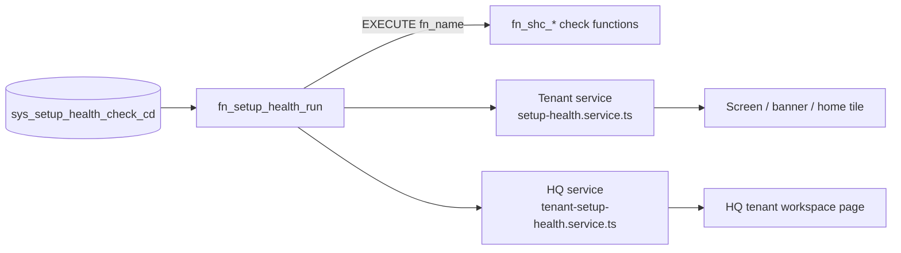

# Setup Health — Developer Guide

Back to [README.md](README.md). Design decisions: [STATUS.md](STATUS.md).

## How it works

1. **Registry** — `sys_setup_health_domain_cd` (groups) and `sys_setup_health_check_cd` (one row per check: severity, EN/AR texts, `fix_route`, `hq_fix_route`, `fix_permission`, `feature_flag_keys`, `ok_name`/`ok_name2`, `shows_banner`, `is_hq_only`, `fn_name`). Read-only for users (RLS + grants); only migrations and the service role write.
2. **Check function** — `fn_shc_<check>(p_tenant uuid, p_branch uuid) → jsonb {status: OK|FAIL|NA, count, sample_ids, details}`.
3. **Dispatcher** — `fn_setup_health_run(p_tenant, p_branch, p_domain)` runs each active check and returns one row per check with the registry metadata. A check that throws gives one `ERROR` row; the run continues.
4. **Tenant guard** — `fn_shc_guard_tenant(p_tenant)` (SECURITY DEFINER) raises `42501` when an end-user caller is not an active member of `p_tenant`. Server and service-role connections pass.
5. **Callers filter** — the database returns everything; each app hides rows:
   - Tenant (`web-admin/lib/services/setup-health/setup-health.service.ts`): drops flag-off checks and `is_hq_only` checks; keeps `fixRoute` only when the user has `fix_permission`.
   - HQ (`platform-api/src/modules/tenant-setup-health/`): drops flag-off checks (`hq_ff_get_effective_values_batch`), keeps HQ-only checks, replaces `{tenantId}` in `hq_fix_route`.

Every screen request runs the checks live (warm full run ≈ 9 ms). The only stored result is `org_setup_health_sum_tr` (0717): one row of counts per organization, for the HQ list only, because a filter across all pages cannot run checks per row.

- **Writers:** `fn_setup_health_refresh_sum(p_tenant)` on HQ Setup Health page load (a failure is logged and never fails the page), and `fn_setup_health_refresh_all()` from the nightly job `setup-health-refresh` (02:15 UTC). "Run setup checks" in the HQ list (migration 0738): `GET /tenants/setup-health/checks` (catalog for the picker) and `POST /tenants/setup-health/runs` `{ tenantIds?: uuid[1..500], checkCodes?: string[] }` (omit = all) → `fn_setup_health_run_bulk(p_tenants, p_checks, p_store)`: one row per organization (`OK` / `NOT_FOUND` / `ERROR`, one failing organization never stops the rest), counts and failing checks. The API stores the counts (`p_store`) only when `checkCodes` is omitted; the SQL function refuses `p_store` with a check list. Service role only; `tenant_setup_health:view`; not audited (derived counts only). Registry v2 (0738): `feature_flag_keys TEXT[]` (all flags must be on; helper `fn_setup_health_flags_on`), `ok_name` / `ok_name2` (passing-state title, NOT NULL: **every new check row must set them**), `fn_setup_health_run(..., p_checks TEXT[] DEFAULT NULL)`. The tenant app resolves fix links only for failing checks, and the banner/home-card summary resolves none. Not the tenant app: it hides HQ-only checks, so its counts would differ.
- **Counts** follow HQ visibility: flag-off checks are out, HQ-only checks are in. The list can be up to a day old; a new check is counted after the next refresh, with no code change.
- **Access:** service role only (RLS on, no policy).

## Add a check (e.g. Tax M8)

One new migration (number = last seq + 1 when written), nothing else:

1. Function `fn_shc_<name>(p_tenant UUID, p_branch UUID) RETURNS JSONB`, `LANGUAGE plpgsql STABLE SECURITY INVOKER SET search_path = public`.
   - First line: `PERFORM public.fn_shc_guard_tenant(p_tenant);`
   - Every `org_*` read filters `tenant_org_id = p_tenant`.
   - Return `status` (`OK`/`FAIL`/`NA`), `count`, up to 5 `sample_ids`, `details`.
2. `REVOKE ALL ... FROM PUBLIC, anon; GRANT EXECUTE ... TO authenticated, service_role;` and `COMMENT ON FUNCTION`.
3. Registry row in `sys_setup_health_check_cd` with `ON CONFLICT (check_code) DO UPDATE`. Since 0738 the row **must** set `ok_name` and `ok_name2` (the title shown when the check passes, NOT NULL, no default) next to `name`/`name2` (the problem title), and names feature flags in `feature_flag_keys TEXT[]` (all must be on; `'{}'` = always shown). The old `feature_flag_key` column no longer exists. Rules enforced by CHECKs: code `^[A-Z][A-Z0-9_]*$`, `fn_name` `^fn_shc_[a-z0-9_]+$`, `shows_banner` only for tenant-visible `BLOCKER`s.
4. Copy the verification `DO` block from 0716 (one row per check per active tenant, no `ERROR`).

The texts come from the registry, so the apps need no code or i18n change.

## Files

| Repo | Path |
|---|---|
| DB | `supabase/migrations/0709_*`, `0710_*`, `0716_*`, `0717_*` |
| Tenant | `lib/constants/setup-health.ts`, `lib/constants/permissions/setup-health-perm.ts`, `lib/types/setup-health.ts`, `lib/services/setup-health/`, `app/api/v1/setup-health/**`, `app/dashboard/setup-health/page.tsx`, `src/features/setup-health/{api,hooks,ui,access}`, `messages/{en,ar}/setupHealth.json` |
| Tenant (shared files, one entry each) | `app/dashboard/layout.tsx` (banner), `src/features/dashboard/ui/DashboardContent.tsx` (tile), `config/navigation.ts`, `src/features/access/page-access-registry.ts` |
| HQ API | `platform-api/src/modules/tenant-setup-health/` (+ `app.module.ts`); list: `tenants/tenants.service.ts` `findAll`, `tenants/dto/query-tenants.dto.ts` |
| HQ web | `lib/api/tenant-setup-health.ts`, `src/features/tenants/hooks/use-tenant-setup-health.ts`, `src/features/tenants/ui/tenant-setup-health-screen.tsx`, `app/tenants/[id]/setup-health/page.tsx`, `tenant-sidebar.tsx`, `messages/{en,ar}/tenants/{setupHealth,sidebar}.json`; list: `app/tenants/page.tsx`, `lib/api/tenants.ts`, `messages/{en,ar}/tenants/list.json` |

## API

| Method + path | Gate | Query | Returns |
|---|---|---|---|
| `GET /api/v1/setup-health` | `setup_health:view` | `domain` (code), `branchId` (uuid) | `{ domains, items }` |
| `GET /api/v1/setup-health/summary` | signed in | — | counts, `bannerItems`, `canView` (used by the banner for every user) |
| HQ `GET /tenants/:tenantId/setup-health` | `tenant_setup_health:view` | — | items with `hqFixRoute` + counts; refreshes the stored counts; 404 if the organization does not exist |
| HQ `GET /tenants` | existing list gate | `setupHealth` = `has_blockers` or `needs_attention` (optional) | each row gains `setup_health` (counts + `checked_at`, or null) |

The tenant id always comes from the session, never from the request.

## Tests

- `web-admin`: `__tests__/services/setup-health.service.test.ts`, `__tests__/api/setup-health.route.test.ts`, `__tests__/features/setup-health/`
- `web-admin` DB (local Supabase): `__tests__/db-integration/setup-health.db.test.ts` — rows per check, tenant isolation, throwing check, guard
- HQ: `platform-api/src/modules/tenant-setup-health/__tests__/`, `platform-api/src/modules/tenants/__tests__/tenants.service.find-all.spec.ts`
