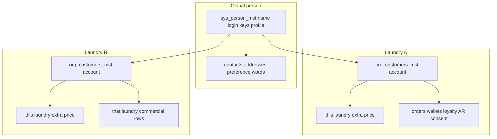

# Tenant Customers — One Person, Many Laundries

**Status:** Discussion draft. Nothing in this document is approved for implementation until you say so.
**Repos:** `cleanmatex` owns the schema, the tenant app, and the `hq_navigation_cd` seed. `cleanmatexsaas` owns the HQ workspace screens and the HQ-only APIs. Tenant commercial edits stay in the tenant app.
**Companion:** staff identity is a different principal. See `docs/features/Tenants_Users/PLAN.md`. A customer is never an `auth.users` row and never a `sys_users_mst` row.
**Progress:** Not started.

## While planning and implementing

These rules apply to every planning pass and every implementation step. They are not optional because this plan already describes the design.

- Follow the `CLAUDE.md` and `AGENTS.md` of the repository being edited (`cleanmatex` or `cleanmatexsaas`). Load the required skill before writing that kind of change, and use the agents, rules, and docs those files name.
- UI comes from the shared Cmx set. In the tenant app, search `web-admin/src/ui/` and use the import snippets in `web-admin/.clauderc`. In HQ, use the existing platform-web Cmx components, including `CmxWorkspaceNav`. If the same control will appear on more than one screen, extend the shared component or add one reusable component. A one-off copy in a feature folder is not acceptable when the control will be reused.

## Why this exists

A customer registers with one email or one mobile and may use several laundries at the same time. The product must keep one person record and still give each laundry its own commercial account. Today the runtime stores everything on `org_customers_mst` and the global table `sys_customers_mst` is switched off: `shouldUseSysCustomers()` returns false immediately in `web-admin/lib/services/customers.service.ts`. Turning that old path back on would also revive cross-tenant search and profile copy. This plan adds a new narrow person table instead.

## Decisions

1. **One global person, many tenant accounts.** `sys_person_mst` is the person. `org_customers_mst` stays the commercial account at one laundry: orders, prices, wallets, loyalty, AR, and consent.
2. **Link only after the phone or email is verified.** A walk-in or guest with no verified contact stays tenant-local. A matching name is not a link. A B2B company row is not a person. Customers already stored are not backfilled by matching phones or emails.
3. **Nothing commercial moves across laundries.** The second laundry gets a new `org_customers_mst` row with the same `person_id` and empty balances, orders, consent, and prices. The retail profile is not copied onto that row. The new account reads it from the person.
4. **Same login rule as staff.** When the person has an active account at more than one laundry, the customer app shows a small window of those laundry names and binds that account until logout or session expiry. There is no in-session switch.
5. **Staff search stays inside the current laundry.** Other laundries’ customers, and the fact that this person shops elsewhere, are invisible to staff.
6. **Existing duplicates are not auto-merged.** A report lists shared phones and emails. A link happens after verification, or after an explicit confirmation inside one tenant.
7. **No `person_main_context` column.** The person is the human. “Customer” is the existence of one or more `org_customers_mst` rows, not a type stored on `sys_person_mst`. A single value (today `CUSTOMER`, later staff, supplier, driver) cannot name a person who is a customer at three laundries and staff at one, and “main” has no owner. A future hat is a new relationship row that points at `person_id`. It is not a new enum value on the person.
8. **The linked retail profile is global.** Once `person_id` is set, every linked laundry reads the same name (`name`, `name2`, `display_name`, `first_name`, `last_name`), every phone and email including unverified ones, `profile_type` (`guest`, `stub`, `walk_in`, `full`), addresses, preference words, preferred language, and the platform category code. An edit updates the person once. Other laundries are not updated row by row. They see the new value because they read the person. `b2b` is not a person type. A B2B company keeps its own name, contacts, addresses, preferences, language, and category on the account.
9. **Two switches for off.** A cashier activates or deactivates only this laundry’s account (`org_customers_mst.is_active`). That account drops out of the picker and only its sessions end. HQ alone locks or unlocks the person. While locked, customer-app sign-in is denied at every laundry, existing customer-app sessions for that person end, and a new laundry cannot link them. Counter sales on an account this laundry already has stay allowed. A cashier cannot see or set this lock, and the screen does not name other laundries.
10. **Login keys stay unique. The contact list does not.** `phone_e164` and `email` on `sys_person_mst` are the one verified login phone and the one verified login email. A change requires a new OTP or a confirmed email, from the customer or from the cashier on the account they have open. An unverified typed value does not replace those columns. Every other phone and email, including unverified ones, lives on `sys_person_contact_dtl`. Verified contact values are globally unique. Unverified values are not unique and cannot sign the person in.
11. **Preference words are global. The extra price is this laundry’s, and it is editable.** `sys_person_pref_dtl` stores `name`, `name2`, and the catalog code as plain text. No price and no foreign key. `org_customer_service_prefs` stores this account’s `extra_price`. The screen shows the shared words and an editable price. The field opens with this laundry’s catalog price when the code exists in `org_service_preference_cf`. Otherwise it opens empty. Nothing is saved until the cashier saves. Saving writes only this account’s price. It does not change the words, the catalog, or another laundry’s price. A price already typed is not replaced because the preference list was reloaded.
12. **Category is the customer group, not the profile type.** The person stores `system_category_code`, a foreign key to `sys_customer_category_cd`, and only a non-B2B code. A group that exists only on one laundry’s `org_customer_category_cf` has no platform code, so it stays on that account.
13. **A verified phone and a verified email that match two different people refuse the save.** The screen asks for one identifier. Nothing is linked.
14. **A guest whose verified contact already has an account at this laundry opens that account.** The walk-in row stays unlinked. This release does not merge orders or balances.

## Model

| Record | Role |
|---|---|
| `sys_person_mst` | Portable person. Retail name, verified login phone, verified login email, profile type, preferred language, platform category code, password, HQ lock, audit. No tenant id, no balance, no consent, no context column. |
| `sys_person_contact_dtl` | Every other phone and email, verified or not. Unique only when verified. |
| `sys_person_address_dtl` | The person’s addresses. No tenant id and no default country. Delivery price stays on the laundry. |
| `sys_person_pref_dtl` | Preference words and the catalog code as text. No price. |
| `org_customers_mst` | This laundry’s account. Gains nullable `person_id`. Unique `(tenant_org_id, person_id)` where `person_id` is set. Holds the commercial file. Name and contact columns on this row remain the source only while `person_id` is null, and for a B2B company. |
| `org_customer_service_prefs` | This account’s extra price for a person preference. Edited on this laundry’s screen. |
| `sys_customers_mst` | Legacy. Left in place. New writes do not use it. `customer_id` is not the person link. This program does not drop it. |
| Money and CRM children | Continue to reference `org_customers_mst.id`: orders, invoices, vouchers, wallets, advances, loyalty accounts, credit notes, AR, gift-card purchaser, B2B contacts and contracts. |

`sys_person_mst` is the customer equivalent of the portability idea behind `sys_users_mst`. It is our id, not a Supabase Auth id. Customer login stays the existing OTP and customer-session mechanism (`app/api/v1/public/customer/*`, `customer-mobile-session.service.ts`). It does not create `auth.users` and does not write `sys_auth_user_sessions_mst`.

Staff and customer principals stay separate even when the mobile matches. Matching phones do not grant web-admin access or customer-app access to the other principal.

Browser roles cannot `SELECT` `sys_person_mst`. A laundry key that could list the table would enumerate people across the platform. Lookup and link run in service-role or security-definer functions that take a verified phone or email and return the person id only.

## Link rules

- Guest, walk-in, and stub rows with no verified phone and no verified email keep `person_id` null. The tenant default guest customer (`TENANT_DEFAULT_GUEST_CUSTOMER_ID`) stays unlinked. Until then, the name, typed phone, typed email, addresses, and preference words sit on the account.
- OTP on the mobile, or a confirmed email, finds or creates `sys_person_mst` and sets `person_id` on **this** laundry’s account. On that first link, the account’s retail profile moves onto the person when the person fields are empty. If the person already has a name, contacts, addresses, preference words, language, profile type, or category, those person values win. The account’s extra price stays on the account.
- If this laundry already has an account for that person, the visit opens that account. The walk-in row being edited stays unlinked. This release does not merge.
- The first verified visit at another laundry inserts a new `org_customers_mst` row: same `person_id`, new account id, no copied wallet, advance, loyalty account, points, AR, orders, consent, or extra price. The new account reads the retail profile from the person.
- Phone uniqueness for the login key is a partial unique index on the normalized verified E.164 value. Email uniqueness is the same for a verified email. Verified rows in `sys_person_contact_dtl` use the same rule. Unverified contact rows are not unique. `org_customers_mst.phone` remains the stored number for an unlinked or B2B row. The application-level per-tenant phone check remains, and a unique index on `(tenant_org_id, normalized phone)` where that account phone is present is added so two concurrent creates cannot both succeed. Rows with no phone (true guests) are allowed to repeat. Staff search for a linked person looks up the contact on the person, then opens this laundry’s account by `(tenant_org_id, person_id)`. Customer lists do not join `sys_person_mst`.

## Customer app session

1. OTP proves the phone and resolves `sys_person_mst`. The current public token is an unsigned base64 phone payload in `web-admin/lib/services/otp.service.ts`. This release replaces it with `sys_person_session_mst`. That table is not `sys_auth_user_sessions_mst`. Browser roles cannot read it.
2. Load eligible accounts for that person: account active, organization active, person not HQ-locked. Return account id, tenant id, and laundry display name. No balances in the picker payload. One query.
3. One account: bind `(person_id, tenant_org_id, org_customer_id)`.
4. Several accounts: small dialog, the person chooses, the server checks the account again. `last_tenant_org_id` on the person may highlight the last laundry. It is not authority.
5. OTP success with several accounts writes a short-lived pending session: person id, no account. Orders, booking, addresses, and the financial view reject that pending session. Binding writes the account and tenant into that same session. The customer session keeps that triple until logout or expiry. Today’s public routes take a client `tenantId` and `resolveCustomerMobileSession` trusts it (`login`, `password`, `auth-options`, `session`, `auth/refresh`, `orders`, `orders/[orderNo]`, `orders/[orderNo]/financial-view`, `booking`, `addresses`). After this release the bound triple wins. A body or query `tenantId` that disagrees with the session is rejected. A branded link may name a tenant only as a hint to skip the picker when the person already has an account there.
6. Changing laundry means logout, then sign-in, then the picker again. Escape cancels sign-in and does not choose the highlighted laundry. Deactivating the account revokes that account’s sessions. An HQ lock revokes every customer-app session for the person.
7. Login proof is the person, not the account. OTP stays the proof. Where password login remains, the hash is stored once on `sys_person_mst`. `org_customers_mst.password_hash` is not read as the credential after this release and is not copied to the new account. The column stays. This release does not drop it. Existing hashes are not auto-picked when two accounts disagree; those people use OTP until they set one person password. The failed-attempt counter sits on the person. Changing the password ends every customer-app session for that person.

A branded laundry link that already names the tenant skips the picker when this person has an account there, and still refuses to open a laundry where they have no account.

## Staff CRM

Retail customers (`app/dashboard/customers`) and B2B customers (`app/dashboard/b2b/customers`) list and edit the current tenant only. Every query keeps `tenant_org_id`. The dormant other-tenant branch inside `searchCustomersProgressive` is removed rather than enabled.

The create and upgrade screens search before they save. The cashier types the phone or email the customer gives. Lookup runs when the field is complete, and the screen offers one next step:

- No person yet: continue as a new customer at this laundry. Nothing is linked until the phone or email is verified.
- Already an account at this laundry: offer “Open this customer”. Do not insert another account. Show this laundry’s name, phone, and last visit so the cashier can see it is the right file.
- A person exists, and this laundry has no account yet: show that person’s name only, not other laundries, not their addresses, and not their balances. The cashier confirms with the customer (“Is this you?”). Confirm creates this laundry’s new account linked to that person, with empty balances. The retail profile is then read from the person. The extra price field opens empty, or with this laundry’s catalog price when the code matches, and is saved only when the cashier saves. The cashier can also choose “Not this person”. That choice cannot save the same phone or email onto a second person. The screen then asks for a different number, or saves an unverified guest with no phone and no link.
- Two staff saving the same verified phone at the same moment: the unique index keeps one person and one account at this laundry. The second save opens the account the first save created.

Copy is EN and AR. The screen uses Cmx controls, inline status, and `cmxMessage` when a save is blocked. Search existing translation keys before adding new ones.

B2B stays a tenant account (`type = b2b`) with `org_b2b_contacts_dtl`. A contact may later point at `sys_person_mst`. This release does not split company and person into a new party schema.

## Merge and hygiene — later plan, not this release

Today’s merge moves orders and the `loyalty_points` column, skips wallets, advances, loyalty accounts, AR, addresses, and B2B children, and does not write `org_customer_merge_log` on the org-only path. Person linking must not call that merge.

A follow-up plan, after this identity release is in production, covers:

- In-tenant merge that moves every financial and CRM child, writes `org_customer_merge_log`, and stays inside one `tenant_org_id`.
- Retiring the embedded address columns in favor of `org_customer_addresses`.
- Retiring `org_customers_mst.loyalty_points` in favor of `org_loyalty_accounts_mst`.
- Composite foreign keys `(tenant_org_id, customer_id)` on orders and the other money tables.

Linking a person never rewrites money amounts.

## Areas this release covers

Same production bar as the users plan: explicit `tenant_org_id` on every `org_*` access, fail closed, EN/AR and RTL, Cmx components, `cmxMessage` for operational feedback, access contracts for new or changed dashboard routes and APIs, indexes for the new lookups, and no N+1 account fetch on the picker (one query, picker columns only).

### Database (new migration in `cleanmatex`, not applied by the agent)

- Create `sys_person_mst` (name within the 30-character limit) with comments and grants that block browser roles. Columns: `id`; `name`, `name2`, `display_name`, `first_name`, `last_name`; `phone_e164` and `phone_verified_at`; `email` and `email_verified_at`; `profile_type` constrained to `guest`, `stub`, `walk_in`, or `full`; `preferred_language` with no default; `system_category_code` referencing `sys_customer_category_cd` for a non-B2B code; `password_hash` and `password_updated_at`; failed-attempt counter and attack-lock timestamp; HQ lock flag, locked at, locked by, and reason; `last_tenant_org_id` as a hint only; standard audit columns. No `tenant_org_id`, no balance, no consent, no role column. Indexes, and no others on this table:
  - Primary key on `id`.
  - `uq_sys_person_phone`: unique on `phone_e164` where `phone_e164` is not null. The stored value is E.164. Many rows may have a null phone.
  - `uq_sys_person_email`: unique on `email` where `email` is not null. The stored value is trimmed and lower-cased. Many rows may have a null email.
  - No index on name. A matching name is not a link, and a name index would invite a scan the lookup does not use. HQ and cashier search are equality lookups on the phone and email indexes.
- Create `sys_person_contact_dtl`, `sys_person_address_dtl`, and `sys_person_pref_dtl`. Same grants as the person table. Contacts: phone or email, verified flag, verified timestamp. Unique on a verified value only. Addresses: the same address fields the product already stores, no `tenant_org_id`, and no default country. Preferences: `name`, `name2`, and the catalog code as text. No price column and no foreign key to a laundry catalog.
- Create `sys_person_session_mst` for the pending and bound customer session: person id, nullable tenant, nullable account, status, expiry, revoked at. No business columns. Not `sys_auth_user_sessions_mst`. Browser roles cannot read it.
- Do not add `person_main_context`, `person_type`, or any other single-value role column. `profile_type` describes the retail file (`guest`, `stub`, `walk_in`, `full`). It does not mean “this human is a customer rather than staff”. Customer, and any later hat, is discovered from the child relationship (`org_customers_mst` now).
- Add nullable `person_id` on `org_customers_mst`, foreign key to `sys_person_mst`, and the partial unique `(tenant_org_id, person_id)`.
- Add the per-tenant unique phone index described above, after a pre-check query that fails the migration with a clear message if one tenant already has duplicate normalized phones. Those duplicates are fixed or excluded by a reviewed data step. The migration does not auto-delete customers.
- `org_customer_service_prefs` keeps this account’s `extra_price` for a person preference. The catalog row in `org_service_preference_cf` is the opening value only when the code matches.
- Confirming “this is the same person” is one database transaction: create or reuse this laundry’s account, set `person_id`, move an empty retail profile onto the person, and write an audit row on that account. If the audit insert fails, the link rolls back. The audit row records actor, account, person, and method. It records no balance and no other laundry. The same rollback rule covers a login-key change and an account activate or deactivate. HQ search, account open, and person lock write an HQ audit row with the same rollback rule.
- The cashier lookup is an authenticated API on the customer permission already used by create. It returns one of the four screen states. For a person who has no account here it returns the person’s name only. It does not return other laundries, addresses, or balances. Anonymous callers cannot use it. It is rate-limited.
- Customer sign-in uses the pending session above. OTP success with several accounts yields a short-lived pending row with a person id and no account. Orders, booking, addresses, and the financial view reject that pending session. Binding writes the account and tenant into that same session. The picker list for that person returns only their own eligible laundry names, through a security-definer function, never through a browser read of `sys_person_mst`.
- Do not backfill `person_id` by matching unverified phones across tenants.

### Services and APIs (`web-admin`)

- Replace the dead `shouldUseSysCustomers()` branch with an explicit person-link service. Delete the other-tenant search branch.
- Verification routes (`send-otp`, `verify-otp`, public customer login and session) set or reuse `person_id` under the rules above.
- Customer CRUD, addresses, preferences, loyalty, stored value, and B2B routes continue to authorize and filter by the session tenant and the **account** id, not by `sys_person_mst` alone.
- Staff merge endpoint stays as it is for this release and is not called by the linker. A merge that would move an account onto a different `person_id`, or that would cross `tenant_org_id`, is rejected.
- Every insert into `org_customers_mst` goes through the person-link use-case. That includes POS create, profile upgrade, and B2B screens that currently write Supabase from the page. The page does not embed a second copy of the link rules.
- Human-friendly customer numbers stay on the tenant account through the existing document-sequence registry. `sys_person_mst` has no customer number.
- Notification consent stays on the account. A message to laundry A checks laundry A’s consent only. The language of that message is the person’s `preferred_language` when the account is linked. An unlinked guest keeps language on the account. The platform category code is read from the person. A laundry-only custom category stays on that account. Prices, including this account’s preference extra price, stay on the account.
- Read-only duplicate report inside the current tenant, permission-gated, EN/AR. The cross-organization review lives only in the HQ workspace `/org-customers-manage`. The tenant app does not grow a cross-tenant browser.
- `cmx-api` has no customer controllers today. This release does not add one. Any later customer route uses the same bound session and does not accept a caller-supplied tenant as authority.
- Files this release edits stop logging raw phone candidate lists.

### UI

- Customer create, detail, and upgrade: verification state, link outcome, shared retail profile, editable extra price, EN/AR, RTL, Cmx, `cmxMessage`.
- Customer app picker: small dialog, laundry names only, keyboard and screen reader, no switch control.
- Empty, loading, and “this code is invalid” states. Wrong OTP and unknown phone use the same generic failure where the channel would otherwise reveal whether a person exists, except where the laundry counter already knows they are creating a local guest.

### Tests

- Unverified guest stays unlinked.
- Verified phone creates one person and one account.
- Same verified phone at a second laundry creates a second account, same person, zero wallet and zero orders copied.
- Same phone again at the first laundry reuses the first account.
- A verified phone that already has an account at this laundry opens that account and leaves the walk-in unlinked.
- A phone that matches one person and an email that matches another is refused.
- Staff search with laundry A’s session returns none of laundry B’s rows. After laundry B links the same person, laundry B sees the person’s name, contacts, and addresses, and does not see laundry A’s orders, wallet, or extra price.
- Saving an extra price at laundry B does not change laundry A’s price or the preference words.
- An inactive account is absent from the picker. An HQ lock rejects customer-app sign-in at every laundry and still allows counter sales on an account the laundry already has.
- Two accounts show the picker; one account skips it; logout is required before the other laundry’s orders are visible.
- Concurrent create of the same phone in one tenant yields one row.
- Browser client cannot read `sys_person_mst` or its child tables directly.
- Public orders, financial view, booking, and addresses reject a `tenantId` that does not match the bound session.
- A B2B or POS create of a verified phone uses the link use-case and does not insert a second unlinked account in the same laundry.

### Production bar

- **Separation of concerns.** Person lookup, account link, and customer session are three use-cases. Routes and screens call them. Order, wallet, loyalty, and AR code keeps using `org_customers_mst.id` and does not learn about `sys_person_mst`.
- **Same identifier rules as staff.** Email trim and lower-case, mobile E.164, with the same test vectors as `docs/features/Tenants_Users/PLAN.md`. Customers keep their own functions. No shared package.
- **Picker.** Same interaction bar as the staff picker: Cmx dialog, focus trap, keyboard, screen reader, RTL, EN/AR, loading and error, escape cancels, laundry display name from the organization, no industry hardcoded in the component. `cmxMessage` for operational feedback. Search existing translation keys before adding new ones.
- **Performance.** The picker is one query returning account id, tenant id, and display name. Customer lists do not join `sys_person_mst`. Linked search is one equality lookup on the contact, then the account by `(tenant_org_id, person_id)`. Unlinked and B2B search keeps the existing trigram phone indexes. Link is one unique lookup on the verified phone or email.
- **Audit.** A link writes an audit row on the tenant account: when, how verified, actor. The row contains no balance change.
- **Access contract.** A new dashboard report or route is gated through `customers-access.ts`, the page, and the API together.
- **Cache.** Customer account screens do not reuse a staff permission cache. A customer session cache, if added, keys by person, tenant, and account, and dies on logout.
- **After you apply the migration.** Regenerate Prisma and database types. The agent does not apply the migration.

### Screen and endpoint inventory

Staff UI: customer list, create, detail, upgrade, addresses, preferences, loyalty, stored value, consent, B2B list and detail, in-tenant duplicate report.

Public customer API, all bound to the session triple: `login`, `password`, `auth-options`, `session`, `auth/refresh`, `orders`, `orders/[orderNo]`, `orders/[orderNo]/financial-view`, `booking`, `addresses`, plus `send-otp` and `verify-otp`.

### HQ workspace `/org-customers-manage`

HQ operators get one workspace for customer persons. It is not a second cashier screen and it does not edit orders, wallets, prices, or consent.

- Navigation: the same `cleanmatex` migration style as the users workspace seeds `hq_navigation_cd` for `/org-customers-manage` and the child paths. Permission codes: `hq_org_customers:read`, `hq_org_customers:review`, `hq_org_customers:lock`. Tenant-app tokens receive 403.
- Shell: `platform-web/app/org-customers-manage/` uses `CmxWorkspaceNav`. Screens:
  - `/org-customers-manage` searches by exact verified phone or email.
  - `/org-customers-manage/[personId]` shows the person and each organization account: organization name, active flag, linked date. No balances on the list. Opening one account is a separate audited action and shows that account’s commercial summary read-only. From here HQ can lock or unlock the person. The screen says the lock signs the person out of every laundry’s customer app and blocks new links. It does not name a cashier action.
  - `/org-customers-manage/duplicates` lists verified phones or emails that match more than one person, for a human to review. It does not auto-link and it does not merge money.
- APIs live in `platform-api`, HQ identity only. Search uses the unique indexes. Every search and every account open writes an audit row with the HQ actor.
- Copy is EN and AR, RTL, Cmx, and `cmxMessage`.
- The tenant app does not link to this workspace.

### Outside this release

- The in-tenant financial merge and the address, loyalty-column, and composite-FK cleanup listed above.
- Social login, biometrics, and the rest of `docs/plan_cr/028_customer_app_onboarding_auth_dev_prd.md`.
- Using `auth.users` for customers.
- Re-enabling `sys_customers_mst` as the live identity.
- A context or party-type column on `sys_person_mst`. Supplier, driver, and B2B contact, if added later, are new tables with `person_id`. `profile_type` is the retail file state, not that column.
- Copying one laundry’s extra price, wallet, consent, or orders onto another laundry.

## Both-repo handoff

The tenant app can be built in `cleanmatex` from this plan. The HQ workspace can be built in `cleanmatexsaas` from this plan. They meet at the schema and at these routes. Neither side invents its own.

Ship order:

1. `cleanmatex` writes the `sys_person_mst` migration, the `hq_navigation_cd` seed, and the `hq_permissions` rows, then stops for you to apply it.
2. After apply, `cleanmatex` changes web-admin and `cleanmatexsaas` adds the workspace. The workspace reads columns that do not exist until the migration is applied.

HQ-only routes, `HqIdentityGuard`, no `AllowTenantIdentity`, tenant token receives 403:

- `GET /api/hq/v1/org-customers` searches by exact verified phone or email.
- `GET /api/hq/v1/org-customers/:personId` lists organization accounts without balances.
- `GET /api/hq/v1/org-customers/:personId/accounts/:accountId` is the audited read-only commercial summary.
- `POST /api/hq/v1/org-customers/:personId/lock` and `POST /api/hq/v1/org-customers/:personId/unlock` change the HQ lock. Each is an audited transaction. `hq_org_customers:lock` is required.
- `GET /api/hq/v1/org-customers/duplicates` lists conflicting persons. It does not link or merge.

Module: `cleanmatexsaas/platform-api/src/modules/org-customers-manage/`. Screens: `platform-web/app/org-customers-manage/page.tsx`, `[personId]/page.tsx`, and `duplicates/page.tsx`. Permissions in `hq_permissions`: `hq_org_customers:read`, `hq_org_customers:review`, `hq_org_customers:lock`. Navigation seed stays in the `cleanmatex` migration. The cashier lookup stays a tenant API in web-admin. It is not this HQ route.

Same email and mobile normalization test vectors as the users plan. Document the routes in both `docs/dev/rules/integration-contracts.md` files.

## Risks

- A linked retail profile is visible to every laundry that has an account for that person. The definer lookup must require that account. Grants that let a browser list `sys_person_mst` or its children are part of the migration, not a follow-up.
- Linking without the cashier’s confirm step would join the wrong person to this laundry’s orders. The create screen is that step. A background job does not link existing phones.
- Unique phone per tenant will fail to apply where duplicates already exist. The migration must detect them and stop with a list, not silently keep the weaker application check.
- Customer session and staff session are different stores. Reusing `sys_auth_user_sessions_mst` for customers would mix principals and RLS. The customer session stays on its own mechanism.

## Implementation tasks

Do the steps in order. After each step, update this plan and the docs that step changed. The last task generates the feature pack. Do not start until this plan is approved by name. Staff identity in `docs/features/Tenants_Users/PLAN.md` is a separate approval.

### 1. Schema migration in `cleanmatex`

- [ ] Write the new migration in the Database section (`sys_person_mst`, contact, address, and preference children, `sys_person_session_mst`, `person_id`, phone uniqueness, HQ navigation and permissions including `hq_org_customers:lock`). Do not apply it.
- [ ] Update **Status** and **Progress** in this plan for this step.
- [ ] Create or update the docs this step changes. Leave `sys_customers_mst` documented as legacy.

### 2. Apply and type generation

- [ ] Stop for review. After you apply the migration, regenerate Prisma and database types in both apps.
- [ ] Update **Status** and **Progress** in this plan for this step.
- [ ] Create or update the docs this step changes.

### 3. Tenant app in `cleanmatex`

- [ ] Implement the person-link service, cashier confirm screen, customer session bind, and the public API tenant check in web-admin. EN/AR and access contracts included.
- [ ] Update **Status** and **Progress** in this plan for this step.
- [ ] Create or update the docs this step changes, including the public customer routes and the cashier lookup.

### 4. HQ API in `cleanmatexsaas`

- [ ] Implement `org-customers-manage` in platform-api, HQ identity only.
- [ ] Update **Status** and **Progress** in this plan for this step.
- [ ] Create or update the docs this step changes, including the HQ routes and permission codes.

### 5. HQ workspace in `cleanmatexsaas`

- [ ] Build `platform-web/app/org-customers-manage/` from shared Cmx components, including the duplicates screen.
- [ ] Update **Status** and **Progress** in this plan for this step.
- [ ] Create or update the docs this step changes, including the screen and navigation notes.

### 6. Shared contract

- [ ] Document the customer person routes in both `docs/dev/rules/integration-contracts.md` files, using the same email and mobile normalization as the users plan.
- [ ] Update **Status** and **Progress** in this plan for this step.
- [ ] Refresh the related customer docs that still describe `sys_customers_mst` as the live identity or that omit `person_id`.

### 7. Documentation pack

- [ ] Load `/documentation` (`.claude/skills/documentation/SKILL.md`) and generate the pack for `docs/features/Tenants_Customers/`: `README.md`, `development_plan.md`, `progress_summary.md`, `current_status.md`, `developer_guide.md`, `developer_guide_mermaid.md`, `user_guide.md`, `user_guide_mermaid.md`, `deploy_guide.md`, `testing_guide_and_scenarios.md`, `CHANGELOG.md`, `version.txt`, and `technical_docs/`. Record only what was implemented. If this folder overlaps an older customer pack, follow that skill’s route to the specialist documentation skill instead of creating a second source of truth.
