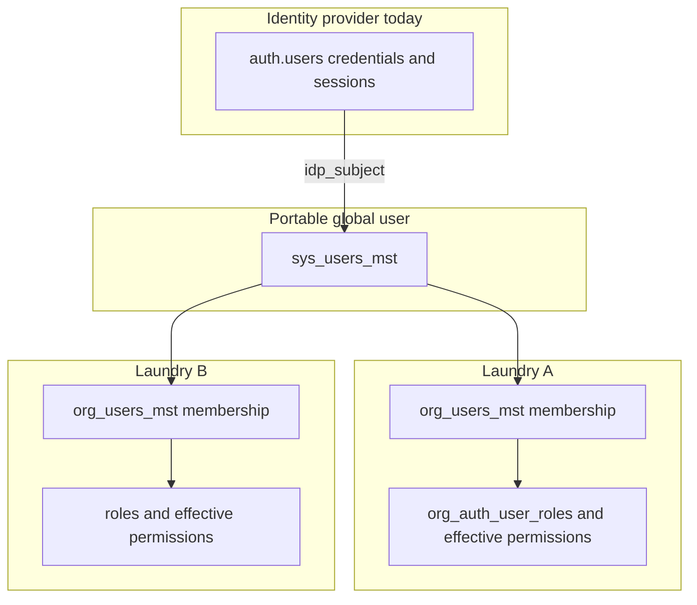

# Tenant Users — Multi-Laundry Identity

**Status:** Approved on 13 Nov 2026 for Tenants_Users only. Customers are not approved. Migrations `0734`, `0736`, and `0737` are applied on local and remote. Types and Prisma were regenerated after `0737`.
**Repos:** `cleanmatex` (schema, RLS, tenant app) and `cleanmatexsaas` (HQ platform-api and platform-web). Both are in scope for the same release.
**Supersedes for this topic:** session ADR decision 1 only (“one auth account per tenant, no tenant switching”) in `docs/features/User_Session_Lifecycle/ADR-session-registry-and-tenant-claim.md`. Decisions 2–10 of that ADR stay, including “never trust `user_metadata` for the tenant”.
**Progress:** Steps 1 through 7 are done. Staff is a global user (`sys_users_mst`) and a laundry membership is an organization user (`org_users_mst`). Person stays for customers. Migrations `0734`, `0736`, and `0737` are applied on local and remote. The tenant login screen can open a pending picker row and bind the chosen organization. Create lookup, the organization-user lock, and the global password warning are in the tenant app. `cmx-api` takes the organization from the ACTIVE session row and ignores a tenant claim and `X-Tenant-Id`. Section 18 of both integration contracts and session ADR decision 1 match this model. Owner scenarios are in [QA_TEST_GUIDE.md](QA_TEST_GUIDE.md). Remote Round 2 (13 Nov 2026) is PASS 33, FAIL 2, PARTIAL 2, NOT RUN 3 (cmx-api header checks). The owner then decided a user or membership is never deleted: deactivate only. Customers are not started. The rest of the documentation pack (step 8) is not started.

## While planning and implementing

These rules apply to every planning pass and every implementation step. They are not optional because this plan already describes the design.

- Follow the `CLAUDE.md` and `AGENTS.md` of the repository being edited (`cleanmatex` or `cleanmatexsaas`). Load the required skill before writing that kind of change, and use the agents, rules, and docs those files name.
- UI comes from the shared Cmx set. In the tenant app, search `web-admin/src/ui/` and use the import snippets in `web-admin/.clauderc`. In HQ, use the existing platform-web Cmx components, including `CmxWorkspaceNav`. If the same control will appear on more than one screen, extend the shared component or add one reusable component. A one-off copy in a feature folder is not acceptable when the control will be reused.

## Why this exists

A global user registers with one email or one mobile. That global user may work at several laundries at the same time, or leave one and join another. The product must accept the same email and the same mobile each time. Today it cannot: `uq_org_users_mst_user_id` allows one `org_users_mst` row per Supabase auth user (`supabase/migrations/0563_org_users_user_code.sql`), and HQ `TenantUsersService.create` always calls `auth.admin.createUser` and returns 409 when that email is already registered (`cleanmatexsaas/platform-api/src/modules/tenant-users/tenant-users.service.ts`).

## Decisions from this discussion

1. **One global user, many memberships.** One login is one `sys_users_mst` row. Each laundry has its own membership row.
2. **Login chooses the laundry. Logout is the only way to change it.** When the global user has more than one active membership, sign-in shows a small window with those laundry names. The chosen membership is the session context until logout or session expiry. There is no in-session switch control and no rebind API.
3. **`sys_users_mst` is the portable global user record.** It is the application identity we would keep if Supabase Auth were replaced by another platform. It is not a second copy of `auth.users`.
4. **`org_users_mst.id` and the global user id stay different.** The membership id identifies “this global user at this laundry”. The global user id identifies the human. Making them the same value allows only one laundry.
5. **Confirmed: `sys_users_mst.id` is born equal to `auth.users.id`.** You chose this on 12 Nov 2026. Portability stays in `idp_provider` and `idp_subject`. A fresh global-user uuid on every check was rejected because it would add a join to every permission and RLS lookup.
5. **HQ and the tenant app ship together.** Create, attach, deactivate, and hard-delete behavior is specified here for both repositories.

## Identity model

| Record | What it is | Id |
|---|---|---|
| `auth.users` | Current credential store (password, GoTrue sessions). Replaceable. | Supabase id |
| `sys_users_mst` | Our global user: real email, verified mobile, `user_code`, status, link to the current identity provider | Our stable id |
| `org_users_mst` | Membership: this global user at one laundry (local name, branch, active flag) | New uuid per laundry |
| `sys_auth_user_sessions_mst` | One signed-in context: global user + one membership + one tenant, fixed for the life of the session | Existing session row |

### Why `sys_users_mst` exists, and what it refuses to copy

`auth.users` is a Supabase GoTrue table. Roles, audit, and memberships that point only at `auth.users.id` would all have to be rewritten to move to Oracle, SQL Server, or another identity provider.

`sys_users_mst` holds the stable global user:

- `id` — our id. **Confirmed: set it equal to `auth.users.id` at insert.** Existing columns named `user_id` already store that uuid (`org_users_mst.user_id`, `org_auth_user_roles.user_id`, session `auth_user_id`). Keeping the same uuid avoids a join inside `current_tenant_id()` and inside every RLS policy. Portability sits in two columns, `idp_provider` (today `supabase`) and `idp_subject` (today the same uuid). A future provider change updates `idp_subject` and one resolver function. Membership ids and permission rows keep `sys_users_mst.id`.
- Real email, nullable, unique when present.
- Verified mobile in E.164, nullable, unique when present. This is the login mobile. A laundry may still store a different contact phone on the membership. That local phone is not a global login. This release does not add a contact or address detail table on `sys_users_mst`. One verified email and one verified mobile are the identity keys. Extra reach numbers stay on the membership.
- `user_code`, one per global user, globally unique, case-insensitive. This is the sign-in code. It moves off the membership row because a global unique index on `org_users_mst.user_code` cannot be copied onto two memberships.
- Status, global HQ lock, password-attack counter, lock timestamps, last-chosen tenant id (hint only), and audit columns.
- No `tenant_org_id`. The global user is not owned by one laundry.
- No password, refresh token, recovery token, or raw `user_metadata`. Those stay in the identity provider. A second password column would drift from GoTrue and become a second door into the account. `org_users_mst.password_hash` is already that kind of leftover and is retired from any read path in this release.

Staff cannot `SELECT` `sys_users_mst` through the browser Supabase key. Lookup goes through the existing service-role sign-in resolver, extended to email, mobile, and `user_code`, still returning one generic failure so callers cannot discover whether an account exists.

### Why `org_users_mst.id` must not equal the global user id

One global user at two laundries is two membership rows and one global user. A primary key can exist once. If `org_users_mst.id` were forced to equal `auth.users.id` or `sys_users_mst.id`, the second laundry insert would fail.

What each column means after this change:

- `org_users_mst.id` — membership id, new uuid, different at every laundry.
- `org_users_mst.user_id` — `sys_users_mst.id`, which on Supabase equals `auth.users.id`.
- Membership lock columns live on `org_users_mst`: locked flag, locked at, locked by. They affect only that laundry.
- `UNIQUE (user_id, tenant_org_id)` stays, so the same global user cannot be inserted twice into the same laundry.
- `uq_org_users_mst_user_id` (`UNIQUE (user_id)`) is dropped in a **new** migration. `0563` is not edited.

`current_tenant_id()` today does `SELECT tenant_org_id FROM org_users_mst WHERE user_id = auth.uid() AND is_active LIMIT 1`. That is safe only while the unique constraint guarantees one row. The same migration that drops the constraint replaces the function. The new body reads the current auth session in `sys_auth_user_sessions_mst` and returns that row’s `tenant_org_id` only when the row is an open business session, the bound `org_user_id` is an active unlocked membership for `auth.uid()`, and `sys_users_mst` is not globally locked or attack-locked. A pending sign-in and a locked membership return null, and RLS denies. The function does not read JWT metadata. It stays one indexed lookup.

## Words

- **Global user / identity.** One `sys_users_mst` row, one email, one mobile, one password. This is what used to be forced into a single laundry by `UNIQUE (user_id)`.
- **Membership.** One `org_users_mst` row. This global user at one laundry.
- **Sign-in session.** Still exactly one laundry at a time. The global user signs in once, picks one laundry when they have several, and stays there until logout. A session never covers two laundries.

The old rule that changes is the identity rule: one password record could belong to only one laundry, so a second laundry required a second email. The session rule the user expected stays: one active laundry per sign-in.

## What changes about the JWT claim, and the effect

The JWT still proves who the global user is (`auth.uid()`). It must not prove which laundry is open. The session tenant and a tenant claim on the JWT are not two values that must be equal. The session row is the only laundry authority. A leftover `tenant_org_id` on the token or in `user_metadata` is ignored, including when it names a different laundry from the session. Requiring them to match would make a stale stamp deny a valid session at the other laundry, and the only ways to keep a token claim truthful are a user-writable metadata field or a custom access-token hook. The session ADR rejected that hook: it needs a manual step in the Supabase dashboard, and the server would still have to check the membership, so the claim adds a second copy of the laundry with nothing the session row does not already prove. This release stops writing the laundry onto the token.

Today some readers used to treat `user_metadata.tenant_org_id`, or a `tenant_org_id` field on the token, as the laundry. That value can be written by the client. The session ADR recorded the hole: a caller could name another laundry and pass a check that trusted the claim. Web-admin `current_tenant_id()` and `cmx-api` `TenantGuard` now read the open session. A token claim and `X-Tenant-Id` are ignored on staff calls.

Effect of this release:

- A request is allowed only when `fn_auth_session_validate` returns the session’s membership, that membership is active and unlocked for `auth.uid()`, and `sys_users_mst` is not globally locked or attack-locked.
- A `tenant_org_id` on the token is ignored. The session laundry is used. A token that names laundry B does not open laundry B, and it does not by itself deny a valid session at laundry A.
- Pending sign-in, before a laundry is chosen, has no tenant, so business APIs deny.
- HQ platform-ops calls that are not a staff session do not reuse the staff guard.

This is a release blocker. Shipping membership changes while any staff path still trusts the JWT tenant or `X-Tenant-Id` is a cross-laundry hole and fails the release.

## Sign-in behavior

1. Resolve the typed email, mobile, or `user_code` to one `sys_users_mst` row. Unknown identifier and bad password both surface as invalid credentials, before any lock message.
2. After the password is correct, check locks in order: password-attack counter on `sys_users_mst`, then the global HQ lock on `sys_users_mst`. Either one denies every laundry.
3. Password success still does not open a business session. The server writes one row in `sys_auth_user_sessions_mst` with status `PENDING`, a null `tenant_org_id`, the global user id, and a short expiry. That row is the only pending-sign-in credential, held in the existing httpOnly session cookie. `current_tenant_id()` stays null, so RLS and `fn_auth_session_validate` deny every business API. The picker is the only call that pending row can make. There is no second token format.
4. Load eligible memberships only: active, not locked at that laundry, organization active. Return membership id, tenant id, and laundry display name. No roles, no other employees, no other laundries’ business data. A membership locked at laundry A is omitted. Laundry B still appears when that membership is unlocked.
5. Zero eligible memberships: deny, with a clear locked or inactive message when the password was correct and every membership is locked or inactive.
6. One eligible membership: bind that membership and tenant. No picker.
7. Two or more: show a small modal listing those laundry names, with the last successful laundry highlighted when we still know it. The global user must choose. The server checks the choice again against an eligible membership. A client-sent tenant id alone is ignored. Escape cancels the sign-in and does not choose the highlighted laundry.
8. The session row stores `auth_user_id`, `org_user_id`, and `tenant_org_id`. Those three stay fixed until logout or until the session policy ends the session (idle, absolute expiry, password change, deactivation or lock of that membership). The shell has no switch-laundry action. Changing laundry means logout, then sign-in, then the picker again.

Password change remains global: one credential, so every laundry session for that global user ends. The screen says that in English and Arabic before the global user submits.

Deactivation is local. Turning off the membership at laundry A revokes sessions whose `org_user_id` is that membership. Sessions at laundry B continue. A global user and an organization user are never deleted. The auth user and `sys_users_mst` stay. HQ refuses `hardDelete=true`.

## Create and invite

HQ `POST /tenants/:tenantId/users` (`TenantUsersController.create`):

- If the real email, verified mobile, or `user_code` already belongs to a `sys_users_mst` row, insert a membership for **this** tenant and assign the requested roles. Do not call `createUser`. Do not mint another `@users.invalid` address.
- One row per global user per tenant, enforced by `UNIQUE (user_id, tenant_org_id)`. Attaching someone who already has an inactive row reactivates that row and assigns the requested roles. It does not insert a second row. A global user who is already an active member of this tenant returns 409 for this tenant. Concurrent attaches collide on the unique key and return that same result, not a 500.
- Reactivation is one database transaction, not a log line. In that transaction the membership is set active, the requested roles are assigned, and `fn_auth_log_event` writes one append-only `sys_auth_audit_log` row (`MEMBERSHIP_REACTIVATED`) with actor, global user id, membership id, and tenant. If the audit insert fails, the reactivation rolls back. Console output is not the audit. This is an auth-audit transaction, not a finance voucher.
- If no global user exists, create `auth.users`, insert `sys_users_mst` with the same id, then insert the membership. Roll back the auth user only when this was a brand-new global user and the membership insert failed. Never delete a pre-existing auth user during rollback.
- Stop stamping `user_metadata.tenant_org_id` as the tenant authority. One metadata value cannot name several laundries, and the session ADR exists because that claim was forgeable. Readers in the tenant app are removed in the same release: `web-admin/lib/auth/request-permission-auth.ts`, `web-admin/lib/auth/jwt-tenant-manager.ts`, and the HQ `stampAuthTenant` call.

Duplicate global users are rejected by the database, not only by the screen. Partial unique indexes on `sys_users_mst` for normalized email and for E.164 mobile, plus the existing unique `user_code`, are the guarantee. Two creates racing the same email or mobile produce one global user. The loser attaches or gets a conflict. A second `auth.users` row is not created.

Tenant-admin create in web-admin, and the HQ create screen, use the same endpoint (`web-admin/lib/api/users.ts`, `web-admin/src/features/users/ui/create-user-screen.tsx`, `platform-web` create-user screen). The screen looks up email and mobile as the admin types, before save:

- No match: new global user. Collect name, role, and a temporary password when there is no mailbox.
- Match, not yet in this laundry: the screen says this global user already has a login and offers “Add to this laundry”. It does not ask for a new email, mobile, or password, and it does not list other employers.
- Match, already active here: open the existing membership. No second row.
- Match, inactive here: offer “Activate again”, which runs the audited reactivation transaction.
- The admin cannot override a unique email or mobile by typing the same value onto a new global user.

A laundry admin’s user list is that tenant’s memberships only.

## Authorization

Permission rows stay tenant-scoped (`org_auth_user_roles`, resource roles, overrides, `cmx_effective_permissions`). They already key by user and tenant. They follow `sys_users_mst.id` (the same uuid as `auth.uid()` while Supabase is the provider).

`org_users_mst.role` stops being an authorization source. `cmx_can`, `get_user_tenants`, and `with-role` checks use the assignment tables for the **session’s** tenant. Workflow-role endpoints stay removed (`0663`).

Effective-permission rebuild runs for the membership that changed, not for every laundry the global user belongs to.

## Areas this release covers

Implementation is incomplete unless each row below is done in the same release. Quality bar for all of them: tenant predicate on every `org_*` query, fail closed, bilingual EN/AR and RTL, Cmx components, `cmxMessage` for operational feedback, no raw HTML controls, access-contract golden path where a route or API is added, and indexes that match the new lookups. Performance target for `current_tenant_id()` is one indexed read. The login membership query returns only the picker columns and uses `(user_id, is_active)`.

### Database (`cleanmatex` migrations only, new files, not applied by the agent)

Applied: `supabase/migrations/0734_sys_users_multi_laundry.sql` on local and remote. Prisma and generated types were regenerated after that apply. `LOGIN_FAILURE` and `ACCOUNT_LOCKED` stay the existing event codes. The session ADR and integration-contract wording are updated in step 7.

- Create `sys_users_mst` with the columns above, including the global lock and the password-attack counter, unique indexes, `COMMENT ON` for every new object, and grants limited to the resolver and service role.
- Add the membership lock columns on `org_users_mst`.
- Seed the new `sys_auth_event_cd` codes used by this release before any audit write: attach, reactivate, laundry chosen, membership deactivated, membership locked and unlocked, global lock and unlock, login failed, attack lock, attack unlock.
- Backfill one `sys_users_mst` row per existing auth user from the single current membership (the 0563 rule means there is at most one). The migration fails if any membership has no global user row afterward.
- Drop `uq_org_users_mst_user_id`. Keep `UNIQUE (user_id, tenant_org_id)`.
- Move `user_code` uniqueness to `sys_users_mst` and point the resolver at it. Remove the membership-row global unique index in the same migration so two memberships cannot collide, and update every reader in the same release so the code is not written in two places.
- Replace `current_tenant_id()` and `fn_auth_resolve_login_identifier` as described. Allow a `PENDING` session row with a null tenant.
- Scope the deactivation session-revoke trigger to the membership’s sessions. A membership lock revokes only that membership’s sessions in the same transaction as the lock. A global lock or an attack lock revokes every session for that global user in the same transaction.
- RLS on `org_users_mst` continues to use `current_tenant_id()`. The picker reads through a security-definer function that returns only the caller’s own eligible membership names. It is not a tenant directory and it is not a broad table policy.
- The create-screen lookup is an authenticated admin API in both apps. It answers match or no-match for the typed email or mobile, plus the add, open, or activate action. It does not list other laundries, and it is rate-limited. Anonymous callers cannot use it to discover accounts.
- Update the session ADR and `docs/dev/rules/integration-contracts.md` §18 in `cleanmatex` and the matching contract in `cleanmatexsaas`.

### HQ (`cleanmatexsaas`)

- `platform-api/src/modules/tenant-users/tenant-users.service.ts` and repository: attach-or-create, tenant-scoped 409, safe rollback, hard delete that preserves the global user while any membership remains, no metadata tenant stamp.
- `platform-api/src/modules/tenant-users/dto/create-tenant-user.dto.ts`: accept verified mobile; password required only for a new global user.
- `platform-api/src/modules/tenant-users/__tests__/tenant-users.service.spec.ts`: new global user, existing email attaches, same tenant conflicts, hard delete with a second membership keeps `auth.users`, hard delete of the last membership removes the auth user.
- `platform-web` workspace `/org-users-manage`, plus the existing per-tenant create, edit, list, details, and roles screens. Messages in `platform-web/messages/en/tenants/users.json` and `ar`, and a new `org-users-manage` message namespace in both locales. No list of other employers on the tenant screen. The HQ workspace is where a platform operator sees every membership of one global user.

### Tenant app (`cleanmatex` web-admin)

- Login route and session start: picker step, bind once, reject a tenant id that is not an active membership of this global user.
- Picker UI: small dialog, keyboard and screen-reader usable, RTL, EN/AR, names only.
- Shell: no switch-tenant control. Logout remains the exit.
- Users create, list, detail, deactivate, reactivate, password, sessions, user-code, and membership lock and unlock. Copy for the global password warning and for “this lock affects only this laundry”.
- Retire JWT tenant reads listed above.
- Access contracts under `web-admin/src/features/users/access/users-access.ts` for any new route. The picker stays on the auth routes. Lock and lookup APIs are gated with the same permission codes as the user screen they belong to.
- Tests: one membership skips the dialog; two memberships require a choice; inactive or suspended organizations are absent; chosen tenant is still checked server-side; the pending sign-in receives 401 or 403 on a business API; after login, queries for the other laundry return nothing; logout is required before the other laundry can be chosen; a laundry lock ends that laundry’s sessions and leaves the other laundry’s session; a global lock ends every session; browser permission cache from laundry A is not reused at laundry B; two creates of the same email produce one global user; `cmx-api` ignores a tenant on the token and on `X-Tenant-Id` for a staff call.

### `cmx-api` (same repo, required in this release)

`JwtAuthGuard` verifies the bearer token and ignores `tenant_org_id` on it. `TenantGuard` calls `fn_auth_session_validate`. The organization is the `ACTIVE` session row, or the request is rejected. `X-Tenant-Id` is not a staff override. A platform-ops header, if still required, stays on a separate HQ-only guard. Manual scenarios are in [QA_TEST_GUIDE.md](QA_TEST_GUIDE.md).

### Production bar

These are acceptance gates, not slogans. A task is unfinished while any gate fails.

- **Separation of concerns.** Identity, membership, and session are three use-cases. Controllers and page components call them. SQL stays in the migration and in the repositories. Permission checks stay in the existing RBAC path.
- **One normalization spec, two implementations.** Email is trimmed and lower-cased. Mobile is E.164. The vectors live in the contract and are tested in both repos. No new shared package (the integration contract requires an approved ADR before a shared library).
- **Tenant display name.** The picker component takes a name. It does not hardcode an industry. The name comes from `org_tenants_mst.name` / `name2` for the active locale.
- **Eligible laundry.** A row appears only when the membership is active and the organization is active. A suspended organization is omitted. If nothing remains, sign-in fails with a clear EN/AR message.
- **Hint, not authority.** The last successfully chosen tenant id may be stored on `sys_users_mst` so the dialog can highlight it. The server still checks an active membership of an active organization.
- **Two different locks.** Administrative lock is per laundry, plus a global HQ lock. Password-attack lock stays on the global user because there is one password.
  - **Laundry lock** on `org_users_mst`: a tenant admin, or HQ acting on one laundry, locks or unlocks that membership only. Other laundries are unchanged. Sessions for that membership end on lock.
  - **Global lock** on `sys_users_mst`: HQ only. While set, every laundry is denied, including ones that are unlocked locally.
  - **Check order:** on `sys_users_mst` first, the password-attack lock and the HQ global lock, either of which denies every laundry. Then the membership lock on `org_users_mst`, which removes only that laundry.
  - **Password-attack counter** stays one row on the global user. The same password guessed at laundry B still counts. A per-laundry failure counter would allow a fresh set of guesses at every laundry. This counter is not the admin lock. Unlocking a laundry does not clear a global attack lock. HQ can clear the attack lock globally.
  - Each lock, unlock, failed attempt, and clear runs in one database transaction with `fn_auth_log_event` (`MEMBERSHIP_LOCKED`, `MEMBERSHIP_UNLOCKED`, `USER_LOCKED_GLOBAL`, `USER_UNLOCKED_GLOBAL`, `LOGIN_FAILED`, `ACCOUNT_LOCKED`, `ACCOUNT_UNLOCKED`). The audit row commits with the change, or both roll back. No password and no token in the row.
- **Cache identity.** Server permission keys are already `permissions:{userId}:{tenantId}`. Invalidate that pair only. The browser permission cache and navigation cache today use a single key; this release keys them by tenant and clears them on logout.
- **Lists that must not pick “the first tenant”.** `get_user_tenants`, `get_user_tenants_jh`, and `get_user_tenants_u` return the caller’s own active memberships for display. Authorization keeps using the session. The existing test that forbids `get_user_tenants()[0]` as the tenant stays green. `web-admin/lib/auth/auth-context.tsx` stops treating the first row as the current tenant.
- **Audit.** Attach, reactivate, laundry chosen, and membership deactivated use the same rule as lockout: one database transaction, one `fn_auth_log_event` row in `sys_auth_audit_log`, rollback if the audit write fails. No password, token, or raw metadata in the row. Application logs are extra and are not the system of record.
- **Logs.** No password, session token, or full mobile in application logs.
- **UI.** Cmx dialog, focus trapped, keyboard and screen reader, RTL, EN/AR strings from the catalogs (search existing keys first), loading and error states, `cmxMessage` for operational feedback, visible text plus any icon. Targets stay comfortable on a phone. The pending sign-in cannot reach dashboard pages.
- **Performance.** `current_tenant_id()` is one indexed lookup. The picker query returns id, tenant id, and display name only, through an index on `(user_id, is_active)`. Permissions and navigation load after the tenant is bound, not before. No N+1 role fetch on the user list.
- **Contracts and docs, both repos.** Update `docs/dev/rules/integration-contracts.md` §18 in `cleanmatex` and the matching contract file in `cleanmatexsaas`. Update the session ADR. Refresh the user-management developer guide so it matches this model.
- **After you apply the migration.** Regenerate Prisma and database types. Do not hand-edit those generated files in the implementation, and do not apply the migration from the agent.

### Screen and endpoint inventory

Tenant app: login and pending-picker step, logout, change-password, users list, create, detail, roles, deactivate and reactivate, sessions, password, unlock, user-code. APIs under `app/api/auth/*` and `app/api/users/*`.

HQ: per-tenant `POST/GET/PATCH/DELETE /tenants/:tenantId/users` stays for actions inside one organization. The new workspace uses HQ-only routes under `platform-api`, guarded by the HQ identity guard and not `AllowTenantIdentity`. A tenant admin token receives 403. Routes cover search by exact email, mobile, or `user_code`, global user detail, global lock and unlock, attack-lock clear, and membership lock. Each search and each lock is an audited transaction. Search uses the unique indexes. It does not scan with a leading wildcard.

### HQ workspace `/org-users-manage`

This is a new HQ workspace, not a replacement for the organization admin’s user screen.

- Navigation: a new migration in `cleanmatex` seeds `hq_navigation_cd` with `nav_path` `/org-users-manage` and the child paths below. Permission codes follow the existing `resource:action` form, seeded in the same HQ permission catalog as `hq_ops:read`, and stored on `main_permission_code`. Suggested codes: `hq_org_users:read`, `hq_org_users:lock`, `hq_org_users:attach`.
- Shell: `platform-web/app/org-users-manage/` uses `CmxWorkspaceNav`. Screens:
  - `/org-users-manage` searches one global user.
  - `/org-users-manage/[userId]` shows the global user, the global lock, the attack lock, and every membership: organization name, active, membership lock. From here HQ can lock the global user globally, clear the attack lock, lock one membership, or add a membership to an organization. Adding uses the same attach-or-reactivate transaction as tenant create.
- Copy is EN and AR, RTL, Cmx, and `cmxMessage`. A global lock says it signs the global user out of every organization. A membership lock says it signs them out of that organization only.
- The tenant app does not link to this workspace.

### Explicitly outside this release

- Customer persons (`sys_person_mst`) — see `docs/features/Tenants_Customers/PLAN.md`. The same mobile may exist on both a global user and a customer person. That match grants nothing. Neither the global-user table nor the customer person table gets a `person_main_context` column. Staff is a membership; customer is an account.
- In-session tenant switch.
- MFA (already deferred by the session ADR).
- Copying GoTrue passwords into `sys_users_mst`.

## Both-repo handoff

The design is ready for the two repositories to implement together. Neither repository invents a path or a permission the other does not have.

Ship order:

1. `cleanmatex` writes the migration and stops. You review and apply it. Prisma and generated database types are regenerated in both apps only after that apply.
2. `cleanmatexsaas` platform-api and platform-web, and `cleanmatex` web-admin plus `cmx-api`, then change against the applied schema in the same release. HQ create must attach an existing global user before any environment uses the new schema, or a second laundry fails on “email already registered”.

Shared contract, updated in both `docs/dev/rules/integration-contracts.md` files, section 18 for staff and a new customer section for the customer person link:

- Email is trimmed and lower-cased. Mobile is E.164. The same test vectors are copied into both repos. No shared package.
- Lookup used by both create screens is one HQ route: `GET /api/hq/v1/tenants/:tenantId/users/lookup`, with `email` or `phone`. It returns `new`, `add`, `open`, or `activate` for that tenant only. web-admin and platform-web both call it. It does not list other organizations.
- Workspace search is a different HQ-only route, `GET /api/hq/v1/org-users`, exact email, mobile, or `user_code`. Global user detail, global lock, attack-lock clear, and membership lock are `GET/POST /api/hq/v1/org-users/:userId` and `POST /api/hq/v1/org-users/:userId/memberships`. `HqIdentityGuard` only. `AllowTenantIdentity` is not applied. A tenant token receives 403.
- New module: `cleanmatexsaas/platform-api/src/modules/org-users-manage/`. Screens: `platform-web/app/org-users-manage/page.tsx` and `platform-web/app/org-users-manage/[userId]/page.tsx`.
- Permissions are rows in `hq_permissions` (`hq_org_users:read`, `hq_org_users:lock`, `hq_org_users:attach`), granted to the HQ roles that already manage tenants, and stored on `hq_navigation_cd.main_permission_code`. The navigation seed is a `cleanmatex` migration. HQ does not create a second migration file.

## Risks

- Dropping `UNIQUE (user_id)` before replacing `current_tenant_id()` would let RLS pick an arbitrary laundry. Those two changes are one migration.
- Shipping the database change before HQ attach-or-create would make a second laundry fail on “email already registered”, or would create a duplicate auth user. Schema and HQ behavior ship together.
- A picker query that uses the browser Supabase key and a broad `org_users_mst` policy would leak other laundries’ staff. The picker function returns only the caller’s own membership names.
- `getAuthUserIdForRbac` in HQ falls back to `org_users_mst.id` when `user_id` is null. After this change the RBAC id is always `sys_users_mst.id`. The fallback to the membership id would write permissions against the wrong uuid and must go away.

## Implementation tasks

Do the steps in order. After each step, update this plan and the docs that step changed. The last task generates the feature pack. Do not start until this plan is approved by name.

### 1. Schema migration in `cleanmatex`

- [x] Write the new migration in the Database section. Do not apply it.
- [x] Update **Status** and **Progress** in this plan for this step.
- [x] Create or update the docs this step changes, including any note that still says one membership per auth user. The ADR and both integration contracts stay on step 7.

### 2. Apply and type generation

- [x] Stop for review. After you apply the migration, regenerate Prisma and database types in both apps.
- [x] Update **Status** and **Progress** in this plan for this step.
- [x] Create or update the docs this step changes.

### 3. HQ API in `cleanmatexsaas`

- [x] Implement lookup, attach-or-create, `org-users-manage`, and the RBAC id fix in platform-api.
- [x] Update **Status** and **Progress** in this plan for this step.
- [x] Create or update the docs this step changes, including the new routes and permission codes.

Implemented in platform-api, under the global prefix `/api/hq/v1`:

- `GET /tenants/:tenantId/users/lookup` returns `new`, `add`, `open`, or `activate` for that organization only.
- `POST /tenants/:tenantId/users` attaches or reactivates an existing global user. A password is required only for a new global user. The auth token is not stamped with a laundry. `getAuthUserIdForRbac` uses `sys_users_mst.id` and rejects a missing global user id. A user or membership is never deleted. Deactivation sets the organization user inactive. Password reset calls `fn_auth_sessions_revoke_global_user`. Unlock clears `sys_users_mst` attack-lock columns.
- `GET /org-users` searches one global user by exact email, mobile, or user code. `GET /org-users/:userId` returns the global user and every membership. `POST /org-users/:userId` is `lock_global`, `unlock_global`, or `clear_attack` and requires `hq_org_users:lock`. `POST /org-users/:userId/memberships` attaches with `hq_org_users:attach`, or locks one membership with `hq_org_users:lock`. `HqIdentityGuard` applies and `AllowTenantIdentity` does not. A failed audit write reverses the lock change. The session revoke itself stays in the database trigger. Migration `0736` renames the function that trigger calls to `fn_auth_sessions_revoke_global_user`.

### 4. HQ workspace in `cleanmatexsaas`

- [x] Build `platform-web/app/org-users-manage/` from shared Cmx components.
- [x] Update **Status** and **Progress** in this plan for this step.
- [x] Create or update the docs this step changes, including the screen and navigation notes.

Screens, both locales, namespace `orgUsersManage`:

- `/org-users-manage` searches one global user by exact email, mobile, or sign-in code, then opens `/org-users-manage/[userId]`.
- `/org-users-manage/[userId]` shows the global user (`sys_users_mst`), the global lock, the attack lock, and every organization user (`org_users_mst`). A global lock says it signs the global user out of every organization. An organization-user lock says it signs them out of that organization only. Adding a membership uses the same attach route as tenant create.
- Staff is not called a person. Person stays for customers. The sidebar entry comes from `hq_navigation_cd` (`/org-users-manage`, permission `hq_org_users:read`), already seeded by migration `0734`. The tenant app does not link here.

### 5. Tenant app in `cleanmatex`

- [x] Implement the resolver, laundry picker, create and lock flows, EN/AR copy, and access contracts in web-admin. Migration `0737` is applied on local and remote.
- [x] Update **Status** and **Progress** in this plan for this step.
- [x] Create or update the docs this step changes, including access contracts and i18n keys that are new.

### 6. Client API in `cleanmatex`

- [x] Make the session row the laundry authority in `cmx-api`. Stop treating a JWT tenant claim as authority. `X-Tenant-Id` is not a staff override.
- [x] Update **Status** and **Progress** in this plan for this step.
- [x] Create or update the docs this step changes. `cmx-api/README.md` now describes session-row organization resolution.

### 7. Shared contract

- [x] Update section 18 in both `docs/dev/rules/integration-contracts.md` files, and session ADR decision 1.
- [x] Update **Status** and **Progress** in this plan for this step.
- [x] Refresh the related docs this contract touches so the old “one account per tenant” wording is gone.

### 8. Documentation pack

- [ ] Load `/documentation` (`.claude/skills/documentation/SKILL.md`) and generate the pack for `docs/features/Tenants_Users/`: `README.md`, `development_plan.md`, `progress_summary.md`, `current_status.md`, `developer_guide.md`, `developer_guide_mermaid.md`, `user_guide.md`, `user_guide_mermaid.md`, `deploy_guide.md`, `testing_guide_and_scenarios.md`, `CHANGELOG.md`, `version.txt`, and `technical_docs/`. Record only what was implemented. If this folder overlaps an older user-management pack, follow that skill’s route to the specialist documentation skill instead of creating a second source of truth.
